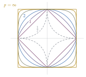
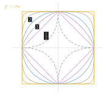

# Preface {.unnumbered}

```{=html}
<figure class="front-figure"><div class="themed-figure" style="max-width: 300px; margin: 0 auto;">


</div></figure>
```

::: {.front-caption}
The unit balls $\{|x|^p + |y|^p \leq 1\}$ in $\mathbb R^2$, from $p = 1$ (a diamond) through $p = 2$ (a disc) to $p = \infty$ (a square). For $p = \tfrac12$ (dashed) the ball is not convex, and $\|\cdot\|_p$ fails the triangle inequality.
:::

Functional analysis extends linear algebra and calculus to infinite-dimensional vector spaces.

These are notes from the course **Functional Analysis**. They are based on the book ***Functional Analysis, Spectral Theory, and Applications*** by Manfred Einsiedler and Thomas Ward [[1]](#ref-1). The notes build on measure and integration theory, and link back to my [Integration Theory notes](../integration-theory/index.html) where needed.

## Lectures

**Lecture 1 — Norms**
: Norms and normed vector spaces · The induced metric and topology · Continuous maps · Equivalence of norms · Semi-norms and Hausdorff spaces · The quotient norm · Strict sub-additivity

More lectures will be added as the course goes on.

## Notation

| Symbol | Meaning |
|--------|---------|
| $(V, \lVert\cdot\rVert)$ | Normed vector space |
| $\lVert v\rVert_1,\ \lVert v\rVert_2,\ \lVert v\rVert_\infty$ | The $1$-, Euclidean and supremum norms on $\mathbb R^d$ |
| $d(v, w) = \lVert v - w\rVert$ | Metric induced by a norm |
| $B_\varepsilon(x)$ | Open ball of radius $\varepsilon$ around $x$ |
| $(X, \mathcal O)$ | Topological space with topology $\mathcal O$ |
| $C_b(X)$ | Continuous bounded functions $X \to \mathbb R$ |
| $V_0$ | Kernel $\{v : \lVert v\rVert = 0\}$ of a semi-norm |
| $V/W$, $\ v + W$ | Quotient space and cosets |

## References {.unnumbered}

1. []{#ref-1}M. Einsiedler and T. Ward, *Functional Analysis, Spectral Theory, and Applications*, Graduate Texts in Mathematics 276, Springer, Cham, 2017. [springer.com](https://www.springer.com/978-3-319-58539-0)
