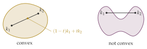
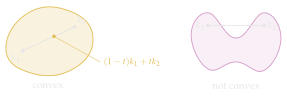
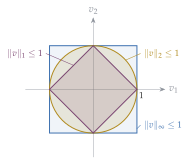
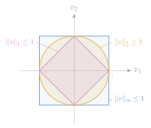
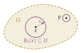
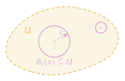
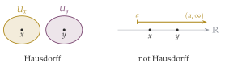
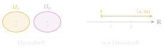
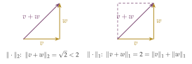
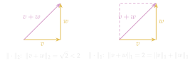

Functional analysis extends linear algebra and calculus to infinite-dimensional vector spaces, typically spaces of functions. The first ingredient we need is a way of measuring the size of a vector.

## Norms

::: {#r-1-1 .callout-note .definition-box}

#### **Definition 1.1** (Convex set). [[1, §2.1]](#ref-1)

A subset $K$ of a vector space $V$ is *convex* if, together with any two of its points $k_1, k_2$, it contains every point
$$(1-t)k_1 + t k_2, \qquad t \in [0,1],$$
on the segment between them.
:::

In words, the line segment between any two points of $K$ stays inside $K$ ([@fig-l01-convex]).

::: {#fig-l01-convex}
```{=html}
<div class="themed-figure" style="max-width: 600px; margin: 0 auto;"></div>
```

Left: a convex set contains the whole segment from $k_1$ to $k_2$. Right: in a non-convex set the segment can leave the set.
:::

::: {#r-1-2 .callout-note .definition-box}

#### **Definition 1.2** (Norm and normed vector space). [[1, Def. 2.1]](#ref-1)

Let $V$ be a vector space over $\mathbb R$ or $\mathbb C$. A function $\|\cdot\| : V \to \mathbb R$ is a *norm* if, for all $v, w \in V$ and all scalars $\alpha$,

- $\|v\| \geq 0$, with equality only for $v = 0$ (*strict positivity*);
- $\|\alpha v\| = |\alpha|\,\|v\|$ (*homogeneity*);
- $\|v + w\| \leq \|v\| + \|w\|$ (*triangle inequality*).

A vector space together with a norm, $(V, \|\cdot\|)$, is a *normed vector space*.
:::

::: {#r-1-3 .callout-caution .example-box}

#### **Example 1.3** (Normed real vector spaces). [[1, Ex. 2.2]](#ref-1)

Each of the following is a normed real vector space.

1. $\mathbb R^d$ with the Euclidean norm $\|v\|_2 = \bigl(|v_1|^2 + \cdots + |v_d|^2\bigr)^{1/2}$.
2. $\mathbb R^d$ with the supremum norm $\|v\|_\infty = \max_k |v_k|$.
3. $\mathbb R^d$ with $\|v\|_1 = |v_1| + \cdots + |v_d|$.
4. The space $C_b(X)$ of bounded continuous functions $f : X \to \mathbb R$ on a topological space $X$, normed by the supremum $\|f\|_\infty = \sup_{x \in X} |f(x)|$.
:::

A good way to picture a norm is through its *unit ball* $\{v : \|v\| \leq 1\}$. For the three norms on $\mathbb R^2$ above these are a diamond, a disc and a square ([@fig-l01-unit-balls]). The unit ball of a norm is always convex: if $\|k_1\|, \|k_2\| \leq 1$, the triangle inequality and homogeneity give $\|(1-t)k_1 + t k_2\| \leq (1-t) + t = 1$.

::: {#fig-l01-unit-balls}
```{=html}
<div class="themed-figure" style="max-width: 380px; margin: 0 auto;"></div>
```

The unit balls of $\|\cdot\|_1$, $\|\cdot\|_2$ and $\|\cdot\|_\infty$ in $\mathbb R^2$. They are nested because $\|v\|_\infty \leq \|v\|_2 \leq \|v\|_1$.
:::

## Normed spaces as metric and topological spaces

::: {#r-1-4 .callout-important .lemma-box}

#### **Lemma 1.4** (Associated metric). [[1, Lem. 2.4]](#ref-1)

Let $(V, \|\cdot\|)$ be a normed vector space. For all $v, w \in V$ the *reverse triangle inequality*
$$\bigl|\|v\| - \|w\|\bigr| \leq \|v - w\|$$ {#eq-reverse-triangle}
holds. The function $d(v, w) = \|v - w\|$ is a metric on $V$, and the norm $V \to \mathbb R$ is continuous for the topology of this metric.
:::

The lemma is a mouthful, so let us break it into its components. Equation ([-@eq-reverse-triangle]) says that if $\|v - w\| \to 0$, then also $\bigl|\|v\| - \|w\|\bigr| \to 0$, which is exactly continuity of the norm. The second part says that every normed vector space is also a metric space.

::: {#r-1-5 .callout-important .proposition-box}

#### **Proposition 1.5** (Every normed space is a metric space). [[1, proof of Lem. 2.4]](#ref-1)

Let $(V, \|\cdot\|)$ be a normed vector space. Then $d(x, y) := \|x - y\|$ defines a metric on $V$.

::: {.callout-note .proof-box collapse="true"}

#### Proof

**Non-negativity.** $d(x, y) = \|x - y\| \geq 0$ by positivity of the norm.

**Definiteness.** $d(x, y) = 0 \iff \|x - y\| = 0 \iff x = y$.

**Symmetry.** $d(x, y) = \|x - y\| = \|{-(y - x)}\| = \|y - x\| = d(y, x)$ by homogeneity.

**Triangle inequality.** $d(x, z) = \|(x - y) + (y - z)\| \leq \|x - y\| + \|y - z\| = d(x, y) + d(y, z)$. $\square$
:::
:::

What does *continuous with respect to the topology induced by $d$* really mean? We first recall what a topology is.

::: {#r-1-6 .callout-note .definition-box}

#### **Definition 1.6** (Topological space).

A *topological space* is a pair $(X, \mathcal O)$, where $\mathcal O \subseteq \mathcal P(X)$ is a *topology* on $X$, meaning

1. $\emptyset, X \in \mathcal O$;
2. $O, O' \in \mathcal O \Rightarrow O \cap O' \in \mathcal O$ (closed under finite intersections);
3. $\{O_i\}_{i \in I} \subseteq \mathcal O \Rightarrow \bigcup_{i \in I} O_i \in \mathcal O$ (closed under arbitrary unions).

The elements of $\mathcal O$ are called *open sets*.
:::

Given a metric $d$ on a set $X$, we induce a topology as follows.

::: {#r-1-7 .callout-note .definition-box}

#### **Definition 1.7** (Metric topology).

Given a metric space $(X, d)$, the *topology induced by $d$* is
$$\mathcal O_d = \{ U \subseteq X \mid \forall x \in U\ \exists \varepsilon > 0 : B_\varepsilon(x) \subseteq U \},$$
where $B_\varepsilon(x) = \{ y \in X \mid d(x, y) < \varepsilon \}$ is the open ball of radius $\varepsilon$ centred at $x$.

::: {.callout-note .proof-box collapse="true"}

#### Proof that $\mathcal O_d$ is a topology

**$\emptyset$ and $X$.** The condition is vacuous for $\emptyset$, and every ball $B_\varepsilon(x)$ lies in $X$.

**Finite intersections.** Let $U, U' \in \mathcal O_d$ and $x \in U \cap U'$. There are $\varepsilon, \varepsilon' > 0$ with $B_\varepsilon(x) \subseteq U$ and $B_{\varepsilon'}(x) \subseteq U'$. With $\delta = \min(\varepsilon, \varepsilon')$ we get $B_\delta(x) \subseteq U \cap U'$, so $U \cap U' \in \mathcal O_d$.

**Arbitrary unions.** Let $\{U_i\}_{i \in I} \subseteq \mathcal O_d$ and $x \in \bigcup_i U_i$. Then $x \in U_j$ for some $j$, and some ball $B_\varepsilon(x) \subseteq U_j \subseteq \bigcup_i U_i$. Hence $\bigcup_i U_i \in \mathcal O_d$. $\square$
:::
:::

So a set is open when every one of its points has a small ball around it that stays inside the set ([@fig-l01-open-set]). A normed vector space always has an associated metric, and hence always an induced topology.

::: {#fig-l01-open-set}
```{=html}
<div class="themed-figure" style="max-width: 380px; margin: 0 auto;"></div>
```

An open set $U$: every point has a ball around it inside $U$. Points near the edge, like $y$, need a smaller radius.
:::

::: {#r-1-8 .callout-note .definition-box}

#### **Definition 1.8** (Continuous map).

A map $f : X \to Y$ between topological spaces $(X, \mathcal O_X)$ and $(Y, \mathcal O_Y)$ is *continuous* if preimages of open sets are open:
$$U \in \mathcal O_Y \implies f^{-1}(U) \in \mathcal O_X.$$
:::

This is the same idea as for [measurable functions](../integration-theory/lecture-05.html#r-5-2) in integration theory, where preimages of measurable sets are required to be measurable. There the structure on the sets is a $\sigma$-algebra; here it is a topology instead.

In Lemma 1.4 we have $f = \|\cdot\| : V \to \mathbb R$, where $V$ carries the topology $\mathcal O_d$ induced by $d(v, w) = \|v - w\|$, and $\mathbb R$ carries the standard topology $\mathcal O_{\text{std}}$ induced by the absolute value $|\cdot|$. The second part of the lemma asserts that
$$\forall\, U \in \mathcal O_{\text{std}}: \quad \|\cdot\|^{-1}(U) \in \mathcal O_d.$$

## Equivalence of norms

Different norms may in principle produce different topologies. The strictest way to compare two norms would be to demand $\|v\| = \|v\|'$ for all $v \in V$. We relax this and instead compare norms through the topologies they induce.

::: {#r-1-9 .callout-important .lemma-box}

#### **Lemma 1.9** (Equivalence of norms). [[1, Lem. 2.5]](#ref-1)

Two norms $\|\cdot\|$ and $\|\cdot\|'$ on $V$ give the same topology exactly when they agree up to a constant factor: there is a $c \geq 1$ with
$$\frac1c \|v\|' \leq \|v\| \leq c \|v\|' \qquad \text{for every } v \in V.$$
Such norms are called *equivalent*.
:::

::: {#r-1-10 .callout-caution .example-box}

#### **Example 1.10** (Equivalent norms on $\mathbb R^d$).

- $\|\cdot\|_\infty$ and $\|\cdot\|_2$, with $c = \sqrt d$: $\ \|v\|_\infty \leq \|v\|_2 \leq \sqrt d\, \|v\|_\infty$.
- $\|\cdot\|_2$ and $\|\cdot\|_1$, with $c = \sqrt d$: $\ \|v\|_2 \leq \|v\|_1 \leq \sqrt d\, \|v\|_2$.
- $\|\cdot\|_\infty$ and $\|\cdot\|_1$, with $c = d$: $\ \|v\|_\infty \leq \|v\|_1 \leq d\, \|v\|_\infty$.
:::

Geometrically, equivalence means that a scaled copy of each unit ball fits inside the other; in [@fig-l01-unit-balls] the square fits in the disc after shrinking by $\sqrt 2$, and the disc fits in the square as it is. Every ball for one norm therefore contains a ball for the other around the same point, so both norms have the same open sets.

::: {#r-1-11 .callout-important .proposition-box}

#### **Proposition 1.11** (Equivalence in finite dimensions). [[1, Prop. 2.6]](#ref-1)

For every $d \geq 1$, all norms on $\mathbb R^d$ are equivalent to each other.
:::

Since every finite-dimensional real (complex) vector space of dimension $n$ is isomorphic to $\mathbb R^n$ ($\mathbb C^n$), see [Theorem 1.12](#r-1-12), any two norms on a finite-dimensional space induce the same topology. On infinite-dimensional spaces, different norms generally produce different topologies.

::: {#r-1-12 .callout-important .theorem-box}

#### **Theorem 1.12** (Finite-dimensional vector spaces are isomorphic to $\mathbb R^n$).

Let $V$ be a finite-dimensional vector space over $\mathbb R$ with $\dim V = n$. Then $V \cong \mathbb R^n$.

::: {.callout-note .proof-box collapse="true"}

#### Proof

Since $\dim V = n$, there exists a basis $\{e_1, \ldots, e_n\}$ of $V$. Define
$$T : \mathbb R^n \to V, \qquad T(\alpha_1, \ldots, \alpha_n) = \sum_{k=1}^n \alpha_k e_k.$$

**Linearity.** For $x = (\alpha_1, \ldots, \alpha_n)$, $y = (\beta_1, \ldots, \beta_n) \in \mathbb R^n$ and $\lambda \in \mathbb R$,
$$T(x + \lambda y) = \sum_{k=1}^n (\alpha_k + \lambda \beta_k) e_k = T(x) + \lambda T(y).$$

**Surjectivity.** Since $\{e_1, \ldots, e_n\}$ spans $V$, every $v \in V$ can be written $v = \sum_k \alpha_k e_k = T(\alpha_1, \ldots, \alpha_n)$.

**Injectivity.** For a linear map, $T(x) = T(y) \Rightarrow x = y$ amounts to $T(x) = 0 \Rightarrow x = 0$. If $T(x) = \sum_k \alpha_k e_k = 0$, linear independence of the basis gives $\alpha_k = 0$ for all $k$, so $\ker T = \{0\}$.

Hence $T$ is a bijective linear map, i.e. a linear isomorphism, and $V \cong \mathbb R^n$. $\square$
:::
:::

## Semi-norms and the quotient norm

::: {#r-1-13 .callout-note .definition-box}

#### **Definition 1.13** (Semi-norm). [[1, Def. 2.11]](#ref-1)

A *semi-norm* (or *pseudo-norm*) on a vector space $V$ is a function $\|\cdot\| : V \to \mathbb R_{\geq 0}$ that is homogeneous and satisfies the triangle inequality, but may vanish on non-zero vectors.
:::

Unlike a norm, a semi-norm does not demand $\|v\| = 0 \Rightarrow v = 0$. Non-zero vectors can have zero semi-norm, and so two *distinct* points can have zero distance from each other.

::: {#r-1-14 .callout-tip .remark-box}

#### **Remark 1.14** (The topology induced by a semi-norm). [[1, §2.1.2]](#ref-1)

Defining $d(v, w) = \|v - w\|$ as in Lemma 1.4 now gives a *pseudo-metric*, which can assign distance zero to distinct points, and Definition 1.7 still turns it into a topology on $V$. This topology need not be Hausdorff (Definition 1.15 below).
:::

::: {#r-1-15 .callout-note .definition-box}

#### **Definition 1.15** (Hausdorff space).

A topological space $(X, \mathcal O)$ is *Hausdorff* if for all $x \neq y$ in $X$ there exist open sets $U_x, U_y \in \mathcal O$ with $x \in U_x$, $y \in U_y$ and $U_x \cap U_y = \emptyset$.
:::

In other words, any two distinct points can be separated by neighbourhoods that do not intersect ([@fig-l01-hausdorff]). The standard topology on $\mathbb R$ is Hausdorff.

::: {#r-1-16 .callout-caution .example-box}

#### **Example 1.16** (A non-Hausdorff space).

Let $X = \mathbb R$ and
$$\mathcal O = \{\emptyset, \mathbb R\} \cup \{(a, \infty) \mid a \in \mathbb R\}.$$
This is a topology, but it is not Hausdorff: for $x < y$, every open set containing $x$ is of the form $(a, \infty)$ with $a < x$ (or $\mathbb R$), and so also contains $y$.
:::

::: {#fig-l01-hausdorff}
```{=html}
<div class="themed-figure" style="max-width: 560px; margin: 0 auto;"></div>
```

Left: in a Hausdorff space, $x$ and $y$ have disjoint neighbourhoods. Right: in Example 1.16, every open set $(a, \infty)$ containing $x$ also contains every $y > x$.
:::

For a semi-norm, the induced topology is Hausdorff precisely when the semi-norm is a norm. Indeed, a vector $v \neq 0$ with $\|v\| = 0$ lies in every ball $B_\varepsilon(0)$, so $v$ and $0$ cannot be separated.

::: {#r-1-17 .callout-caution .example-box}

#### **Example 1.17** (Promoting the $L^1$ semi-norm to a norm). [[1, Ex. 2.12]](#ref-1)

For a measure space $(X, \mathcal B, \mu)$, let $L^1_\mu(X)$ be the space of measurable functions $f : X \to \mathbb R$ that are integrable with respect to $\mu$ (see [Lecture 6](../integration-theory/lecture-06.html) of the integration theory notes). Here the elements are actual functions, not equivalence classes. The integral
$$\|f\|_1 = \int_X |f| \, d\mu$$
is a semi-norm on this space, but in general not a norm, since $\|f\|_1 = 0$ only forces $f = 0$ $\mu$-a.e. Identifying functions that agree $\mu$-a.e., via $f \sim g \Leftrightarrow f = g$ $\mu$-a.e., turns it into a norm. This is the quotient construction of [Lemma 1.19](#r-1-19) with $W = V_0$, the functions that vanish a.e.
:::

::: {#r-1-18 .callout-important .lemma-box}

#### **Lemma 1.18** (Kernel of a semi-norm). [[1, Lem. 2.14]](#ref-1)

For a semi-norm on $V$, the vectors of zero semi-norm, $V_0 = \{v \in V \mid \|v\| = 0\}$, form a linear subspace, and this subspace is closed in the topology the semi-norm induces.
:::

$V_0$ is a linear subspace (as is easily verified), and it is closed since it is the preimage of the closed set $\{0\}$^[Closed in the standard topology $\mathcal O_{\text{std}}$ on $\mathbb R$, which we assume unless otherwise stated: its complement $(-\infty, 0) \cup (0, \infty)$ is open. This depends on the topology; in the discrete topology, where every subset is open, every set is also closed.] under the continuous map $v \mapsto \|v\|$ (see Lemma 1.4).

::: {#r-1-19 .callout-important .lemma-box}

#### **Lemma 1.19** (Quotient norm). [[1, Lem. 2.15]](#ref-1)

Let $\|\cdot\|$ be a semi-norm on $V$ and $W \subseteq V$ a closed subspace. On the quotient space $V/W = \{v + W \mid v \in V\}$,
$$\|v + W\|_{V/W} = \inf_{w \in W} \|v + w\|$$
is a norm. When $W = V_0$ is the kernel of the semi-norm (closed by Lemma 1.18), this norm is simply $\|v + V_0\|_{V/V_0} = \|v\|$.
:::

The quotient norm finds the smallest norm among all representatives of the coset $v + W$. Geometrically, it is the size of the smallest ball around $0$ that touches the coset ([@fig-viz-quotient]). For $W = V_0$, every representative has the same semi-norm, since $\|v\| - \|w\| \leq \|v + w\| \leq \|v\| + \|w\|$ with $\|w\| = 0$.

::: {#fig-viz-quotient}
```{=html}
<div id="viz-quotient" class="viz"></div>
<script>
(function() {
  if (typeof React === 'undefined') return;
  const { useState, useRef } = React;
  // Left: the plane V = R^2 with a subspace W (a line through 0) and the coset v + W (the parallel line through v).
  // The quotient norm ||v + W|| is the radius of the smallest ball around 0 that touches the coset.
  // Right: the function t -> ||v + t e|| along the coset (e spans W); its infimum is ||v + W||.
  const NORMS = [
    { key: "2", label: "‖·‖₂", f: (x, y) => Math.hypot(x, y) },
    { key: "1", label: "‖·‖₁", f: (x, y) => Math.abs(x) + Math.abs(y) },
    { key: "i", label: "‖·‖∞", f: (x, y) => Math.max(Math.abs(x), Math.abs(y)) },
    { key: "s", label: "semi-norm, W = V₀", f: (x, y) => Math.abs(y), semi: true },
  ];
  function Quotient() {
    const ACCENT = "#b08a1e", PLUM = "#9a5a8f", BORDER = "rgba(128,128,128,0.35)";
    const TEXT = "var(--bs-body-color, #222)", MUTED = "var(--bs-secondary-color, #777)", BG = "var(--bs-body-bg, #fff)";
    const [k, setK] = useState(0);
    const [v, setV] = useState([1.3, 1.5]);
    const [phi, setPhi] = useState(0.45);
    const N = NORMS[k], nf = N.f;
    const ang = N.semi ? 0 : phi, e = [Math.cos(ang), Math.sin(ang)];
    const along = (t) => nf(v[0] + t * e[0], v[1] + t * e[1]);
    // the map t -> ||v + t e|| is convex: ternary search for the infimum
    let a = -12, b = 12;
    for (let i = 0; i < 90; i++) { const m1 = a + (b - a) / 3, m2 = b - (b - a) / 3; if (along(m1) <= along(m2)) b = m2; else a = m1; }
    let ts = N.semi ? 0 : (a + b) / 2;
    const q = along(ts), nv = nf(v[0], v[1]);
    const u = [v[0] + ts * e[0], v[1] + ts * e[1]];

    // geometry
    const W = 660, H = 322, top = 18, bot = 290;
    const L = { l: 20, r: 292 }, R = { l: 372, r: 644 }, S = 3.1;
    const sc = (L.r - L.l) / (2 * S), cy = (top + bot) / 2, cx = (L.l + L.r) / 2;
    const X = (x) => cx + x * sc, Y = (y) => cy - y * sc;
    const T = 4.2, tx = (t) => R.l + (t + T) / (2 * T) * (R.r - R.l);
    const tsN = 161, tgrid = Array.from({ length: tsN }, (_, i) => -T + 2 * T * i / (tsN - 1)), vals = tgrid.map(along);
    const vmax = Math.max(4, ...vals.filter((x) => isFinite(x))) * 1.05;
    const vy = (s) => bot - s / vmax * (bot - top);
    const path = (P) => P.map((p, i) => (i ? "L" : "M") + p[0].toFixed(1) + "," + p[1].toFixed(1)).join("");

    // the ball of radius q around 0
    let ball = null;
    if (N.semi) ball = el("rect", { x: L.l, y: Y(q), width: L.r - L.l, height: Math.max(0, Y(-q) - Y(q)), fill: PLUM, fillOpacity: 0.12, stroke: "none" });
    else if (N.key === "2") ball = el("circle", { cx: X(0), cy: Y(0), r: q * sc, fill: PLUM, fillOpacity: 0.12, stroke: PLUM, strokeWidth: 1.5 });
    else if (N.key === "1") ball = el("path", { d: path([[X(q), Y(0)], [X(0), Y(q)], [X(-q), Y(0)], [X(0), Y(-q)]]) + "Z", fill: PLUM, fillOpacity: 0.12, stroke: PLUM, strokeWidth: 1.5 });
    else ball = el("rect", { x: X(-q), y: Y(q), width: 2 * q * sc, height: 2 * q * sc, fill: PLUM, fillOpacity: 0.12, stroke: PLUM, strokeWidth: 1.5 });

    const far = 3 * S, lineThrough = (p) => [[X(p[0] - far * e[0]), Y(p[1] - far * e[1])], [X(p[0] + far * e[0]), Y(p[1] + far * e[1])]];
    const Wl = lineThrough([0, 0]), Cl = lineThrough(v);
    const hW = [2.3 * e[0], 2.3 * e[1]];

    const svg = useRef(null), drag = useRef(null);
    const toWorld = (ev) => {
      const r = svg.current.getBoundingClientRect();
      const px = (ev.clientX - r.left) / r.width * W, py = (ev.clientY - r.top) / r.height * H;
      return [(px - cx) / sc, (cy - py) / sc, px];
    };
    const clamp = (z) => Math.max(-2.5, Math.min(2.5, z));
    const apply = (w) => {
      if (drag.current === "v") setV([clamp(w[0]), clamp(w[1])]);
      else if (drag.current === "w") { let a = Math.atan2(w[1], w[0]); if (Math.hypot(w[0], w[1]) > 0.2) setPhi(a); }
    };
    const down = (ev) => {
      const w = toWorld(ev);
      if (w[2] > (L.r + R.l) / 2) return;
      ev.preventDefault();
      const dv = Math.hypot(w[0] - v[0], w[1] - v[1]), dw = Math.hypot(w[0] - hW[0], w[1] - hW[1]);
      drag.current = (!N.semi && dw < dv) ? "w" : "v";
      ev.currentTarget.setPointerCapture(ev.pointerId); apply(w);
    };
    const move = (ev) => { if (drag.current) apply(toWorld(ev)); };
    const up = () => { drag.current = null; };

    const PAL = '"Palatino Linotype", Palatino, "Book Antiqua", "URW Palladio L", "TeX Gyre Pagella", P052, serif';
    const math = (s, tag) => s.split(/(inf|[A-Za-z])/).filter(Boolean).map((tok, i) =>
      /^[A-Za-z]$/.test(tok) ? el(tag, { key: i, style: { fontStyle: "italic" }, fontStyle: "italic" }, tok) : tok);
    const M = (s) => math(s, "span"), Tm = (s) => math(s, "tspan");
    const btn = (on) => ({ font: "inherit", fontFamily: PAL, fontSize: 16, padding: "1px 2px", margin: "0 10px 0 0", background: "transparent", color: on ? TEXT : MUTED,
      border: "none", borderBottom: "1.5px solid " + (on ? ACCENT : "transparent"), borderRadius: 0, cursor: "pointer" });
    const halo = { stroke: BG, strokeWidth: 4, paintOrder: "stroke", strokeLinejoin: "round" };
    const lab = (x, y, s, fill, extra) => el("text", Object.assign({ x, y, fill, fontSize: 14, fontFamily: PAL }, halo, extra || {}), Tm(s));
    // label for the coset, placed where its line leaves the panel
    // label the coset at whichever end of the visible line is farthest from both v and v + w*
    const exitAt = (dir) => { for (let i = 0; i <= 116; i++) { const s = (5.8 - 0.05 * i) * dir; const p = [v[0] + s * e[0], v[1] + s * e[1]]; if (Math.abs(p[0]) < 2.6 && Math.abs(p[1]) < 2.75) return p; } return v; };
    const score = (p) => Math.min(Math.hypot(p[0] - v[0], p[1] - v[1]), N.semi ? 9 : Math.hypot(p[0] - u[0], p[1] - u[1]));
    const c1 = exitAt(1), c2 = exitAt(-1), cl = score(c1) >= score(c2) ? c1 : c2;
    const wl = [2.75 * e[0] / Math.max(Math.abs(e[0]), Math.abs(e[1])) * 0.95, 2.75 * e[1] / Math.max(Math.abs(e[0]), Math.abs(e[1])) * 0.95];
    const fmt = (z) => z.toFixed(2);

    return el("div", { style: { fontFamily: PAL, color: TEXT } },
      el("div", { style: { marginBottom: 4 } }, NORMS.map((n, i) => el("button", { key: n.key, style: btn(i === k), onClick: () => setK(i) }, n.label))),
      el("svg", { ref: svg, width: "100%", viewBox: "0 0 " + W + " " + H, style: { display: "block", background: "transparent", touchAction: "none", userSelect: "none", WebkitUserSelect: "none", fontFamily: PAL },
          onPointerDown: down, onPointerMove: move, onPointerUp: up, onPointerCancel: up },
        el("defs", null, el("clipPath", { id: "qnclip" }, el("rect", { x: L.l, y: top, width: L.r - L.l, height: bot - top }))),
        el("g", { clipPath: "url(#qnclip)" },
          el("line", { x1: L.l, y1: Y(0), x2: L.r, y2: Y(0), stroke: BORDER }),
          el("line", { x1: X(0), y1: top, x2: X(0), y2: bot, stroke: BORDER }),
          ball,
          N.semi && el("line", { x1: L.l, y1: Y(q), x2: L.r, y2: Y(q), stroke: PLUM, strokeWidth: 1.5 }),
          N.semi && el("line", { x1: L.l, y1: Y(-q), x2: L.r, y2: Y(-q), stroke: PLUM, strokeWidth: 1.5 }),
          el("path", { d: path(Wl), stroke: TEXT, strokeWidth: 1.5, fill: "none" }),
          el("path", { d: path(Cl), stroke: ACCENT, strokeWidth: 2, fill: "none" })),
        el("rect", { x: L.l, y: top, width: L.r - L.l, height: bot - top, fill: "none", stroke: BORDER }),
        !N.semi && el("line", { x1: X(0), y1: Y(0), x2: X(u[0]), y2: Y(u[1]), stroke: PLUM, strokeWidth: 1.2, strokeDasharray: "3 3" }),
        el("circle", { cx: X(0), cy: Y(0), r: 2.5, fill: TEXT }),
        !N.semi && el("circle", { cx: X(hW[0]), cy: Y(hW[1]), r: 5.5, fill: BG, stroke: TEXT, strokeWidth: 1.5, style: { cursor: "grab" } }),
        !N.semi && Math.hypot(u[0] - v[0], u[1] - v[1]) > 0.08 && el("circle", { cx: X(u[0]), cy: Y(u[1]), r: 4.5, fill: PLUM }),
        el("circle", { cx: X(v[0]), cy: Y(v[1]), r: 6.5, fill: ACCENT, stroke: BG, strokeWidth: 1.5, style: { cursor: "grab" } }),
        lab(X(v[0]) + 9, Y(v[1]) - 8, "v", ACCENT, { fontStyle: "italic" }),
        !N.semi && Math.hypot(u[0] - v[0], u[1] - v[1]) > 0.35 && (() => {
          const s = Math.sign(-e[1] * v[0] + e[0] * v[1]) || 1, nx = -e[1] * s, ny = e[0] * s;   // normal pointing from W towards v + W
          return lab(X(u[0] + 0.32 * nx), Y(u[1] + 0.32 * ny) + 5, "v + w*", PLUM, { textAnchor: "middle" });
        })(),
        lab(X(cl[0]), Y(cl[1]) - 8, "v + W", ACCENT, { textAnchor: cl[0] > 0 ? "end" : "start" }),
        lab(X(wl[0]) + (wl[0] > 0 ? -4 : 4), Y(wl[1]) + (wl[1] > 0 ? 16 : -8), N.semi ? "W = V₀" : "W", TEXT, { textAnchor: wl[0] > 0 ? "end" : "start" }),
        // right panel: t -> ||v + t e||
        el("line", { x1: R.l, y1: bot, x2: R.r, y2: bot, stroke: BORDER }),
        el("line", { x1: tx(0), y1: top, x2: tx(0), y2: bot, stroke: BORDER }),
        el("text", { x: R.r, y: bot + 16, fill: MUTED, fontSize: 13, fontStyle: "italic", textAnchor: "end", fontFamily: PAL }, "t"),
        el("line", { x1: R.l, y1: vy(q), x2: R.r, y2: vy(q), stroke: PLUM, strokeWidth: 1.2, strokeDasharray: "4 4" }),
        el("path", { d: path(tgrid.map((t, i) => [tx(t), vy(vals[i])])), stroke: ACCENT, strokeWidth: 2, fill: "none" }),
        el("circle", { cx: tx(0), cy: vy(nv), r: 6, fill: ACCENT, stroke: BG, strokeWidth: 1.5 }),
        !N.semi && Math.abs(ts) <= T && el("circle", { cx: tx(ts), cy: vy(q), r: 4.5, fill: PLUM }),
        el("text", { x: R.l + 4, y: bot + 26, fill: ACCENT, fontSize: 15, fontFamily: PAL }, Tm("t ↦ ‖v + t e‖"), el("tspan", { fill: MUTED, fontSize: 13, dx: 8 }, Tm("(e spans W)"))),
        el("text", Object.assign({ x: R.r - 2, y: N.semi ? vy(q) + 18 : vy(q) - 6, fill: PLUM, fontSize: 14, textAnchor: "end", fontFamily: PAL }, halo), Tm("‖v + W‖"))
      ),
      el("div", { style: { display: "flex", gap: 22, flexWrap: "wrap", fontSize: 16, marginTop: 4, justifyContent: "center", fontVariantNumeric: "lining-nums" } },
        el("span", { style: { color: ACCENT } }, M("‖v‖ = "), fmt(nv)),
        el("span", { style: { color: PLUM } }, M("‖v + W‖ = inf"), el("sub", null, M("w ∈ W")), M(" ‖v + w‖ = "), fmt(q)),
        el("span", { style: { color: MUTED, fontStyle: "italic" } }, N.semi ? "drag v" : "drag v, or the ring on W"))
    );
  }
  var el = React.createElement;
  var root = document.getElementById('viz-quotient');
  if (root) ReactDOM.createRoot(root).render(React.createElement(Quotient));
})();

</script>
```

The quotient norm in $V = \mathbb R^2$. Left: a subspace $W$ and the coset $v + W$; the shaded ball is the smallest one around $0$ that touches the coset, at $v + w^*$. Right: the norm along the coset, whose infimum is $\|v + W\|$. With the semi-norm $\|(x, y)\| = |y|$, the kernel $V_0$ is the $x$-axis and the norm is constant along the coset.
:::

## Strict sub-additivity

::: {#r-1-20 .callout-note .definition-box}

#### **Definition 1.20** (Strictly sub-additive norm). [[1, Def. 2.17]](#ref-1)

A norm on $V$ is *strictly sub-additive* if equality in the triangle inequality only occurs for vectors pointing in the same direction:
$$\|v + w\| < \|v\| + \|w\|$$
for all $v, w \in V$, except when $v$ and $w$ are both non-negative real multiples of $v + w$.
:::

::: {#r-1-21 .callout-caution .example-box}

#### **Example 1.21** (Strictly sub-additive norms on $\mathbb R^n$).

**Strictly sub-additive:** $(\mathbb R^n, \|\cdot\|_p)$ for $1 < p < \infty$, since Minkowski's inequality is strict unless the vectors are proportional.

**Not strictly sub-additive:**

- $(\mathbb R^2, \|\cdot\|_1)$: $v = (1, 0)$ and $w = (0, 1)$ are not proportional, yet $\|v + w\|_1 = 2 = \|v\|_1 + \|w\|_1$.
- $(\mathbb R^2, \|\cdot\|_\infty)$: $v = (1, 1)$ and $w = (1, 0)$ are not proportional, yet $\|v + w\|_\infty = 2 = \|v\|_\infty + \|w\|_\infty$ (compare [[1, Ex. 2.19]](#ref-1)).
:::

::: {#fig-l01-subadditive}
```{=html}
<div class="themed-figure" style="max-width: 520px; margin: 0 auto;"></div>
```

The vectors $v = (1, 0)$ and $w = (0, 1)$. In $\|\cdot\|_2$ the diagonal is strictly shorter than the two legs; in $\|\cdot\|_1$ it has the same length, as does any staircase path between the endpoints.
:::

## References {.unnumbered}

1. []{#ref-1}M. Einsiedler and T. Ward, *Functional Analysis, Spectral Theory, and Applications*, Graduate Texts in Mathematics 276, Springer, Cham, 2017. Chapter 2. [springer.com](https://www.springer.com/978-3-319-58539-0)
