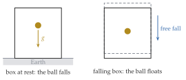
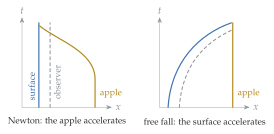
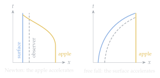

The aim of the course is to formulate general relativity as a theory of gravity, and to use it to describe

- the motion of particles and electromagnetic fields in arbitrary gravitational fields,
- gravitational waves,
- black holes,
- the evolution of the Universe.

This lecture introduces the principle of relativity and the equivalence principle, and shows how the two together lead to general relativity.

## The principle of relativity

::: {#r-1-1 .callout-note .definition-box}

#### **Definition 1.1** (Principle of relativity). [[1, Ch. 1]](#ref-1)

The *principle of relativity* states that the equations expressing the laws of physics have the same form in all *admissible* coordinate systems. A theory that obeys it is a *theory of relativity*.
:::

The content of the principle lies in which coordinate systems count as admissible. We go through Newtonian mechanics, special relativity and general relativity in turn.

### Newtonian mechanics

::: {#r-1-2 .callout-note .definition-box}

#### **Definition 1.2** (Reference frames).

A *reference frame* is a three-dimensional spatial coordinate system with a clock at every point. It is *inertial* if every free particle moves along a straight line at constant speed.
:::

In Newtonian mechanics the admissible coordinate systems are the inertial ones, at rest or in uniform motion with respect to absolute space. Two of them, $(t, \vec x)$ and $(t', \vec x')$, are related by a *Galilean transformation*
$$\vec x' = R\vec x + \vec v t + \vec d, \qquad t' = t + \tau, \tag{1}$$
with $R$ a rotation, $\vec v$ a constant velocity and $\vec d$, $\tau$ constant translations. These form the 10-parameter *Galileo group*: three angles for $R$, three components each for $\vec v$ and $\vec d$, and one for $\tau$ [[1, Ch. 1]](#ref-1).

::: {.callout-caution .example-box}

#### **Example 1.3** (A free particle).

The equation of motion of a free particle of mass $m$ is
$$m\,\frac{d^2\vec x}{dt^2} = 0, \tag{2}$$
a straight line in the $(t, \vec x)$-plane. Inverting (1) gives $\vec x = R^{-1}(\vec x' - \vec v t - \vec d)$ and $t = t' - \tau$, so (2) becomes $m R^{-1}\, d^2\vec x'/dt'^2 = 0$. Since $R$ is invertible, $m\, d^2\vec x'/dt'^2 = 0$: the equation has the same form in every inertial frame.
:::

There are two ways an equation can keep its form. Take rotations only ($\vec v = \vec d = 0$).

::: {#r-1-4 .callout-note .definition-box}

#### **Definition 1.4** (Invariance and covariance).

A quantity is *invariant* if it does not change under a transformation. If $S$ and $P$ are scalars, $S' = S$ and $P' = P$, then $S = P$ implies $S' = P'$, and the equation is *invariant*.

An equation is *covariant* if both sides transform in the same way. If $\vec a$ and $\vec b$ are vectors, $\vec a' = R\vec a$ and $\vec b' = R\vec b$, then $\vec a = \vec b$ becomes $R^{-1}(\vec a' - \vec b') = 0$, and since $R$ is invertible, $\vec a' = \vec b'$.
:::

Newtonian mechanics is covariant under Galilean transformations by construction.

::: {.callout-tip .remark-box}

#### **Remark 1.5** (The end of Galilean invariance).

Maxwell's equations are not Galilean invariant: under a Galilean boost the speed of light would change. In the 19th century this was explained by an ether filling space, relative to which light has a fixed speed. The Michelson–Morley experiment looked for the resulting difference in the speed of light along perpendicular directions and found none.
:::

### Special relativity

Special relativity rests on two postulates: the laws of physics are the same in all inertial frames, and the speed of light is the same for all observers. The admissible coordinate systems are still the inertial ones, but they are now related by Lorentz transformations rather than Galilean ones.

::: {#r-1-6 .callout-note .definition-box}

#### **Definition 1.6** (Poincaré transformation). [[1, Ch. 2]](#ref-1)

A *Poincaré* (or inhomogeneous Lorentz) *transformation* is a map
$$\xi^\alpha \mapsto \xi'^\alpha = \Lambda^\alpha{}_\beta\, \xi^\beta + a^\alpha, \qquad \Lambda^\alpha{}_\gamma\, \Lambda^\beta{}_\delta\, \eta_{\alpha\beta} = \eta_{\gamma\delta}, \tag{3}$$
where $\xi^\alpha = (t, \vec x)$, $\eta_{\alpha\beta} = \operatorname{diag}(-1, 1, 1, 1)$ and $a^\alpha$ is constant. When $a^\alpha = 0$ it is a *Lorentz transformation*. The condition on $\Lambda$ says that the Minkowski metric $\eta_{\alpha\beta}$ is invariant.
:::

The Poincaré transformations are the most general maps between inertial frames: rotations, boosts and spacetime translations. They form the full symmetry group of special relativity.

::: {.callout-caution .example-box}

#### **Example 1.7** (A free particle in special relativity).

The equation of motion of a free particle is
$$\frac{d^2\xi^\alpha}{d\tau^2} = 0, \qquad d\tau^2 = -\eta_{\alpha\beta}\, d\xi^\alpha d\xi^\beta, \tag{4}$$
with $\tau$ the proper time. For $\alpha = 0$ this gives $dt/d\tau = \text{const}$, and the motion is again a straight line in the $(t, \vec x)$-plane.

Under (3), $d\xi'^\alpha = \Lambda^\alpha{}_\beta\, d\xi^\beta$, so
$$d\tau'^2 = -\eta_{\alpha\beta}\, \Lambda^\alpha{}_\gamma \Lambda^\beta{}_\delta\, d\xi^\gamma d\xi^\delta = -\eta_{\gamma\delta}\, d\xi^\gamma d\xi^\delta = d\tau^2.$$
Proper time is invariant, and therefore
$$\frac{d^2\xi'^\alpha}{d\tau'^2} = \Lambda^\alpha{}_\beta\, \frac{d^2\xi^\beta}{d\tau^2} = 0.$$
:::

### General relativity

In general relativity *all* coordinate systems $x^\mu = (t, \vec x)$ are admissible. The transformations between them,
$$x^\mu \mapsto x'^\mu(x), \tag{5}$$
are arbitrary smooth invertible maps, called *general coordinate transformations* or *diffeomorphisms*. The resulting covariance is called *general covariance* or *diffeomorphism covariance*; it is discussed in [Lecture 8](lecture-08.qmd).

## The equivalence principle

An *inertial force* acts on every mass in a non-inertial frame. By Newton's second law every inertial force is proportional to the mass it acts on. So is gravity, and this led Einstein to ask whether gravity is itself an inertial force. An observer in a closed box in free fall cannot detect the gravitational field: a freely falling frame behaves like an inertial one ([@fig-l01-elevator]).

::: {#fig-l01-elevator}
```{=html}
<div class="themed-figure" style="max-width: 520px; margin: 0 auto;"></div>
```

Left: in a box at rest on the Earth, a released ball falls to the floor. Right: in a freely falling box, the ball floats as it would in empty space. Locally, gravity can be transformed away.
:::

To see how inertial forces arise, apply a general transformation (5) to $m\, d^2x^i/dt^2 = 0$, with $t' = t'(t, \vec x)$ and $x'^i = x'^i(t, \vec x)$. By the chain rule,
$$\frac{d^2 x^i}{dt^2} = \frac{d}{dt}\Bigl(\frac{\partial x^i}{\partial t'}\frac{dt'}{dt} + \frac{\partial x^i}{\partial x'^j}\frac{dx'^j}{dt}\Bigr),$$
and solving for $d^2x'^i/dt'^2$ leaves terms on the right-hand side. These terms, multiplied by $m$, are the inertial forces.

::: {.callout-caution .example-box}

#### **Example 1.8** (A rotating frame).

Let $(t, \vec x)$ be inertial and let $(t', \vec x')$ rotate counter-clockwise about the $z$-axis with constant angular velocity $\omega$:
$$t' = t, \quad x' = x\cos\omega t + y\sin\omega t, \quad y' = -x\sin\omega t + y\cos\omega t, \quad z' = z.$$
A free particle then obeys
$$m\,\frac{d^2\vec x'}{dt'^2} = -2m\, \vec\omega \times \frac{d\vec x'}{dt'} - m\, \vec\omega \times (\vec\omega \times \vec x'),$$
the Coriolis and centrifugal forces.
:::

::: {.callout-caution .example-box}

#### **Example 1.9** (A uniformly accelerated frame).

Let $t' = t$ and $\vec x' = \vec x - \tfrac12 \vec a\, t^2$, a frame accelerating in the direction of $\vec a$. A free particle then obeys
$$m\,\frac{d^2\vec x'}{dt'^2} = -m\,\vec a.$$
With $\vec a = (GM/R^2)\, \hat{\vec r}$ this inertial force coincides with the gravitational force of a mass $M$ at distance $R$.
:::

Should gravity therefore be thought of as an inertial force? A priori there is no reason for the *inertial mass* $m$, which measures the resistance to acceleration, to equal the *gravitational mass* $m_g$, which measures the strength of the coupling to a gravitational field.

Let $(t, \vec x)$ be inertial and let a test particle move in a gravitational field $\vec g(t, \vec x)$:
$$m\, \frac{d^2\vec x}{dt^2} = m_g\, \vec g(t, \vec x).$$
Pass to the freely falling frame $t' = t$, $\vec x' = \vec x - \tfrac12 \vec g\, t^2$. Then
$$m\,\frac{d^2\vec x'}{dt'^2} = (m_g - m)\,\vec g - 2m t\, \frac{d\vec g}{dt} - \tfrac12 m t^2\, \frac{d^2\vec g}{dt^2}.$$
If $m_g = m$, the field cancels up to terms in the derivatives of $\vec g$. Gravity cannot be removed everywhere when the field is inhomogeneous or time-dependent, but in a small enough neighbourhood these derivative terms are negligible. Locally, gravity is an inertial force.

::: {#r-1-10 .callout-note .definition-box}

#### **Definition 1.10** (Equivalence principle). [[1, Ch. 3]](#ref-1)

The *weak equivalence principle* is the statement $m_g = m$.

The *strong equivalence principle* states that at every spacetime point $X$ there is a coordinate system $\xi^\alpha_X$ such that, in a sufficiently small neighbourhood of $X$, the laws of physics take the form they have in special relativity in the absence of gravity. Such a $\xi^\alpha_X$ is called a *locally inertial* or *freely falling* coordinate system.
:::

General relativity is then a framework for particle mechanics and electrodynamics whose equations

1. are covariant under general coordinate transformations (the principle of relativity), and
2. reduce to those of special relativity in a locally inertial coordinate system (the equivalence principle).

## Free fall in a gravitational field

Consider a particle that moves under gravity alone. In a locally inertial coordinate system $\xi^\alpha$ it is free, and by (4)
$$\frac{d^2\xi^\alpha}{d\tau^2} = 0, \qquad d\tau^2 = -\eta_{\alpha\beta}\, d\xi^\alpha d\xi^\beta.$$
Now pass to an arbitrary coordinate system $x^\mu$, in which the effects of gravity appear, with inverse $\xi^\alpha(x)$. Then
$$0 = \frac{d}{d\tau}\Bigl(\frac{\partial\xi^\alpha}{\partial x^\mu}\frac{dx^\mu}{d\tau}\Bigr) = \frac{\partial\xi^\alpha}{\partial x^\mu}\frac{d^2x^\mu}{d\tau^2} + \frac{\partial^2\xi^\alpha}{\partial x^\mu \partial x^\nu}\frac{dx^\mu}{d\tau}\frac{dx^\nu}{d\tau}.$$
Multiplying by $\partial x^\lambda/\partial\xi^\alpha$ and using $\frac{\partial\xi^\alpha}{\partial x^\mu}\frac{\partial x^\lambda}{\partial\xi^\alpha} = \delta^\lambda_\mu$ gives the following.

::: {#r-1-11 .callout-note .definition-box}

#### **Definition 1.11** (Affine connection and metric tensor). [[1, Ch. 3]](#ref-1)

The *affine connection* and the *metric tensor* are
$$\Gamma^\lambda_{\mu\nu} = \frac{\partial x^\lambda}{\partial\xi^\alpha}\frac{\partial^2\xi^\alpha}{\partial x^\mu \partial x^\nu}, \qquad g_{\mu\nu} = \eta_{\alpha\beta}\, \frac{\partial\xi^\alpha}{\partial x^\mu}\frac{\partial\xi^\beta}{\partial x^\nu}.$$
:::

::: {#r-1-12 .callout-important .proposition-box}

#### **Proposition 1.12** (Equation of motion in free fall). [[1, Ch. 3]](#ref-1)

A particle moving under gravity alone satisfies
$$\frac{d^2x^\lambda}{d\tau^2} = -\Gamma^\lambda_{\mu\nu}\, \frac{dx^\mu}{d\tau}\frac{dx^\nu}{d\tau}, \qquad d\tau^2 = -g_{\mu\nu}\, dx^\mu dx^\nu. \tag{6}$$
:::

Equation (6) cannot be solved until we know how $g_{\mu\nu}$ and $\Gamma^\lambda_{\mu\nu}$ depend on the spacetime point. Formulating general relativity as a theory of gravity thus has two parts:

1. express all effects of gravity on particles and electromagnetic fields in terms of $g_{\mu\nu}$ and $\Gamma^\lambda_{\mu\nu}$;
2. find a dynamical equation for the metric, which also determines the affine connection.

::: {.callout-tip .remark-box}

#### **Remark 1.13** (The Newtonian analogy).

In Newtonian gravity a particle obeys $d^2\vec x/dt^2 = -\nabla\phi$, which cannot be solved without knowing the potential $\phi$. The potential is fixed by the mass density $\rho$ through the Poisson equation $\nabla^2\phi = 4\pi G\rho$. In general relativity the metric plays the role of the potential, and the Einstein equations ([Lecture 11](lecture-11.qmd)) play the role of the Poisson equation: given the distribution of energy and momentum, they determine the metric, and with it the motion of particles.
:::

## Gravity as geometry

The equivalence principle suggests a change of perspective, which the following example makes concrete.

::: {.callout-caution .example-box}

#### **Example 1.14** (An apple falling from a tree).

In the Newtonian picture, the Earth produces a gravitational field that accelerates the apple towards the ground. In general relativity the apple is in free fall: by [Proposition 1.12](#r-1-12) it moves on a geodesic, and its worldline is as "straight" as a worldline can be. It is the observer standing on the ground who is accelerated, pushed upwards by the ground, and from their point of view the apple appears to fall ([@fig-l01-apple]). Light needs no separate treatment: it also moves on geodesics, so to the observer on the ground it too appears to bend.
:::

::: {#fig-l01-apple}
```{=html}
<div class="themed-figure" style="max-width: 600px; margin: 0 auto;"></div>
```

Worldlines of the Earth's surface, an observer on it and an apple. Left: the Newtonian picture, in which the apple accelerates. Right: the free-fall picture, in which the apple moves on a straight line and the surface accelerates. (Schematic: a flat diagram cannot show curvature.)
:::

The second picture also explains why inertial and gravitational mass are equal: the observed acceleration does not depend on the falling object at all, just as for the inertial forces of Examples 1.8 and 1.9.

::: {.callout-tip .remark-box}

#### **Remark 1.15** (Spacetime becomes dynamical).

In Newtonian mechanics and in special relativity, space and time form a fixed background: the arena in which particles and fields move, but which is not itself affected by them. In general relativity, space and time are combined into *spacetime*, a manifold with a metric $g_{\mu\nu}$, and the metric is a dynamical field in its own right. It tells matter how to move, through the geodesic equation (6), and is in turn determined by the distribution of energy and momentum, through the Einstein equations
$$R_{\mu\nu} - \tfrac12\, g_{\mu\nu} R = -8\pi G\, T_{\mu\nu}$$
of [Lecture 11](lecture-11.qmd). Gravity is then not a force acting in spacetime, but the curvature of spacetime itself. Even without any matter, the metric has degrees of freedom of its own: gravitational waves ([Lecture 16](lecture-16.qmd)) are ripples of spacetime that propagate through empty space.
:::

## References {.unnumbered}

1. []{#ref-1}S. Weinberg, *Gravitation and Cosmology: Principles and Applications of the General Theory of Relativity*, Wiley, New York (1972).
