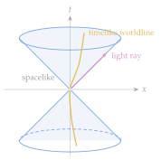

Special relativity is a framework for particle mechanics and electrodynamics whose equations

1. are covariant under Lorentz transformations, a requirement that follows from the principle of relativity ([Definition 1.1](lecture-01.qmd#r-1-1)), and
2. reduce to those of Newtonian mechanics in the non-relativistic limit.

The second requirement plays the same role here as the equivalence principle does in general relativity ([Definition 1.10](lecture-01.qmd#r-1-10)).

## Lorentz transformations

Let $x^\alpha$ and $x'^\alpha$ be the coordinates of two inertial coordinate systems. They are related by a Poincaré transformation ([Definition 1.6](lecture-01.qmd#r-1-6))
$$x'^\alpha = \Lambda^\alpha{}_\beta\, x^\beta + a^\alpha, \qquad \Lambda^\alpha{}_\gamma\, \Lambda^\beta{}_\delta\, \eta_{\alpha\beta} = \eta_{\gamma\delta}.$$
The condition on $\Lambda$ is exactly what is needed to leave the proper time invariant,
$$d\tau^2 = -\eta_{\alpha\beta}\, dx^\alpha dx^\beta = dt^2 - |d\vec x|^2.$$

::: {#r-2-1 .callout-important .proposition-box}

#### **Proposition 2.1** (The speed of light is frame independent). [[1, Ch. 2]](#ref-1)

A signal that moves at the speed of light in one inertial frame moves at the speed of light in every inertial frame related to it by a Lorentz transformation.

::: {.callout-note .proof-box collapse="true"}

#### Proof

Along the path of the signal,
$$d\tau^2 = dt^2\bigl(1 - |d\vec x/dt|^2\bigr) = 0.$$
Since $d\tau'^2 = d\tau^2$,
$$0 = d\tau'^2 = dt'^2\bigl(1 - |d\vec x'/dt'|^2\bigr),$$
so $|d\vec x'/dt'| = 1$. $\square$
:::
:::

::: {.callout-caution .example-box}

#### **Example 2.2** (A plane wave).

Consider the monochromatic plane wave $e^{i(|\vec k|t - \vec k\cdot\vec x)}$. Its wave fronts move so that the phase is constant,
$$\frac{d}{dt}\bigl(|\vec k|\, t - \vec k\cdot\vec x\bigr) = 0,$$
which is solved by $d\vec x/dt = \vec k/|\vec k|$, a speed of one. Along the wave front $d\tau^2 = 0$, so by [Proposition 2.1](#r-2-1) it moves at the speed of light in every inertial frame.
:::

The surfaces $d\tau^2 = 0$ through a point form its *light cone* ([@fig-l02-lightcone]). A Lorentz transformation preserves it, and so preserves the split into timelike ($d\tau^2 > 0$), lightlike ($d\tau^2 = 0$) and spacelike ($d\tau^2 < 0$) separations.

::: {#fig-l02-lightcone}
```{=html}
<div class="themed-figure" style="max-width: 380px; margin: 0 auto;"></div>
```

The light cone at a point. Timelike worldlines stay inside it and light rays run along it; Lorentz transformations map the cone to itself.
:::

Conversely, the Lorentz transformations are the only non-singular linear transformations that preserve $d\tau^2 = 0$ for every light signal and fix the scale of $d\tau^2$. This makes them the physically relevant class of transformations between inertial frames.

## Some differential geometry

Let $\mathcal M$ be a smooth manifold with tangent space $T_p\mathcal M$ at each point $p$.

::: {#r-2-3 .callout-note .definition-box}

#### **Definition 2.3** (Tangent bundle).

The *tangent bundle* of $\mathcal M$ is the disjoint union of all its tangent spaces,
$$T\mathcal M = \bigsqcup_{p \in \mathcal M} T_p\mathcal M.$$
:::

On a curved manifold, vectors at different points live in different tangent spaces, with different bases, so they cannot be added or subtracted directly. In particular, the derivative of a vector field along a curve is not defined without extra structure.

::: {#r-2-4 .callout-note .definition-box}

#### **Definition 2.4** (Affine connection, informally).

An *affine connection* on $\mathcal M$ is a rule that connects nearby tangent spaces. It says how to transport a vector along a curve "without changing its direction", which makes the manifold look infinitesimally like Euclidean space and allows vector fields to be differentiated.
:::

The connection coefficients $\Gamma^\lambda_{\mu\nu}$ of [Definition 1.11](lecture-01.qmd#r-1-11) are the components of such a connection. The precise definition, through the covariant derivative, comes in [Lecture 7](lecture-07.qmd).

## References {.unnumbered}

1. []{#ref-1}S. Weinberg, *Gravitation and Cosmology: Principles and Applications of the General Theory of Relativity*, Wiley, New York (1972).
