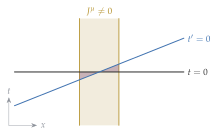
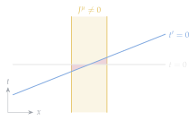

## Charge is a scalar

In [Lecture 4](lecture-04.qmd) we introduced the four-current $J^\alpha$ of a set of charged particles, with
$$\partial_\alpha J^\alpha = 0, \qquad Q = \int d^3x\, J^0(x). \tag{1}$$
By the divergence theorem $dQ/dt = -\int d^3x\, \partial_i J^i = 0$, so $Q$ is constant in time. It is also the same in every inertial frame.

::: {#r-5-1 .callout-important .proposition-box}

#### **Proposition 5.1** (Charge is Lorentz invariant). [[1, Ch. 2]](#ref-1)

The total charge $Q$ is a Lorentz scalar.

::: {.callout-note .proof-box collapse="true"}

#### Proof

Let $n_\beta = (1, 0, 0, 0)$ and let $\theta$ be the step function, so that $\partial_t\theta(t) = \delta(t)$. Then
$$Q = \int d^4x\, J^\alpha(x)\, \frac{\partial}{\partial x^\alpha}\theta(n_\beta x^\beta),$$
since the derivative produces $\delta(t)$ and reduces the integral to one over $t = 0$. In the transformed frame the same expression holds with $n_\beta$ replaced by $n'_\gamma = n_\beta\Lambda^\beta{}_\gamma$, the normal of the surface $t' = 0$. Hence
$$Q' - Q = \int d^4x\, J^\alpha\, \frac{\partial}{\partial x^\alpha}\bigl[\theta(n'_\beta x^\beta) - \theta(n_\beta x^\beta)\bigr] = -\int d^4x\, \bigl(\partial_\alpha J^\alpha\bigr)\bigl[\theta(n'_\beta x^\beta) - \theta(n_\beta x^\beta)\bigr] = 0,$$
integrating by parts and using (1). The boundary term vanishes because the bracket is non-zero only between the two surfaces $t = 0$ and $t' = 0$ ([@fig-l05-slices]), and the current vanishes at spatial infinity, where the two surfaces separate. $\square$
:::
:::

::: {#fig-l05-slices}
```{=html}
<div class="themed-figure" style="max-width: 400px; margin: 0 auto;"></div>
```

The surfaces $t = 0$ and $t' = 0$ of two inertial frames. The current is localised, so the region between the surfaces where it is non-zero is bounded, and the two integrals of $J^0$ agree.
:::

The same argument, applied to each component of $T^{\alpha 0}$, shows that the total four-momentum $p^\alpha_{\text{tot}}$ of [Proposition 4.7](lecture-04.qmd#r-4-7) is a contravariant vector.

## Maxwell's equations in covariant form

In units with $\epsilon_0 = \mu_0 = 1$, Maxwell's equations read
$$\nabla\cdot\vec E = \varepsilon, \qquad \nabla\times\vec B = \vec j + \frac{\partial\vec E}{\partial t}, \qquad \nabla\cdot\vec B = 0, \qquad \nabla\times\vec E = -\frac{\partial\vec B}{\partial t}. \tag{2}$$

::: {#r-5-2 .callout-note .definition-box}

#### **Definition 5.2** (Field strength tensor). [[1, Ch. 2]](#ref-1)

The *electromagnetic field strength tensor* is the antisymmetric tensor with $F^{0i} = E_i$ and $F^{ij} = \epsilon_{ijk} B_k$:
$$F^{\alpha\beta} = \begin{pmatrix} 0 & E_1 & E_2 & E_3 \\ -E_1 & 0 & B_3 & -B_2 \\ -E_2 & -B_3 & 0 & B_1 \\ -E_3 & B_2 & -B_1 & 0 \end{pmatrix}.$$
:::

::: {#r-5-3 .callout-important .proposition-box}

#### **Proposition 5.3** (Covariant Maxwell equations). [[1, Ch. 2]](#ref-1)

Maxwell's equations (2) are equivalent to
$$\frac{\partial}{\partial x^\alpha} F^{\alpha\beta} = -J^\beta, \qquad \epsilon^{\alpha\beta\gamma\delta}\, \frac{\partial}{\partial x^\beta} F_{\gamma\delta} = 0. \tag{3}$$
The second equation is equivalent to
$$\partial_\alpha F_{\beta\gamma} + \partial_\beta F_{\gamma\alpha} + \partial_\gamma F_{\alpha\beta} = 0. \tag{4}$$

::: {.callout-note .proof-box collapse="true"}

#### Proof

For $\beta = 0$ the first equation is $\partial_i F^{i0} = -\partial_i E_i = -J^0$, which is Gauss's law. For $\beta = j$ it is $\partial_0 F^{0j} + \partial_i F^{ij} = \partial_t E_j - (\nabla\times\vec B)_j = -j_j$, which is the Ampère–Maxwell law; here $\partial_i F^{ij} = \epsilon_{ijk}\partial_i B_k = -(\nabla\times\vec B)_j$. The second equation contains the two homogeneous laws in the same way: $\alpha = 0$ gives $\nabla\cdot\vec B = 0$ and $\alpha = i$ gives Faraday's law. Equation (4) is trivial unless $\alpha, \beta, \gamma$ are distinct, and then it is a component of the second equation in (3). $\square$
:::
:::

Equation (4) contains more equations than the second equation in (3), but the extra ones are trivial. Its advantage is that it generalises directly to general relativity ([Lecture 8](lecture-08.qmd)).

::: {#r-5-4 .callout-important .proposition-box}

#### **Proposition 5.4** (Lorentz force). [[1, Ch. 2]](#ref-1)

The four-force on a particle of charge $e$ in an electromagnetic field is
$$f^\alpha = e\, F^\alpha{}_\gamma\, \frac{dx^\gamma}{d\tau} = e\, \eta_{\beta\gamma}\, F^{\alpha\beta}\, \frac{dx^\gamma}{d\tau}.$$

::: {.callout-note .proof-box collapse="true"}

#### Proof

Both sides are contravariant vectors, so it suffices to check the equation in one frame. As in [Lecture 4](lecture-04.qmd), boost to coordinates $x'^\alpha$ in which the particle is momentarily at rest, so that $dx'^\gamma/d\tau = \delta^\gamma_0$. Then $f'^0 = e F'^0{}_0 = 0$ and $f'^i = e\, F'^i{}_0 = e\, \eta_{00} F'^{i0} = e E'_i$, the Coulomb force, which is the correct force on a charge at rest. $\square$
:::
:::

## The affine connection and the metric

We return to gravity. Let $X$ be a spacetime point and $\xi^\alpha_X$ a locally inertial coordinate system at $X$. By [Definition 1.11](lecture-01.qmd#r-1-11),
$$\frac{\partial^2\xi^\alpha_X}{\partial x^\mu \partial x^\nu} = \Gamma^\lambda_{\mu\nu}\, \frac{\partial\xi^\alpha_X}{\partial x^\lambda}.$$
Read this as a differential equation for $\xi^\alpha_X(x)$, given $\Gamma$. Expanding around $X$,
$$\xi^\alpha_X(x) = a^\alpha + b^\alpha{}_\mu\, (x - X)^\mu + \tfrac12\, b^\alpha{}_\lambda\, \Gamma^\lambda_{\mu\nu}(X)\, (x - X)^\mu (x - X)^\nu + \cdots,$$
with $a^\alpha = \xi^\alpha_X(X)$ and $b^\alpha{}_\mu = \partial\xi^\alpha_X/\partial x^\mu|_{x = X}$. The metric fixes $g_{\mu\nu}(X) = \eta_{\alpha\beta}\, b^\alpha{}_\mu\, b^\beta{}_\nu$, which is 10 conditions on the 16 entries of $b$. This leaves 6 free parameters in $b$ and 4 in $a$: the 10 parameters of a Poincaré transformation. Locally inertial coordinates thus exist and are unique up to Poincaré transformations, as they should be.

::: {#r-5-5 .callout-important .proposition-box}

#### **Proposition 5.5** (The connection is determined by the metric). [[1, Ch. 3]](#ref-1)

The affine connection is given by
$$\Gamma^\sigma_{\lambda\mu} = \tfrac12\, g^{\sigma\nu}\Bigl(\frac{\partial g_{\mu\nu}}{\partial x^\lambda} + \frac{\partial g_{\lambda\nu}}{\partial x^\mu} - \frac{\partial g_{\mu\lambda}}{\partial x^\nu}\Bigr). \tag{5}$$

::: {.callout-note .proof-box collapse="true"}

#### Proof

Differentiating $g_{\mu\nu} = \eta_{\alpha\beta}\, \partial_\mu\xi^\alpha\, \partial_\nu\xi^\beta$ and using [Definition 1.11](lecture-01.qmd#r-1-11) for the second derivatives,
$$\frac{\partial g_{\mu\nu}}{\partial x^\lambda} = \Gamma^\rho_{\lambda\mu}\, g_{\rho\nu} + \Gamma^\rho_{\lambda\nu}\, g_{\mu\rho}.$$
Adding the same identity with $\lambda \leftrightarrow \mu$ and subtracting it with $\lambda \to \nu$, $\nu \to \lambda$, and using $\Gamma^\rho_{\mu\nu} = \Gamma^\rho_{\nu\mu}$, all terms cancel except
$$\frac{\partial g_{\mu\nu}}{\partial x^\lambda} + \frac{\partial g_{\lambda\nu}}{\partial x^\mu} - \frac{\partial g_{\mu\lambda}}{\partial x^\nu} = 2\, \Gamma^\rho_{\lambda\mu}\, g_{\rho\nu}.$$
Multiplying by $g^{\sigma\nu}$ gives (5). $\square$
:::
:::

At $X$ one can therefore always pass to coordinates in which $g_{\mu\nu}(X) = \eta_{\mu\nu}$ and $\Gamma^\lambda_{\mu\nu}(X) = 0$. This rests on the equivalence principle, which guarantees that locally inertial coordinates exist.

## Free fall of massive and massless particles

For a massive particle, the derivation in [Lecture 1](lecture-01.qmd) gave the following.

::: {#r-5-6 .callout-note .definition-box}

#### **Definition 5.6** (Geodesic equation). [[1, Ch. 3]](#ref-1)

The *geodesic equation* is
$$\frac{d^2x^\lambda}{d\tau^2} + \Gamma^\lambda_{\mu\nu}\, \frac{dx^\mu}{d\tau}\frac{dx^\nu}{d\tau} = 0, \qquad d\tau^2 = -g_{\mu\nu}\, dx^\mu dx^\nu. \tag{6}$$
:::

A massless particle has no proper time, $d\tau = 0$. In locally inertial coordinates it still moves on a straight line, $d^2\xi^\alpha/d\sigma^2 = 0$ with $\eta_{\alpha\beta}\, (d\xi^\alpha/d\sigma)(d\xi^\beta/d\sigma) = 0$, for a parameter $\sigma$ such as $\sigma = \xi^0$; the solutions are $\xi^i(\sigma) = A^i\sigma + B^i$. The same change of coordinates then gives
$$\frac{d^2x^\lambda}{d\sigma^2} + \Gamma^\lambda_{\mu\nu}\, \frac{dx^\mu}{d\sigma}\frac{dx^\nu}{d\sigma} = 0, \qquad g_{\mu\nu}\, \frac{dx^\mu}{d\sigma}\frac{dx^\nu}{d\sigma} = 0. \tag{7}$$
Writing out the second condition, $g_{00}\, dt^2 + 2g_{0i}\, dt\, dx^i + g_{ij}\, dx^i dx^j = 0$, and solving for $dt$,
$$dt = \frac{1}{g_{00}}\Bigl\{-g_{0i}\, dx^i - \bigl[(g_{0i}\, g_{0j} - g_{00}\, g_{ij})\, dx^i dx^j\bigr]^{1/2}\Bigr\},$$
the sign chosen so that $dt > 0$ (recall $g_{00} < 0$). If the metric is static, the coordinate time a light signal takes between two given points is therefore the same for every signal. We use this in the next lecture.

## References {.unnumbered}

1. []{#ref-1}S. Weinberg, *Gravitation and Cosmology: Principles and Applications of the General Theory of Relativity*, Wiley, New York (1972).
