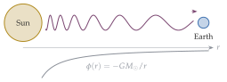
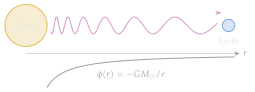

## The Newtonian limit

The geodesic equation (6) of [Lecture 5](lecture-05.qmd) should reduce to Newton's law of gravity for slow particles in weak, static fields. We assume:

1. the particle is slow, $|d\vec x/dt| \ll 1$;
2. the field is static, $\partial_0 g_{\mu\nu} = 0$;
3. the field is weak, $g_{\mu\nu} = \eta_{\mu\nu} + h_{\mu\nu}$ with $|h_{\mu\nu}| \ll 1$.

::: {#r-6-1 .callout-important .proposition-box}

#### **Proposition 6.1** (Newtonian limit). [[1, Ch. 3]](#ref-1)

Under assumptions 1–3, the geodesic equation reduces to
$$\frac{d^2\vec x}{dt^2} = \tfrac12\, \nabla h_{00},$$
which is Newton's law $d^2\vec x/dt^2 = -\nabla\phi$ provided
$$g_{00} = -(1 + 2\phi). \tag{1}$$

::: {.callout-note .proof-box collapse="true"}

#### Proof

By assumption 1, $|d\vec x/d\tau| \ll dt/d\tau$, so only the $\mu = \nu = 0$ term of the connection survives:
$$\frac{d^2x^\mu}{d\tau^2} + \Gamma^\mu_{00}\Bigl(\frac{dt}{d\tau}\Bigr)^2 = 0.$$
By assumption 2 and (5) of [Lecture 5](lecture-05.qmd),
$$\Gamma^\mu_{00} = -\tfrac12\, g^{\mu\sigma}\, \partial_\sigma g_{00} = -\tfrac12\, g^{\mu i}\, \partial_i g_{00}.$$
By assumption 3, $\partial_i g_{00} = \partial_i h_{00}$ is of order $h$. For $\mu = 0$, $g^{0i}$ is also of order $h$, so the second term is of second order and $d^2t/d\tau^2 = 0$: $dt/d\tau$ is constant. For $\mu = i$ we may replace $g^{ij}$ by $\delta^{ij}$, and
$$\frac{d^2x^i}{d\tau^2} = \tfrac12\, \partial_i h_{00}\Bigl(\frac{dt}{d\tau}\Bigr)^2.$$
Dividing by the constant $(dt/d\tau)^2$ gives the stated equation. Comparing with Newton's law, $h_{00} = -2\phi + \text{const}$. Far from all sources $\phi \to 0$ and $g_{\mu\nu} \to \eta_{\mu\nu}$, so the constant is zero. $\square$
:::
:::

## Gravitational redshift

Let an atom at rest emit light of a definite frequency. In locally inertial coordinates at the atom, the proper time $\Delta\tau$ between two wave crests is fixed by atomic physics. In arbitrary coordinates,
$$\Delta\tau = \bigl(-\eta_{\alpha\beta}\, d\xi^\alpha_X\, d\xi^\beta_X\bigr)^{1/2} = \bigl(-g_{\mu\nu}(X)\, dx^\mu dx^\nu\bigr)^{1/2},$$
so the coordinate time between the crests is
$$dt = \Delta\tau\, \Bigl(-g_{\mu\nu}\, \frac{dx^\mu}{dt}\frac{dx^\nu}{dt}\Bigr)^{-1/2} = \Delta\tau\, \bigl(-g_{00}\bigr)^{-1/2}$$
for a source at rest.

Now let the atom sit at $x_2$, say on the surface of the Sun, and the observer at $x_1$, on the Earth ([@fig-l06-redshift]). The crests leave $x_2$ a coordinate time $dt_2 = \Delta\tau\, (-g_{00}(x_2))^{-1/2}$ apart. In a static field every light signal takes the same coordinate time to travel from $x_2$ to $x_1$ ([Lecture 5](lecture-05.qmd)), so they also arrive $dt_2$ apart. The observer at rest at $x_1$ measures the proper time $\sqrt{-g_{00}(x_1)}\, dt_2$ between them, so the observed frequency is
$$\nu_2 = \frac{1}{\sqrt{-g_{00}(x_1)}\, dt_2}.$$
The same atom at rest at $x_1$ is seen with frequency $\nu_1 = 1/(\sqrt{-g_{00}(x_1)}\, dt_1)$, with $dt_1 = \Delta\tau\, (-g_{00}(x_1))^{-1/2}$.

::: {#fig-l06-redshift}
```{=html}
<div class="themed-figure" style="max-width: 520px; margin: 0 auto;"></div>
```

Light emitted at the surface of the Sun, deep in its potential well, climbs out to the Earth. The crests leave and arrive the same coordinate time apart, but clocks deeper in the well run slower, so the light arrives redshifted.
:::

::: {#r-6-2 .callout-important .proposition-box}

#### **Proposition 6.2** (Gravitational redshift). [[1, Ch. 3]](#ref-1)

The ratio of the frequency of light emitted at $x_2$ to that of the same line emitted at $x_1$, both observed at $x_1$, is
$$\frac{\nu_2}{\nu_1} = \frac{dt_1}{dt_2} = \Bigl(\frac{g_{00}(x_2)}{g_{00}(x_1)}\Bigr)^{1/2}.$$
In a weak field, by (1),
$$\frac{\nu_2}{\nu_1} = \Bigl(\frac{1 + 2\phi(x_2)}{1 + 2\phi(x_1)}\Bigr)^{1/2} \approx 1 + \phi(x_2) - \phi(x_1).$$
:::

::: {.callout-caution .example-box}

#### **Example 6.3** (Light from the Sun).

For a line emitted on the Sun and observed on the Earth,
$$\frac{\nu_2}{\nu_1} - 1 \approx \phi_\odot - \phi_\oplus \approx \phi_\odot = -\frac{GM_\odot}{R_\odot} \approx -2.12\times 10^{-6},$$
since the Earth's potential is much smaller. The frequency decreases and the wavelength increases: the light is *redshifted*.
:::

## Tensors under general coordinate transformations

We now want tools for writing equations that are covariant under arbitrary coordinate transformations $x^\mu \mapsto x'^\mu$. The definitions mirror those for Lorentz transformations ([Definition 3.4](lecture-03.qmd#r-3-4)), with $\Lambda$ replaced by the Jacobian of the transformation.

::: {#r-6-4 .callout-note .definition-box}

#### **Definition 6.4** (Scalars and vectors). [[1, Ch. 4]](#ref-1)

Under $x^\mu \mapsto x'^\mu$:

- a *scalar* transforms as $S' = S$;
- a *contravariant vector* transforms as $V'^\mu = \dfrac{\partial x'^\mu}{\partial x^\nu}\, V^\nu$, the example being the differential $dx^\mu$;
- a *covariant vector* transforms as $U'_\mu = \dfrac{\partial x^\nu}{\partial x'^\mu}\, U_\nu$, the example being the gradient $\partial\phi/\partial x^\mu$ of a scalar.
:::

## References {.unnumbered}

1. []{#ref-1}S. Weinberg, *Gravitation and Cosmology: Principles and Applications of the General Theory of Relativity*, Wiley, New York (1972).
