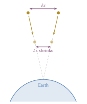
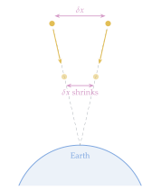
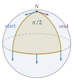
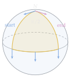

## The Bianchi identities

::: {#r-10-1 .callout-important .proposition-box}

#### **Proposition 10.1** (Bianchi identities). [[1, Ch. 6]](#ref-1)

The Riemann tensor satisfies
$$R_{\mu\nu\rho\sigma;\lambda} + R_{\mu\nu\lambda\rho;\sigma} + R_{\mu\nu\sigma\lambda;\rho} = 0. \tag{1}$$

::: {.callout-note .proof-box collapse="true"}

#### Proof

This is a tensor equation, so we check it in locally inertial coordinates at a point. There $\Gamma = 0$, so covariant derivatives are partial derivatives, and the $\Gamma\Gamma$ terms in (2) of [Lecture 9](lecture-09.qmd) have vanishing first derivatives. Hence
$$R_{\mu\nu\rho\sigma;\lambda} = \tfrac12\, \frac{\partial}{\partial x^\lambda}\Bigl(\frac{\partial^2 g_{\mu\rho}}{\partial x^\sigma \partial x^\nu} - \frac{\partial^2 g_{\nu\rho}}{\partial x^\sigma \partial x^\mu} - \frac{\partial^2 g_{\mu\sigma}}{\partial x^\rho \partial x^\nu} + \frac{\partial^2 g_{\nu\sigma}}{\partial x^\rho \partial x^\mu}\Bigr),$$
and in the cyclic sum over $(\rho, \sigma, \lambda)$ every third derivative appears twice with opposite signs. $\square$
:::
:::

::: {#r-10-2 .callout-important .proposition-box}

#### **Proposition 10.2** (Contracted Bianchi identities). [[1, Ch. 6]](#ref-1)

$$\Bigl(R^{\mu\nu} - \tfrac12\, g^{\mu\nu} R\Bigr)_{;\mu} = 0.$$

::: {.callout-note .proof-box collapse="true"}

#### Proof

Contract $\mu$ with $\rho$ in (1). Since the metric is covariantly constant ([Proposition 7.5](lecture-07.qmd#r-7-5)), contraction commutes with differentiation, and using the antisymmetry in the last pair,
$$R_{\nu\sigma;\lambda} - R_{\nu\lambda;\sigma} + R^\rho{}_{\nu\sigma\lambda;\rho} = 0.$$
Contracting $\nu$ with $\sigma$ gives
$$R_{;\lambda} - R^\sigma{}_{\lambda;\sigma} - R^\rho{}_{\lambda;\rho} = 0, \quad\text{that is}\quad \bigl(R^\sigma{}_\lambda - \tfrac12\, \delta^\sigma_\lambda R\bigr)_{;\sigma} = 0.$$
Raising $\lambda$ gives the result. $\square$
:::
:::

The combination $R^{\mu\nu} - \frac12 g^{\mu\nu}R$ is the *Einstein tensor*. Its vanishing divergence will be essential in [Lecture 11](lecture-11.qmd).

## Geodesic deviation

Consider two freely falling particles. If they are close enough, a freely falling observer can describe both with a single locally inertial coordinate system, and sees no effect of gravity: the particles stay at rest relative to each other. If they are far enough apart to resolve, say, the curvature of the Earth, no single locally inertial system covers both, and the observer sees them accelerate towards each other ([@fig-l10-deviation]). The relative motion of nearby free particles is what reveals gravity.

::: {#fig-l10-deviation}
```{=html}
<div class="themed-figure" style="max-width: 460px; margin: 0 auto;"></div>
```

Two particles dropped side by side above the Earth fall along radial lines towards its centre, so their separation shrinks as they fall. A freely falling observer between them sees them accelerate towards each other: a tidal effect that cannot be transformed away.
:::

Let particle 1 follow $x^\mu(\tau)$ and particle 2 follow $x^\mu(\tau) + \delta x^\mu(\tau)$, both geodesics:
$$\frac{d^2x^\mu}{d\tau^2} + \Gamma^\mu_{\rho\sigma}(x)\, \frac{dx^\rho}{d\tau}\frac{dx^\sigma}{d\tau} = 0, \qquad \frac{d^2(x^\mu + \delta x^\mu)}{d\tau^2} + \Gamma^\mu_{\rho\sigma}(x + \delta x)\, \frac{d(x^\rho + \delta x^\rho)}{d\tau}\frac{d(x^\sigma + \delta x^\sigma)}{d\tau} = 0.$$
Subtracting, to first order in $\delta x$,
$$\frac{d^2\delta x^\mu}{d\tau^2} + \frac{\partial\Gamma^\mu_{\rho\sigma}}{\partial x^\lambda}\frac{dx^\rho}{d\tau}\frac{dx^\sigma}{d\tau}\, \delta x^\lambda + 2\Gamma^\mu_{\rho\sigma}\, \frac{dx^\rho}{d\tau}\frac{d\delta x^\sigma}{d\tau} = 0. \tag{2}$$

::: {#r-10-3 .callout-important .proposition-box}

#### **Proposition 10.3** (Geodesic deviation). [[1, Ch. 6]](#ref-1)

The separation $\delta x^\mu$ of two neighbouring geodesics satisfies
$$\frac{D^2\delta x^\mu}{D\tau^2} + R^\mu{}_{\rho\sigma\lambda}\, \frac{dx^\rho}{d\tau}\frac{dx^\sigma}{d\tau}\, \delta x^\lambda = 0.$$

::: {.callout-note .proof-box collapse="true"}

#### Proof

By [Definition 8.1](lecture-08.qmd#r-8-1),
$$\frac{D\delta x^\mu}{D\tau} = \frac{d\delta x^\mu}{d\tau} + \Gamma^\mu_{\rho\sigma}\, \frac{dx^\rho}{d\tau}\, \delta x^\sigma,$$
and applying $D/D\tau$ once more,
$$\frac{D^2\delta x^\mu}{D\tau^2} = \frac{d^2\delta x^\mu}{d\tau^2} + \frac{\partial\Gamma^\mu_{\rho\sigma}}{\partial x^\lambda}\frac{dx^\lambda}{d\tau}\frac{dx^\rho}{d\tau}\, \delta x^\sigma + \Gamma^\mu_{\rho\sigma}\, \frac{d^2x^\rho}{d\tau^2}\, \delta x^\sigma + \Gamma^\mu_{\rho\sigma}\, \frac{dx^\rho}{d\tau}\frac{d\delta x^\sigma}{d\tau} + \Gamma^\mu_{\eta\xi}\, \frac{dx^\eta}{d\tau}\frac{D\delta x^\xi}{D\tau}.$$
Eliminate $d^2\delta x^\mu/d\tau^2$ with (2) and $d^2x^\rho/d\tau^2$ with the geodesic equation. The terms in $d\delta x/d\tau$ cancel, and the remaining terms, all proportional to $\delta x^\lambda\, \frac{dx^\rho}{d\tau}\frac{dx^\sigma}{d\tau}$, combine into $-R^\mu{}_{\rho\sigma\lambda}$ by [Definition 9.1](lecture-09.qmd#r-9-1). $\square$
:::
:::

If the Riemann tensor vanishes, nearby free particles do not accelerate relative to each other, and there is no gravitational field in any physical sense. The converse is also true.

::: {#r-10-4 .callout-important .theorem-box}

#### **Theorem 10.4** (Flat metrics). [[1, Ch. 6]](#ref-1)

There is a coordinate transformation $x \mapsto \xi(x)$ such that
$$\eta^{\alpha\beta} = \frac{\partial\xi^\alpha}{\partial x^\mu}\frac{\partial\xi^\beta}{\partial x^\nu}\, g^{\mu\nu}$$
everywhere if and only if

1. $R^\mu{}_{\nu\rho\sigma} = 0$ everywhere, and
2. at some point, $g_{\mu\nu}$ has the same number of positive and negative eigenvalues as $\eta_{\mu\nu}$.
:::

The theorem decides whether a given metric is Minkowski space written in curvilinear coordinates, or a genuinely different geometry.

## Curvature and non-Euclidean geometry

::: {#r-10-5 .callout-note .definition-box}

#### **Definition 10.5** (Euclidean geometry).

Euclidean plane geometry rests on five postulates:

1. any two points can be joined by a straight line segment;
2. any line segment can be extended indefinitely;
3. a circle can be drawn with any centre and any radius;
4. all right angles are congruent;
5. through a point not on a given line there is exactly one line that does not meet the given line (the *parallel postulate*).

A geometry is *non-Euclidean* if it satisfies the first four postulates but not the fifth.
:::

The two-sphere is an example, with great circles as its straight lines (they are the shortest paths between points). Any two great circles meet: two lines that are both perpendicular to the equator, and so "parallel" there, meet at the poles.

::: {#r-10-6 .callout-note .definition-box}

#### **Definition 10.6** (Geodesic curve, affine parameter). [[1, Ch. 6]](#ref-1)

A curve is a *geodesic* if it admits a parametrisation whose tangent vector is parallel transported along it,
$$\frac{d^2x^i}{d\lambda^2} + \Gamma^i_{lm}\, \frac{dx^l}{d\lambda}\frac{dx^m}{d\lambda} = 0.$$
Such a parameter $\lambda$ is called *affine*.
:::

A geodesic is thus a curve that parallel transports its own tangent vector. More generally, a curve whose tangent $W$ satisfies $\nabla_W W \propto W$ can always be reparametrised so that $\nabla_W W = 0$.

::: {.callout-caution .example-box}

#### **Example 10.7** (The plane).

In Cartesian coordinates the plane has $g_{ij} = \delta_{ij}$, so $\Gamma^l_{ij} = 0$, and parallel transport is $dV_i/d\lambda = 0$: vectors are constant. In particular, a vector carried around any closed curve returns to itself. For a small closed curve in a general space, the change is
$$\Delta V_i = \tfrac12\, R^l{}_{ijm}\, V_l \oint \xi^m\, d\xi^j,$$
so in the plane $R^l{}_{ijm} = 0$.
:::

::: {.callout-caution .example-box}

#### **Example 10.8** (The sphere).

On a sphere of radius $a$ in coordinates $(\theta, \phi)$,
$$ds^2 = a^2\bigl(d\theta^2 + \sin^2\theta\, d\phi^2\bigr),$$
with non-zero connection coefficients $\Gamma^\theta_{\phi\phi} = -\sin\theta\cos\theta$ and $\Gamma^\phi_{\theta\phi} = \Gamma^\phi_{\phi\theta} = \cot\theta$. These depend on $\theta$, and parallel transport is non-trivial.

On the equator $\theta = \pi/2$ all of them vanish, so a vector carried along the equator keeps its components. Carry a vector from the north pole down a meridian, a quarter of the way along the equator and back up another meridian ([@fig-l10-sphere]). Each leg is a geodesic, along which the angle between the vector and the tangent stays fixed, and the vector returns to the pole rotated by $\pi/2$, the angle enclosed at the pole. The curvature of the sphere is seen in this failure of a vector to return to itself.
:::

::: {#fig-l10-sphere}
```{=html}
<div class="themed-figure" style="max-width: 400px; margin: 0 auto;"></div>
```

Parallel transport around a geodesic triangle with three right angles. The vector returns to the north pole rotated by $\pi/2$, the angle the triangle encloses at the pole.
:::

Non-vanishing curvature $R^\mu{}_{\nu\rho\sigma} \neq 0$ thus signals both that the geometry is non-Euclidean and, by geodesic deviation, that gravity is present. This is the link between gravity and geometry on which general relativity rests.

## References {.unnumbered}

1. []{#ref-1}S. Weinberg, *Gravitation and Cosmology: Principles and Applications of the General Theory of Relativity*, Wiley, New York (1972).
