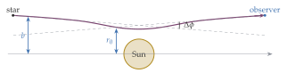
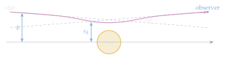
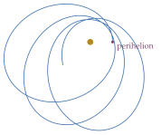
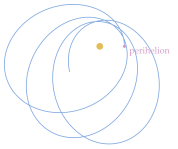

We now derive the motion of massive and massless particles in the empty space around a static isotropic source, where the metric is (1) of [Lecture 13](lecture-13.qmd) and, outside the source, the Schwarzschild solution.

## Constants of the motion

Write the geodesic equation with a parameter $p$,
$$\frac{d^2x^\mu}{dp^2} + \Gamma^\mu_{\rho\sigma}\, \frac{dx^\rho}{dp}\frac{dx^\sigma}{dp} = 0,$$
where $p$ is proportional to $\tau$ for a massive particle and is an affine parameter for a photon. With the connection coefficients of [Lecture 13](lecture-13.qmd), the four components are
$$\begin{aligned}
0 &= \frac{d^2t}{dp^2} + \frac{B'}{B}\frac{dt}{dp}\frac{dr}{dp}, \\
0 &= \frac{d^2r}{dp^2} + \frac{A'}{2A}\Bigl(\frac{dr}{dp}\Bigr)^2 - \frac rA\Bigl(\frac{d\theta}{dp}\Bigr)^2 - \frac{r\sin^2\theta}{A}\Bigl(\frac{d\phi}{dp}\Bigr)^2 + \frac{B'}{2A}\Bigl(\frac{dt}{dp}\Bigr)^2, \\
0 &= \frac{d^2\theta}{dp^2} + \frac2r\frac{dr}{dp}\frac{d\theta}{dp} - \sin\theta\cos\theta\Bigl(\frac{d\phi}{dp}\Bigr)^2, \\
0 &= \frac{d^2\phi}{dp^2} + \frac2r\frac{d\phi}{dp}\frac{dr}{dp} + 2\cot\theta\, \frac{d\theta}{dp}\frac{d\phi}{dp}.
\end{aligned}$$
By isotropy we may choose the orbit to start in the equatorial plane with $d\theta/dp = 0$; then $\theta = \pi/2$ solves the third equation for all $p$.

::: {#r-14-1 .callout-important .proposition-box}

#### **Proposition 14.1** (Constants of the motion). [[1, Ch. 8]](#ref-1)

For motion in the plane $\theta = \pi/2$, and with $p$ normalised suitably,
$$\frac{dt}{dp} = \frac1B, \qquad r^2\, \frac{d\phi}{dp} = J, \qquad A\Bigl(\frac{dr}{dp}\Bigr)^2 + \frac{J^2}{r^2} - \frac1B = -E,$$
with constants $J$ and $E$. Moreover $d\tau^2 = E\, dp^2$, so $E = 0$ for photons and $E > 0$ for massive particles.

::: {.callout-note .proof-box collapse="true"}

#### Proof

The $t$-equation is $\frac{d}{dp}\bigl(\ln\frac{dt}{dp} + \ln B\bigr) = 0$, so $B\, dt/dp$ is constant, and we normalise $p$ to make it one. With $\theta = \pi/2$ the $\phi$-equation is $\frac{d}{dp}\bigl(\ln\frac{d\phi}{dp} + \ln r^2\bigr) = 0$, which gives $J$. Inserting both into the $r$-equation,
$$\frac{d^2r}{dp^2} + \frac{A'}{2A}\Bigl(\frac{dr}{dp}\Bigr)^2 - \frac{J^2}{Ar^3} + \frac{B'}{2AB^2} = 0,$$
and multiplying by $2A\, dr/dp$ gives $\frac{d}{dp}\bigl[A\, (dr/dp)^2 + J^2/r^2 - 1/B\bigr] = 0$. Finally, inserting the three constants into the metric,
$$d\tau^2 = B\, dt^2 - A\, dr^2 - r^2 d\phi^2 = \Bigl[\frac1B - \Bigl(\frac1B - \frac{J^2}{r^2} - E\Bigr) - \frac{J^2}{r^2}\Bigr] dp^2 = E\, dp^2. \qquad \square$$
:::
:::

$J$ is the angular momentum per unit mass. Eliminating $p$ in favour of $t$,
$$r^2\, \frac{d\phi}{dt} = JB, \qquad \frac{A}{B^2}\Bigl(\frac{dr}{dt}\Bigr)^2 + \frac{J^2}{r^2} - \frac1B = -E, \tag{1}$$
and eliminating $t$ in favour of $\phi$,
$$\frac{A}{r^4}\Bigl(\frac{dr}{d\phi}\Bigr)^2 + \frac1{r^2} - \frac1{J^2 B} = -\frac{E}{J^2}.$$

::: {#r-14-2 .callout-important .proposition-box}

#### **Proposition 14.2** (Shape of the orbit). [[1, Ch. 8]](#ref-1)

$$\phi(r) = \phi(r_m) \pm \int_{r_m}^r \frac{A^{1/2}(\bar r)\, d\bar r}{\bar r^2\, \bigl(\frac{1}{J^2 B(\bar r)} - \frac{E}{J^2} - \frac1{\bar r^2}\bigr)^{1/2}}. \tag{2}$$
:::

Given $J$, $E$ and the initial values $r_m$ and $\phi(r_m)$, this determines the orbit.

::: {.callout-caution .example-box}

#### **Example 14.3** (The Newtonian limit).

For a weak field and slow motion, $|B - 1| \approx 2|\phi| \ll 1$, $|A - 1| \ll 1$ and $|dr/dt|, |r\, d\phi/dt| \ll 1$. To leading order, with $1/B \approx 1 - 2\phi$, equations (1) become
$$r^2\, \frac{d\phi}{dt} = J, \qquad \underbrace{\tfrac12\Bigl(\frac{dr}{dt}\Bigr)^2 + \frac{J^2}{2r^2}}_{\text{kinetic}} + \underbrace{\phi}_{\text{potential}} = \frac{1 - E}{2},$$
conservation of angular momentum and of energy, with energy per unit mass $(1 - E)/2$. Bound orbits have $E > 1$ and unbound orbits $E < 1$.
:::

## The deflection of light

Consider a particle coming in from infinity with speed $V$ and impact parameter $b$, passing the Sun at a closest distance $r_0$ and leaving again ([@fig-l14-deflection]). Far away, $\phi(r) \approx \phi_\infty - b/r$, so with $dr/dt \to -V$ and $B \to 1$, equations (1) give
$$J = -bV, \qquad E = 1 - V^2.$$
At $r_0$, $dr/d\phi = 0$, so
$$\frac1{r_0^2} - \frac1{J^2 B(r_0)} = -\frac{E}{J^2} \quad\Longrightarrow\quad J = -r_0\Bigl(\frac{1}{B(r_0)} - 1 + V^2\Bigr)^{1/2},$$
the sign matching $J = -bV$. Inserting in (2), the orbit is described by $r_0$ and $V$:
$$\phi(r) = \phi_\infty - \int_r^\infty \frac{A^{1/2}(\bar r)\, d\bar r}{\bar r^2\Bigl\{\frac1{r_0^2}\Bigl[\frac{1}{B(\bar r)} - 1 + V^2\Bigr]\Bigl[\frac{1}{B(r_0)} - 1 + V^2\Bigr]^{-1} - \frac1{\bar r^2}\Bigr\}^{1/2}}.$$
The total change in $\phi$ from infinity to $r_0$ and back is $2|\phi(r_0) - \phi_\infty|$. In the absence of gravity the path is straight and this is $\pi$, so we define the *deflection*
$$\Delta\phi = 2|\phi(r_0) - \phi_\infty| - \pi.$$

::: {#fig-l14-deflection}
```{=html}
<div class="themed-figure" style="max-width: 520px; margin: 0 auto;"></div>
```

A light ray passing the Sun at closest distance $r_0$ is bent by the angle $\Delta\phi$. An observer on the Earth sees the star displaced outwards from the Sun.
:::

::: {#r-14-4 .callout-important .proposition-box}

#### **Proposition 14.4** (Deflection of light). [[1, Ch. 8]](#ref-1)

For a photon, $V = 1$, and to first order in $GM/r_0$, with the metric of [Definition 13.5](lecture-13.qmd#r-13-5),
$$\Delta\phi = \frac{4GM}{r_0}\Bigl(\frac{1 + \gamma}{2}\Bigr).$$
:::

For light grazing the Sun, $r_0 = R_\odot$, this is
$$\Delta\phi = \frac{4GM_\odot}{R_\odot}\Bigl(\frac{1 + \gamma}{2}\Bigr) = 1.75''\Bigl(\frac{1 + \gamma}{2}\Bigr),$$
and in general $\Delta\phi = 1.75''\,(R_\odot/r_0)$ for $\gamma = 1$. It is measured by comparing the apparent positions of stars seen near the Sun during a solar eclipse with their positions half a year earlier, when the Sun is elsewhere in the sky.

## The precession of perihelia

For a bound orbit, $r$ oscillates between the perihelion $r_-$ and the aphelion $r_+$, where $dr/d\phi = 0$. In Newtonian gravity the orbit closes, so $\phi$ changes by $2\pi$ from one perihelion to the next. In general relativity it does not ([@fig-l14-precession]), and we define the *precession per revolution*
$$\Delta\phi = 2|\phi(r_+) - \phi(r_-)| - 2\pi.$$

::: {#fig-l14-precession}
```{=html}
<div class="themed-figure" style="max-width: 360px; margin: 0 auto;"></div>
```

The perihelion of a bound orbit advances a little on each revolution (here greatly exaggerated), so the orbit traces out a rosette.
:::

At $r_\pm$ the orbit equation gives $1/r_\pm^2 = (1/B(r_\pm) - E)/J^2$, and solving these two equations for $J$ and $E$,
$$J^2 = \frac{1/B(r_+) - 1/B(r_-)}{1/r_+^2 - 1/r_-^2}, \qquad E = \frac{r_+^2/B(r_+) - r_-^2/B(r_-)}{r_+^2 - r_-^2}.$$

::: {#r-14-5 .callout-important .proposition-box}

#### **Proposition 14.5** (Precession of perihelia). [[1, Ch. 8]](#ref-1)

To first order in $GM/L$, the perihelion advances by
$$\Delta\phi = \frac{6\pi GM}{L}\Bigl(\frac{2 - \beta + 2\gamma}{3}\Bigr)$$
per revolution, where $L$ is the semi-latus rectum, $\frac1L = \frac12\bigl(\frac1{r_+} + \frac1{r_-}\bigr)$.
:::

::: {.callout-caution .example-box}

#### **Example 14.6** (Mercury).

For Mercury, general relativity gives $\Delta\phi = 0.1038''$ per revolution. Mercury completes about $415$ revolutions per century, which gives $43.03''$ per century, in agreement with the anomalous precession left over after the perturbations by the other planets are subtracted.
:::

## References {.unnumbered}

1. []{#ref-1}S. Weinberg, *Gravitation and Cosmology: Principles and Applications of the General Theory of Relativity*, Wiley, New York (1972).
