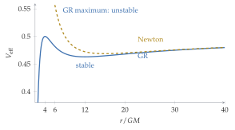
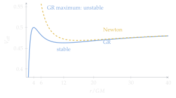
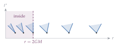
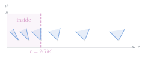

So far we have used the Schwarzschild solution in the empty space outside a body such as the Sun, at radii $r \gg 2GM$. For ordinary stars the Schwarzschild radius lies deep inside the body: the radius of the Sun is about $10^6\, GM_\odot$. The exterior Schwarzschild metric must then be matched smoothly to an interior solution. There are, however, objects for which the full Schwarzschild metric is needed: black holes [[2, Ch. 5]](#ref-2).

## The effective potential

We take over the constants of the motion of [Proposition 14.1](lecture-14.qmd#r-14-1), but now leave the normalisation of the parameter $p$ free. The $t$-equation then gives
$$\frac{dt}{dp} = \frac{\varepsilon}{B(r)}$$
for a constant $\varepsilon$, which we interpret as the energy per unit mass, and we normalise $p$ so that $d\tau^2 = E\, dp^2$ with $E = 1$ for massive and $E = 0$ for massless particles, following Carroll [[2, Ch. 5]](#ref-2). Inserting $dt/dp$ and $r^2\, d\phi/dp = J$ in the radial equation, as in [Lecture 14](lecture-14.qmd), gives
$$A\Bigl(\frac{dr}{dp}\Bigr)^2 + \frac{J^2}{r^2} - \frac{\varepsilon^2}{B} = -E,$$
which for $\varepsilon = 1$ is the earlier result. For the Schwarzschild solution $A = 1/B$, and multiplying by $B/2$ gives the following.

::: {#r-15-1 .callout-important .proposition-box}

#### **Proposition 15.1** (Effective potential). [[2, Ch. 5]](#ref-2)

Radial motion in the Schwarzschild metric is that of a particle in one dimension,
$$\tfrac12\Bigl(\frac{dr}{dp}\Bigr)^2 + V_{\text{eff}}(r) = \tfrac12\varepsilon^2, \qquad V_{\text{eff}}(r) = \tfrac12 E - \frac{EGM}{r} + \frac{J^2}{2r^2} - \frac{GMJ^2}{r^3}.$$
:::

The terms of $V_{\text{eff}}$ are, in order, a constant; the Newtonian gravitational potential; the centrifugal barrier, the same as in Newtonian mechanics; and a new attractive term, $-GMJ^2/r^3$, which is absent in Newtonian gravity and dominates near the source. The motion is confined to the region where $\frac12\varepsilon^2 - V_{\text{eff}} \geq 0$. Circular orbits sit at extrema of $V_{\text{eff}}$: they are stable at minima and unstable at maxima.

::: {#fig-l15-potential}
```{=html}
<div class="themed-figure" style="max-width: 560px; margin: 0 auto;"></div>
```

The effective potential for a massive particle at fixed angular momentum, in Newtonian gravity (dashed) and in general relativity (solid). The relativistic $-GMJ^2/r^3$ term turns the centrifugal barrier into a finite maximum, inside which the particle falls in.
:::

In Newtonian gravity ($V_{\text{eff}}$ without the last term), a massless particle sees only the centrifugal barrier: there are no circular orbits, and light moves on straight lines, as it should, since Newtonian gravity does not act on it. A massive particle has a stable circular orbit at the minimum of the potential, bound orbits oscillating about it, and unbound orbits that come in from infinity and turn around at the barrier ([@fig-l15-potential]).

In general relativity the last term changes the picture at small $r$. For every $J$, the potential now has a maximum and then falls to $-\infty$, so the centrifugal barrier can be overcome.

::: {#r-15-2 .callout-important .proposition-box}

#### **Proposition 15.2** (Circular orbits). [[2, Ch. 5]](#ref-2)

For a massless particle there is a single circular orbit, at $r = 3GM$, and it is unstable. For a massive particle the circular orbits are at
$$r_\pm = \frac{J^2 \pm \sqrt{J^4 - 12\, G^2M^2J^2}}{2GM},$$
with $r_+$ stable and $r_-$ unstable. They exist only for $J^2 \geq 12\, G^2M^2$, and the smallest stable circular orbit has radius $r = 6GM$.

::: {.callout-note .proof-box collapse="true"}

#### Proof

For $E = 0$, $V'_{\text{eff}} = -J^2/r^3 + 3GMJ^2/r^4$ vanishes only at $r = 3GM$, where $V_{\text{eff}}$ has a maximum. For $E = 1$,
$$V'_{\text{eff}} = \frac{1}{r^4}\bigl(GMr^2 - J^2 r + 3GMJ^2\bigr),$$
whose roots are $r_\pm$. They are real when $J^2 \geq 12G^2M^2$; the larger root is a minimum and the smaller a maximum. At $J^2 = 12G^2M^2$ the two coincide at $r = J^2/2GM = 6GM$. $\square$
:::
:::

## The Schwarzschild radius

At $r = 2GM$ the Schwarzschild metric is singular: $B(r) \to 0$, so $g_{tt} \to 0$ and $g_{rr} \to \infty$. To understand what this means, consider an observer 1 falling radially from rest at $r_0$ towards $r = 2GM$, emitting light signals at constant intervals of proper time, and an observer 2 at rest at infinity receiving them.

::: {#r-15-3 .callout-important .proposition-box}

#### **Proposition 15.3** (Infall to the Schwarzschild radius). [[1, Ch. 8]](#ref-1) [[2, Ch. 5]](#ref-2)

Observer 1 reaches $r = 2GM$ after a finite proper time
$$\Delta\tau_1 = \int_{2GM}^{r_0} \frac{dr}{\sqrt{B(r_0) - B(r)}} < \infty,$$
while the corresponding coordinate time, which is the proper time of observer 2, diverges:
$$\Delta t = \int_{2GM}^{r_0} \frac{\sqrt{B(r_0)}\, dr}{B(r)\sqrt{B(r_0) - B(r)}} = \infty.$$

::: {.callout-note .proof-box collapse="true"}

#### Proof

For radial motion $u^\mu = (u^0, u^1, 0, 0)$ with $u^0 = dt/d\tau = \varepsilon/B$, and the normalisation $g_{\mu\nu}u^\mu u^\nu = -1$ with $g_{00} = -B$ and $g_{11} = 1/B$ gives
$$u^1 = \frac{dr}{d\tau} = \pm\sqrt{\varepsilon^2 - B(r)}.$$
At $r_0$, $dr/d\tau = 0$, so $\varepsilon = \sqrt{B(r_0)}$, and since $r$ decreases,
$$d\tau = -\frac{dr}{\sqrt{B(r_0) - B(r)}}.$$
The integrand is finite at $r = 2GM$, so $\Delta\tau_1$ is finite. Observer 2 is at rest where the metric is Minkowskian, so its proper time is $t$, and
$$dt = \frac{u^0}{u^1}\, dr = -\frac{\sqrt{B(r_0)}}{B(r)\sqrt{B(r_0) - B(r)}}\, dr.$$
Near $r = 2GM$ the integrand behaves as $(r - 2GM)^{-1}$, so the integral diverges logarithmically. $\square$
:::
:::

The infalling observer crosses $r = 2GM$ in finite proper time and notices nothing special there, yet the distant observer never sees it happen. The singularity at $r = 2GM$ is a property of the coordinates, not of spacetime.

::: {#r-15-4 .callout-note .definition-box}

#### **Definition 15.4** (Eddington–Finkelstein coordinates). [[2, Ch. 5]](#ref-2)

The *ingoing Eddington–Finkelstein coordinate* is
$$v = t + r + 2GM\ln\Bigl(\frac{r}{2GM} - 1\Bigr).$$
In the coordinates $(v, r, \theta, \phi)$ the Schwarzschild metric reads
$$ds^2 = -\Bigl(1 - \frac{2GM}{r}\Bigr) dv^2 + 2\, dv\, dr + r^2\bigl(d\theta^2 + \sin^2\theta\, d\phi^2\bigr).$$
:::

This metric is regular and invertible at $r = 2GM$, so the Schwarzschild metric can be continued through this radius. The coordinate $v$ was designed to advance slowly along ingoing light rays. For radial null curves, $ds^2 = 0$ with $\theta$ and $\phi$ fixed,
$$\Bigl(1 - \frac{2GM}{r}\Bigr) dv^2 = 2\, dv\, dr, \qquad\text{so}\qquad \frac{dv}{dr} = \begin{cases} 0 & \text{(ingoing)}, \\ 2\Bigl(1 - \dfrac{2GM}{r}\Bigr)^{-1} & \text{(outgoing)}. \end{cases}$$
These are the slopes of the edges of the light cones in the $(r, v)$ plane. It is clearer to plot $t^* = v - r$ against $r$ ([@fig-l15-cones]). Then ingoing rays have slope $dt^*/dr = -1$, and outgoing rays have
$$\frac{dt^*}{dr} = \frac{1 + 2GM/r}{1 - 2GM/r}.$$
At large $r$ this tends to $1$, and the cones look as in flat space. As $r \to 2GM$ it becomes infinite: the outgoing ray stands still at $r = 2GM$. For $r < 2GM$ it is negative, so both rays move to smaller $r$, and every future-directed path leads inwards.

::: {#fig-l15-cones}
```{=html}
<div class="themed-figure" style="max-width: 520px; margin: 0 auto;"></div>
```

Light cones in ingoing Eddington–Finkelstein coordinates. Far away they are as in flat space. At the horizon $r = 2GM$ the outgoing edge is vertical, and inside it both edges point inwards: nothing can reach larger $r$.
:::

As long as $r > 2GM$, observer 1 can send signals to observer 2, but they arrive ever more slowly and ever more redshifted. From $r = 2GM$ on, no future-directed path reaches larger $r$, and observer 1 can no longer communicate with observer 2: the two are *causally disconnected*.

::: {#r-15-5 .callout-note .definition-box}

#### **Definition 15.5** (Event horizon, black hole). [[2, Ch. 5]](#ref-2)

An *event horizon* is a surface past which particles can never escape to infinity. In the Schwarzschild solution it is the surface $r = 2GM$, and the region inside it is the *Schwarzschild black hole*.
:::

Since nothing escapes from inside the horizon, its interior cannot be seen from outside.

## References {.unnumbered}

1. []{#ref-1}S. Weinberg, *Gravitation and Cosmology: Principles and Applications of the General Theory of Relativity*, Wiley, New York (1972).
2. []{#ref-2}S. M. Carroll, *Spacetime and Geometry: An Introduction to General Relativity*, Addison-Wesley, San Francisco (2004).
