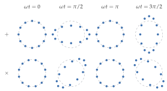
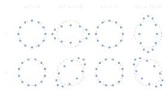

## The linearised Einstein equations

We return to the weak field approximation
$$g_{\mu\nu} = \eta_{\mu\nu} + h_{\mu\nu}, \qquad |h_{\mu\nu}| \ll 1.$$
For gravitational waves this means that the waves carry too little energy and momentum to affect their own propagation. Indices are raised and lowered with $\eta$. To first order in $h$, the connection is
$$\Gamma^\lambda_{\mu\nu} = \tfrac12\, \eta^{\lambda\rho}\bigl(\partial_\mu h_{\rho\nu} + \partial_\nu h_{\rho\mu} - \partial_\rho h_{\mu\nu}\bigr) + \mathcal O(h^2), \tag{1}$$
and in the Ricci tensor only the derivatives of the connection survive:
$$R_{\mu\nu} = \partial_\nu\Gamma^\rho_{\mu\rho} - \partial_\rho\Gamma^\rho_{\mu\nu} + \mathcal O(h^2) = R^{(1)}_{\mu\nu} + \mathcal O(h^2),$$
with $R^{(1)}_{\mu\nu}$ as in (2) of [Lecture 12](lecture-12.qmd). With
$$S_{\mu\nu} = T_{\mu\nu} - \tfrac12\, \eta_{\mu\nu}\, T^\lambda{}_\lambda,$$
the Einstein equations (6) of [Lecture 11](lecture-11.qmd) become
$$\Box\, h_{\mu\nu} - \partial_\nu\partial_\lambda h^\lambda{}_\mu - \partial_\mu\partial_\lambda h^\lambda{}_\nu + \partial_\mu\partial_\nu h^\lambda{}_\lambda = -16\pi G\, S_{\mu\nu}. \tag{2}$$
The linearised Ricci tensor satisfies $\partial_\mu R^{(1)\mu}{}_\nu = \frac12\partial_\nu\bigl(\Box\, h^\mu{}_\mu - \partial_\lambda\partial_\mu h^{\lambda\mu}\bigr) = \frac12\partial_\nu R^{(1)\lambda}{}_\lambda$, so
$$\partial_\mu\bigl(R^{(1)\mu}{}_\nu - \tfrac12\, \delta^\mu_\nu\, R^{(1)\lambda}{}_\lambda\bigr) = 0.$$
Consistency of (2) therefore requires the source to be conserved in the ordinary sense, $\partial_\mu T^\mu{}_\nu = 0$, or equivalently $\partial_\mu S^\mu{}_\nu = \frac12\partial_\nu S^\lambda{}_\lambda$.

## Gauge transformations

If $g_{\mu\nu}$ solves the Einstein equations, so does its transform under any coordinate transformation. Within the weak field approximation we must only allow transformations that keep $h$ small:
$$x^\mu \mapsto x'^\mu = x^\mu + \epsilon^\mu(x),$$
with $\partial\epsilon$ of the order of $h$. These are the most general coordinate transformations compatible with the approximation.

::: {#r-16-1 .callout-important .proposition-box}

#### **Proposition 16.1** (Gauge transformations). [[1, Ch. 10]](#ref-1)

Under $x^\mu \mapsto x^\mu + \epsilon^\mu(x)$,
$$h'_{\mu\nu} = h_{\mu\nu} - \partial_\mu\epsilon_\nu - \partial_\nu\epsilon_\mu. \tag{3}$$

::: {.callout-note .proof-box collapse="true"}

#### Proof

From $g^{\mu\nu}g_{\nu\rho} = \delta^\mu_\rho$, the inverse metric is $g^{\mu\nu} = \eta^{\mu\nu} - h^{\mu\nu} + \mathcal O(h^2)$. It transforms as
$$g'^{\mu\nu} = \frac{\partial x'^\mu}{\partial x^\rho}\frac{\partial x'^\nu}{\partial x^\sigma}\, g^{\rho\sigma} = \bigl(\delta^\mu_\rho + \partial_\rho\epsilon^\mu\bigr)\bigl(\delta^\nu_\sigma + \partial_\sigma\epsilon^\nu\bigr) g^{\rho\sigma} = g^{\mu\nu} + \partial^\nu\epsilon^\mu + \partial^\mu\epsilon^\nu + \mathcal O(h^2),$$
so $h'^{\mu\nu} = h^{\mu\nu} - \partial^\nu\epsilon^\mu - \partial^\mu\epsilon^\nu$. Lowering the indices gives (3). $\square$
:::
:::

This is the analogue of the gauge transformation $A_\mu \mapsto A_\mu + \partial_\mu\lambda$ in electrodynamics. To solve (2) we break the gauge invariance by choosing harmonic coordinates ([Definition 12.2](lecture-12.qmd#r-12-2)). To first order,
$$0 = g^{\mu\nu}\Gamma^\lambda_{\mu\nu} = \tfrac12\, \eta^{\lambda\rho}\bigl(2\partial_\mu h^\mu{}_\rho - \partial_\rho h^\mu{}_\mu\bigr),$$
so the harmonic condition is
$$\partial_\mu h^\mu{}_\rho = \tfrac12\, \partial_\rho h^\mu{}_\mu. \tag{4}$$
Inserting (4) into (2), the second, third and fourth terms cancel, leaving only $\Box\, h_{\mu\nu}$.

If $h$ is not harmonic, a gauge transformation (3) makes it so. The transformed coordinates have
$$g'^{\mu\nu}\Gamma'^\lambda_{\mu\nu} = \eta^{\lambda\rho}\Bigl(\partial_\mu h^\mu{}_\rho - \tfrac12\, \partial_\rho h^\mu{}_\mu - \Box\, \epsilon_\rho\Bigr),$$
so they are harmonic if
$$\Box\, \epsilon_\rho = \partial_\mu h^\mu{}_\rho - \tfrac12\, \partial_\rho h^\mu{}_\mu, \tag{5}$$
a wave equation that can always be solved, given initial conditions.

In harmonic coordinates the linearised Einstein equations are thus
$$\Box\, h_{\mu\nu} = -16\pi G\, S_{\mu\nu}, \qquad \partial_\mu h^\mu{}_\rho = \tfrac12\, \partial_\rho h^\mu{}_\mu.$$

## Plane waves

Away from the sources, $\Box\, h_{\mu\nu} = 0$ together with (4); the sources enter through the boundary conditions, as they did for the Schwarzschild solution. We look for plane waves
$$h_{\mu\nu}(x) = e_{\mu\nu}\, e^{ik_\rho x^\rho} + e^*_{\mu\nu}\, e^{-ik_\rho x^\rho},$$
where the *polarisation tensor* $e_{\mu\nu}$ is symmetric, like the metric. The two equations become
$$k_\rho k^\rho = 0, \qquad k_\mu\, e^\mu{}_\nu = \tfrac12\, k_\nu\, e^\mu{}_\mu. \tag{6}$$
The waves move at the speed of light.

::: {#r-16-2 .callout-important .proposition-box}

#### **Proposition 16.2** (Two physical polarisations). [[1, Ch. 10]](#ref-1)

A gravitational plane wave has two physical degrees of freedom. For a wave moving along the $x^3$-axis they can be taken to be $e_{11} = -e_{22}$ and $e_{12} = e_{21}$, with all other components zero.

::: {.callout-note .proof-box collapse="true"}

#### Proof

A symmetric $e_{\mu\nu}$ has 10 components, and the harmonic condition (6) imposes 4 conditions, leaving 6. By (5), a gauge transformation with $\Box\, \epsilon_\rho = 0$ keeps the coordinates harmonic. Choose
$$\epsilon^\mu(x) = i\epsilon^\mu\, e^{ik_\rho x^\rho} - i\epsilon^{\mu *}\, e^{-ik_\rho x^\rho},$$
which satisfies $\Box\, \epsilon^\mu = 0$ since $k_\rho k^\rho = 0$. By (3) it changes $e_{\mu\nu} \mapsto e_{\mu\nu} + k_\mu\epsilon_\nu + k_\nu\epsilon_\mu$, and the four constants $\epsilon^\mu$ can be chosen to remove four more components. This leaves $6 - 4 = 2$. For $k = (k, 0, 0, k)$ one can use them to set $e_{0\mu} = e_{3\mu} = 0$ and $e^\mu{}_\mu = 0$, which leaves $e_{11} = -e_{22}$ and $e_{12}$. $\square$
:::
:::

## Helicity

::: {#r-16-3 .callout-note .definition-box}

#### **Definition 16.3** (Helicity). [[1, Ch. 10]](#ref-1)

A plane wave $\psi$ has *helicity* $h$ if under a rotation by an angle $\varphi$ about its direction of propagation it transforms as $\psi \mapsto e^{ih\varphi}\psi$.
:::

A rotation about the $x^3$-axis leaves $k_\mu$ unchanged, $R_\mu{}^\nu k_\nu = k_\mu$, and has non-zero entries
$$R_0{}^0 = R_3{}^3 = 1, \qquad R_1{}^1 = R_2{}^2 = \cos\varphi, \qquad R_1{}^2 = -R_2{}^1 = \sin\varphi.$$
The polarisation tensor transforms as $e'_{\mu\nu} = R_\mu{}^\rho R_\nu{}^\sigma e_{\rho\sigma}$; using $e_{22} = -e_{11}$,
$$e'_{11} = \cos 2\varphi\, e_{11} + \sin 2\varphi\, e_{12}, \qquad e'_{12} = -\sin 2\varphi\, e_{11} + \cos 2\varphi\, e_{12}.$$

::: {#r-16-4 .callout-important .proposition-box}

#### **Proposition 16.4** (Gravitational waves have helicity $\pm 2$). [[1, Ch. 10]](#ref-1)

The combinations $e_\pm = e_{11} \mp i\, e_{12}$ transform as $e'_\pm = e^{\pm 2i\varphi}\, e_\pm$.
:::

A gravitational wave thus decomposes into two physical components of helicity $\pm 2$.

## The effect of a wave on test masses

To see what a gravitational wave does, consider two nearby test particles and use the geodesic deviation equation ([Proposition 10.3](lecture-10.qmd#r-10-3)),
$$\frac{D^2\delta x^\mu}{D\tau^2} = -R^\mu{}_{\nu\rho\sigma}\, U^\nu U^\rho\, \delta x^\sigma.$$
Let the particles move slowly, $U^\mu = (1, 0, 0, 0) + \mathcal O(h)$, and work in the gauge of [Proposition 16.2](#r-16-2), where $h_{0\mu} = 0$. To first order, (2) of [Lecture 9](lecture-09.qmd) gives
$$R_{\rho 00\sigma} = -\tfrac12\, \frac{\partial^2 h_{\rho\sigma}}{\partial t^2},$$
and so
$$\frac{d^2\delta x^\mu}{dt^2} = \tfrac12\, \frac{\partial^2 h^\mu{}_\sigma}{\partial t^2}\, \delta x^\sigma + \mathcal O(h^2).$$
Integrating, with $\delta x$ initially at rest,
$$\delta x^\mu(t) = \delta x^\mu(0) + \tfrac12\, h^\mu{}_\sigma(t)\, \delta x^\sigma(0) + \mathcal O(h^2).$$

::: {.callout-caution .example-box}

#### **Example 16.5** (The two polarisations).

*Plus polarisation*, $e_{11} = -e_{22} \neq 0$, $e_{12} = 0$:
$$\delta x^1 = \bigl(1 + \tfrac12 h^1{}_1\bigr)\, \delta x^1(0), \qquad \delta x^2 = \bigl(1 - \tfrac12 h^1{}_1\bigr)\, \delta x^2(0).$$
Separations along $x^1$ stretch while those along $x^2$ shrink, and half a period later the other way round.

*Cross polarisation*, $e_{11} = 0$, $e_{12} \neq 0$:
$$\delta x^1 = \delta x^1(0) + \tfrac12 h^1{}_2\, \delta x^2(0), \qquad \delta x^2 = \delta x^2(0) + \tfrac12 h^2{}_1\, \delta x^1(0).$$
The same stretching and squeezing now happens along the diagonals.

A ring of free particles in the $x^1x^2$-plane is therefore deformed into an oscillating ellipse, as in [@fig-l16-polarisation]. The two patterns are rotated by $45°$ with respect to each other, as befits helicity $2$.
:::

::: {#fig-l16-polarisation}
```{=html}
<div class="themed-figure" style="max-width: 560px; margin: 0 auto;"></div>
```

A ring of free test particles in the plane transverse to a passing gravitational wave, at four moments of one period. Top: plus polarisation. Bottom: cross polarisation, the same pattern rotated by $45°$.
:::

## References {.unnumbered}

1. []{#ref-1}S. Weinberg, *Gravitation and Cosmology: Principles and Applications of the General Theory of Relativity*, Wiley, New York (1972).
