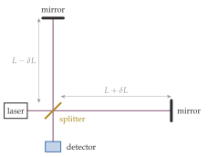
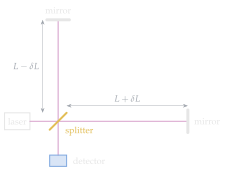

## Rotating bodies

Consider a body rotating rigidly with angular velocity $\Omega$ about the $x^3$-axis, with mass density $T^{00} = \rho(\vec x')$ in coordinates $\vec x'$ fixed in the body:
$$x^1 = x'^1\cos\Omega t - x'^2\sin\Omega t, \qquad x^2 = x'^1\sin\Omega t + x'^2\cos\Omega t, \qquad x^3 = x'^3.$$
Let
$$I^{ij} = \int d^3x'\, x'^i x'^j\, \rho(\vec x')$$
be the moment of inertia tensor in the body-fixed coordinates, and take the $x'$-axes to be its principal axes in the plane, so that $I^{12} = 0$. Then, for example,
$$D^{11}(t) = \int d^3x\, x^1 x^1\, T^{00} = \int d^3x'\, \bigl(x'^1\cos\Omega t - x'^2\sin\Omega t\bigr)^2 \rho(\vec x') = \cos^2\Omega t\, I^{11} + \sin^2\Omega t\, I^{22},$$
and similarly for the other components. $D^{ij}(t)$ is periodic, and can be expanded as
$$D^{ij}(t) = D^{ij}(0) + \sum_{n \geq 1}\bigl(D^{ij}(n\Omega)\, e^{-in\Omega t} + \text{c.c.}\bigr).$$
Writing $\cos^2\Omega t = \frac12(1 + \cos 2\Omega t)$ and so on, only the modes $n = 0$ and $n = 2$ appear. The static mode does not radiate, so all the radiation is emitted at $\omega = 2\Omega$.

::: {#r-18-1 .callout-important .proposition-box}

#### **Proposition 18.1** (Radiation from a rotating body). [[1, Ch. 10]](#ref-1)

A body rotating rigidly about a principal axis radiates at frequency $2\Omega$ with power
$$P = \frac{32\, G\, \Omega^6\, e^2 I^2}{5}, \qquad I = I^{11} + I^{22}, \qquad e = \frac{I^{11} - I^{22}}{I}.$$
:::

The *ellipticity* $e$ measures the departure from axial symmetry: an axially symmetric body does not radiate.

::: {.callout-caution .example-box}

#### **Example 18.2** (A binary).

Two stars of mass $m$ orbiting their centre of mass at distance $r$ from it, placed on the $x'^1$-axis, have $I^{11} = 2mr^2$ and $I^{22} = I^{33} = 0$, so $e = 1$ and
$$P = \frac{128\, G\, \Omega^6 m^2 r^4}{5}.$$
:::

## Detecting gravitational waves

A gravitational wave changes the distance $L$ between free test masses by $\delta L/L \sim h$ ([Example 16.5](lecture-16.qmd)). Interferometric detectors such as LIGO measure this with a Michelson interferometer whose arms are kilometres long, with mirrors suspended as test masses at their ends ([@fig-l18-ligo]). A wave of plus polarisation stretches one arm while it squeezes the other, which changes the interference pattern at the output.

::: {#fig-l18-ligo}
```{=html}
<div class="themed-figure" style="max-width: 460px; margin: 0 auto;"></div>
```

A Michelson interferometer. A passing wave lengthens one arm and shortens the other by $\delta L \sim hL$, shifting the phase between the two beams when they recombine at the detector.
:::

How large is $h$? For a non-relativistic source, by (1) of [Lecture 17](lecture-17.qmd) and the quadrupole approximation, $e_{ij} \sim (G/r)\, \omega^2 D_{ij}$. With $D_{ij} \sim MR^2$ for a source of mass $M$ and size $R$,
$$h \sim \frac{GMR^2\omega^2}{r}.$$
For a binary of two masses $M$ a distance $2R$ apart, the virial theorem, or simply the balance of forces, gives
$$M\omega^2 R = \frac{GM^2}{(2R)^2}, \qquad \omega = \sqrt{\frac{GM}{4R^3}}.$$

::: {.callout-caution .example-box}

#### **Example 18.3** (Order of magnitude).

Take $M = 10\, M_\odot$ and $R = 10^7$ cm. Then $\omega$ is of order $10^2$–$10^3\, \text{s}^{-1}$. For an extragalactic source at $r \sim 100\, \text{Mpc} \sim 10^{26}$ cm,
$$h \sim 10^{-21}, \qquad \delta L \sim 10^{-16}\, \frac{L}{\text{km}}\ \text{cm}.$$
This is far smaller than the Bohr radius, about $10^{-9}$ cm: the displacement to be measured is much smaller than the atoms that make up the mirrors. It can be measured because the mirrors move as a whole, and because the light is reflected many times in each arm. After some $100$ round trips, in both arms, the accumulated phase difference is
$$\delta\phi \sim 2 \times 100 \times \frac{2\pi}{\lambda}\, \delta L \sim 10^{-9}$$
for $\lambda \sim 1\, \mu\text{m}$ and $L$ of a few kilometres.
:::

## Killing vectors

We now turn to the symmetries of a metric, which will be essential for cosmology.

::: {#r-18-4 .callout-note .definition-box}

#### **Definition 18.4** (Form invariance, isometry). [[1, Ch. 13]](#ref-1)

Under $x \mapsto x'(x)$ the metric transforms as $g'_{\mu\nu}(x') = \frac{\partial x^\rho}{\partial x'^\mu}\frac{\partial x^\sigma}{\partial x'^\nu}\, g_{\rho\sigma}(x)$. It is *form invariant* if $g'_{\mu\nu}(x') = g_{\mu\nu}(x')$, that is, if
$$g_{\mu\nu}(x) = \frac{\partial x'^\rho}{\partial x^\mu}\frac{\partial x'^\sigma}{\partial x^\nu}\, g_{\rho\sigma}(x'). \tag{1}$$
A transformation satisfying (1) is an *isometry*.
:::

Consider an infinitesimal transformation $x'^\mu = x^\mu + \epsilon\, \xi^\mu(x)$ with $|\epsilon| \ll 1$. To first order in $\epsilon$, (1) becomes
$$g_{\mu\nu} = \bigl(\delta^\rho_\mu + \epsilon\, \partial_\mu\xi^\rho\bigr)\bigl(\delta^\sigma_\nu + \epsilon\, \partial_\nu\xi^\sigma\bigr)\bigl(g_{\rho\sigma} + \epsilon\, \xi^\lambda\partial_\lambda g_{\rho\sigma}\bigr),$$
so an infinitesimal isometry must satisfy
$$\partial_\mu\xi^\rho\, g_{\rho\nu} + \partial_\nu\xi^\sigma\, g_{\mu\sigma} + \xi^\lambda\, \partial_\lambda g_{\mu\nu} = 0.$$
Lowering the index of $\xi$ and using (5) of [Lecture 5](lecture-05.qmd),
$$0 = \partial_\mu\xi_\nu + \partial_\nu\xi_\mu + \xi^\lambda\bigl(\partial_\lambda g_{\mu\nu} - \partial_\mu g_{\lambda\nu} - \partial_\nu g_{\mu\lambda}\bigr) = \partial_\mu\xi_\nu + \partial_\nu\xi_\mu - 2\Gamma^\sigma_{\mu\nu}\, \xi_\sigma.$$

::: {#r-18-5 .callout-note .definition-box}

#### **Definition 18.5** (Killing vector). [[1, Ch. 13]](#ref-1)

A vector field $\xi^\mu$ is a *Killing vector* if
$$\xi_{\mu;\nu} + \xi_{\nu;\mu} = 0.$$
:::

Killing vectors are the generators of the infinitesimal isometries of the metric; in the language of Lie derivatives, $\mathcal L_\xi g = 0$.

::: {#r-18-6 .callout-important .proposition-box}

#### **Proposition 18.6** (Second derivatives of a Killing vector). [[1, Ch. 13]](#ref-1)

A Killing vector satisfies
$$\xi_{\sigma;\rho;\mu} = -R^\lambda{}_{\mu\sigma\rho}\, \xi_\lambda. \tag{2}$$

::: {.callout-note .proof-box collapse="true"}

#### Proof

For any covariant vector, the commutator of covariant derivatives is given by the curvature:
$$\xi_{\sigma;\rho;\mu} - \xi_{\sigma;\mu;\rho} = -R^\lambda{}_{\sigma\rho\mu}\, \xi_\lambda.$$
Add the cyclic permutations of $(\sigma, \rho, \mu)$ with alternating signs. By the cyclic identity of [Proposition 9.2](lecture-09.qmd#r-9-2) the right-hand sides sum to zero, and using $\xi_{\sigma;\rho} = -\xi_{\rho;\sigma}$ the left-hand side becomes
$$\xi_{\sigma;\rho;\mu} - \xi_{\sigma;\mu;\rho} - \xi_{\mu;\rho;\sigma} = 0.$$
Combining this with the commutator identity once more, and using the Killing equation to reorder indices, gives (2). $\square$
:::
:::

Equation (2) has a strong consequence. Suppose $\xi_\lambda$ and $\xi_{\lambda;\rho}$ are known at a point $X$. Then (2) gives the second derivatives at $X$, and differentiating (2) gives all higher derivatives in terms of these. Assuming the Taylor series converges, every Killing vector can therefore be written as
$$\xi_\mu(x) = A_\mu{}^\lambda(x; X)\, \xi_\lambda(X) + B_\mu{}^{\lambda\rho}(x; X)\, \xi_{\lambda;\rho}(X),$$
with $A$ and $B$ depending only on the metric, not on $\xi$.

::: {#r-18-7 .callout-important .proposition-box}

#### **Proposition 18.7** (Maximal number of Killing vectors). [[1, Ch. 13]](#ref-1)

An $N$-dimensional metric has at most $N(N+1)/2$ linearly independent Killing vectors.

::: {.callout-note .proof-box collapse="true"}

#### Proof

A Killing vector is fixed by $\xi_\lambda(X)$, $N$ numbers, and $\xi_{\lambda;\rho}(X)$, which is antisymmetric by the Killing equation and so has $N(N-1)/2$ independent entries. In total there are $N + N(N-1)/2 = N(N+1)/2$ free numbers. $\square$
:::
:::

::: {#r-18-8 .callout-note .definition-box}

#### **Definition 18.8** (Homogeneous space). [[1, Ch. 13]](#ref-1)

An $N$-dimensional metric space is *homogeneous* if for each point $X$ there are $N$ infinitesimal isometries $x^\mu \mapsto x^\mu + \epsilon\, \xi^{(\nu)\mu}(x; X)$, $\nu = 0, \dots, N - 1$, with
$$\xi^{(\nu)}_\mu(X; X) = \delta^\nu_\mu.$$
:::

In other words, there are isometries that move $X$ in every direction: the metric is invariant under "translations" to any nearby point.

## References {.unnumbered}

1. []{#ref-1}S. Weinberg, *Gravitation and Cosmology: Principles and Applications of the General Theory of Relativity*, Wiley, New York (1972).
