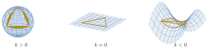
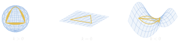

By [Proposition 18.7](lecture-18.qmd#r-18-7), an $N$-dimensional metric has at most $N(N+1)/2$ independent Killing vectors. In this lecture we study the spaces that have them all. They are the building blocks of cosmology: by the cosmological principle ([Lecture 20](lecture-20.qmd)), space is such a space.

## Isotropy and maximal symmetry

::: {#r-19-1 .callout-note .definition-box}

#### **Definition 19.1** (Isotropic space). [[1, Ch. 13]](#ref-1)

An $N$-dimensional metric space is *isotropic at* $X$ if there are $N(N-1)/2$ infinitesimal isometries
$$x^\mu \mapsto x^\mu + \varepsilon^{(\sigma\rho)}\, \xi^{(\sigma\rho)\mu}(x; X), \qquad \varepsilon^{(\sigma\rho)} = -\varepsilon^{(\rho\sigma)}, \quad \xi^{(\sigma\rho)\mu} = -\xi^{(\rho\sigma)\mu},$$
that fix $X$ and rotate everything around it:
$$\xi^{(\sigma\rho)}_\mu(X; X) = 0, \qquad \xi^{(\sigma\rho)}_{\mu;\nu}(X; X) = \delta^\sigma_\mu\delta^\rho_\nu - \delta^\sigma_\nu\delta^\rho_\mu.$$
:::

::: {.callout-caution .example-box}

#### **Example 19.2** (Rotations in three dimensions).

In three dimensions there are three such isometries. Label them by a vector, $\vec\varepsilon = (\varepsilon^{(23)}, \varepsilon^{(31)}, \varepsilon^{(12)})$, and collect the corresponding matrices $\xi^{(23)}_{i;j}$, $\xi^{(31)}_{i;j}$, $\xi^{(12)}_{i;j}$ into a vector of antisymmetric matrices $\vec\epsilon$. Near $X$ the isometry acts as $\partial x'/\partial x = \mathbb 1 + \vec\varepsilon\cdot\vec\epsilon$, an infinitesimal rotation, and exponentiating gives the finite rotations $R = \exp(\vec\varepsilon\cdot\vec\epsilon)$.
:::

A space that is isotropic at every point is also homogeneous ([Definition 18.8](lecture-18.qmd#r-18-8)).

::: {#r-19-3 .callout-note .definition-box}

#### **Definition 19.3** (Maximally symmetric space). [[1, Ch. 13]](#ref-1)

A metric space is *maximally symmetric* if it has the maximal number $N(N+1)/2$ of independent Killing vectors.
:::

One can show that a maximally symmetric space is homogeneous and isotropic at every point, and conversely, that a space that is homogeneous and isotropic about some point is maximally symmetric. The $N(N+1)/2$ Killing vectors split into $N$ translations and $N(N-1)/2$ rotations, matching the count of [Proposition 18.7](lecture-18.qmd#r-18-7).

## Spaces of constant curvature

::: {#r-19-4 .callout-important .theorem-box}

#### **Theorem 19.4** (Curvature of a maximally symmetric space). [[1, Ch. 13]](#ref-1)

In a maximally symmetric space of dimension $N$,
$$R_{\rho\sigma} = \frac1N\, g_{\rho\sigma}\, R, \qquad R_{\lambda\rho\sigma\nu} = \frac{R}{N(N-1)}\bigl(g_{\nu\rho}\, g_{\lambda\sigma} - g_{\sigma\rho}\, g_{\lambda\nu}\bigr),$$
and for $N > 2$ the curvature scalar $R$ is constant.

::: {.callout-note .proof-box collapse="true"}

#### Proof

Applying the commutator of covariant derivatives to the tensor $\xi_{\rho;\mu}$ gives
$$\xi_{\rho;\mu;\sigma;\nu} - \xi_{\rho;\mu;\nu;\sigma} = -R^\lambda{}_{\rho\sigma\nu}\, \xi_{\lambda;\mu} - R^\lambda{}_{\mu\sigma\nu}\, \xi_{\rho;\lambda}.$$
For a Killing vector, the left-hand side can instead be computed by differentiating (2) of [Lecture 18](lecture-18.qmd). Equating the two expressions and moving all terms with $\xi_{\lambda;\eta}$ to one side gives an identity of the form
$$Q^{\lambda\eta}{}_{\rho\sigma\nu\mu}\, \xi_{\lambda;\eta} = \bigl(R^\lambda{}_{\sigma\mu\rho;\nu} - R^\lambda{}_{\nu\mu\rho;\sigma}\bigr)\xi_\lambda,$$
with
$$Q^{\lambda\eta}{}_{\rho\sigma\nu\mu} = -R^\lambda{}_{\rho\sigma\nu}\, \delta^\eta_\mu + R^\lambda{}_{\mu\sigma\nu}\, \delta^\eta_\rho - R^\lambda{}_{\sigma\rho\mu}\, \delta^\eta_\nu + R^\lambda{}_{\nu\rho\mu}\, \delta^\eta_\sigma.$$
In a maximally symmetric space we may choose, at any point, a Killing vector with $\xi_\lambda = 0$ and $\xi_{\lambda;\eta}$ an arbitrary antisymmetric matrix. Hence the part of $Q$ antisymmetric in $\lambda\eta$ vanishes:
$$Q^{\lambda\eta}{}_{\rho\sigma\nu\mu} = Q^{\eta\lambda}{}_{\rho\sigma\nu\mu}.$$
Contracting $\eta$ with $\mu$, and using the cyclic identity, gives
$$-N R^\lambda{}_{\rho\sigma\nu} = -R^\lambda{}_{\rho\sigma\nu} + R_{\sigma\rho}\, \delta^\lambda_\nu - R_{\nu\rho}\, \delta^\lambda_\sigma,$$
that is, with the first index lowered,
$$(N-1)\, R_{\lambda\rho\sigma\nu} = R_{\nu\rho}\, g_{\lambda\sigma} - R_{\sigma\rho}\, g_{\lambda\nu}.$$
The left-hand side is antisymmetric under $\lambda \leftrightarrow \rho$, so the right-hand side must be too: $R_{\nu\rho}\, g_{\lambda\sigma} - R_{\sigma\rho}\, g_{\lambda\nu} = -R_{\nu\lambda}\, g_{\rho\sigma} + R_{\sigma\lambda}\, g_{\rho\nu}$. Contracting $\lambda$ with $\nu$ gives $R_{\rho\sigma} - N R_{\rho\sigma} = -R\, g_{\rho\sigma} + R_{\rho\sigma}$, so $R_{\rho\sigma} = g_{\rho\sigma}R/N$, and substituting back gives the Riemann tensor.

Finally, by the contracted Bianchi identities ([Proposition 10.2](lecture-10.qmd#r-10-2)),
$$0 = \bigl(R^\sigma{}_\rho - \tfrac12\, \delta^\sigma_\rho R\bigr)_{;\sigma} = \Bigl(\frac1N - \frac12\Bigr)\frac{\partial R}{\partial x^\rho},$$
so $R$ is constant when $N > 2$. $\square$
:::
:::

Maximally symmetric spaces are therefore also called *spaces of constant curvature*.

::: {#r-19-5 .callout-note .definition-box}

#### **Definition 19.5** (Curvature constant). [[1, Ch. 13]](#ref-1)

The *curvature constant* $k$ of a maximally symmetric space is defined by $R = -N(N-1)k$, so that
$$R_{\lambda\rho\sigma\nu} = k\bigl(g_{\sigma\rho}\, g_{\lambda\nu} - g_{\nu\rho}\, g_{\lambda\sigma}\bigr), \qquad R_{\rho\sigma} = -(N-1)\, k\, g_{\rho\sigma}.$$
:::

The minus sign reflects Weinberg's sign convention for the Riemann tensor ([Definition 9.1](lecture-09.qmd#r-9-1)): with it, a sphere has negative $R$ but positive $k$.

## Constructing the metric

Which metrics are maximally symmetric? The answer is that there are very few.

::: {#r-19-6 .callout-important .theorem-box}

#### **Theorem 19.6** (Uniqueness of maximally symmetric spaces). [[1, Ch. 13]](#ref-1)

Two maximally symmetric metrics with the same curvature constant $k$ and the same numbers of positive and negative eigenvalues are related by a coordinate transformation.
:::

It therefore suffices to construct one maximally symmetric metric for each $k$ and each signature. Embed an $N$-dimensional space in an $(N+1)$-dimensional one with line element
$$ds^2 = C_{\mu\nu}\, dx^\mu dx^\nu + k^{-1}\, dz^2, \qquad \mu, \nu = 0, \dots, N-1, \tag{1}$$
where $C_{\mu\nu}$ is a constant symmetric matrix whose eigenvalues carry the signature, and restrict to the surface
$$k\, C_{\mu\nu}\, x^\mu x^\nu + z^2 = 1. \tag{2}$$
For $k > 0$ and $C_{\mu\nu} = \delta_{\mu\nu}$ this is a sphere of radius $k^{-1/2}$; for $k < 0$ a hyperboloid; and as $k \to 0$ the surface becomes flat ([@fig-l19-embed]).

::: {#fig-l19-embed}
```{=html}
<div class="themed-figure" style="max-width: 560px; margin: 0 auto;"></div>
```

Two-dimensional spaces of constant curvature: positive $k$ (a sphere), $k = 0$ (a plane) and negative $k$ (a hyperbolic surface, drawn here as a saddle). A triangle has angle sum greater than, equal to and less than $\pi$ respectively.
:::

Differentiating (2) gives $z\, dz = -k\, C_{\mu\nu}\, x^\mu dx^\nu$, so
$$dz^2 = \frac{k^2\, (C_{\mu\nu}\, x^\mu dx^\nu)^2}{1 - k\, C_{\rho\sigma}\, x^\rho x^\sigma},$$
and inserting this in (1),
$$ds^2 = C_{\mu\nu}\, dx^\mu dx^\nu + \frac{k\, (C_{\mu\nu}\, x^\mu dx^\nu)^2}{1 - k\, C_{\rho\sigma}\, x^\rho x^\sigma}.$$

::: {#r-19-7 .callout-important .proposition-box}

#### **Proposition 19.7** (The maximally symmetric metric). [[1, Ch. 13]](#ref-1)

The metric
$$g_{\mu\nu} = C_{\mu\nu} + \frac{k}{1 - k\, C_{\rho\sigma}\, x^\rho x^\sigma}\, C_{\mu\eta}\, x^\eta\, C_{\nu\epsilon}\, x^\epsilon \tag{3}$$
is maximally symmetric with curvature constant $k$.

::: {.callout-note .proof-box collapse="true"}

#### Proof

*Rotations.* Let $x'^\mu = R^\mu{}_\nu\, x^\nu$ with $C_{\mu\nu}\, R^\mu{}_\rho\, R^\nu{}_\sigma = C_{\rho\sigma}$. Since (3) is built only from $C_{\mu\nu}$, $x^\mu$ and $dx^\mu$ through contractions with $C$, these are preserved, and
$$g'_{\mu\nu}(x') = (R^{-1})^\rho{}_\mu\, (R^{-1})^\sigma{}_\nu\, g_{\rho\sigma}(R^{-1}x') = C_{\mu\nu} + \frac{k\, C_{\mu\zeta}\, C_{\nu\xi}\, x'^\zeta x'^\xi}{1 - k\, C_{\eta\epsilon}\, x'^\eta x'^\epsilon} = g_{\mu\nu}(x').$$
The matrix $R$ has $N^2$ entries subject to the $N(N+1)/2$ conditions above, which leaves $N(N-1)/2$ independent rotations.

*Quasi-translations.* The metric is also form invariant under a family of "quasi-translations" $x^\mu \mapsto x^\mu + a^\mu(\cdots)$, with $N$ independent parameters $a^\mu$; we do not need their explicit form.

In total there are $N(N-1)/2 + N = N(N+1)/2$ independent isometries, so the metric is maximally symmetric. $\square$
:::
:::

## References {.unnumbered}

1. []{#ref-1}S. Weinberg, *Gravitation and Cosmology: Principles and Applications of the General Theory of Relativity*, Wiley, New York (1972).
