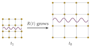
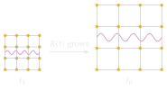

## Maximally symmetric spaces and spacetimes

We apply the construction of [Proposition 19.7](lecture-19.qmd#r-19-7) in the cases of interest.

**Space.** For a positive definite metric and $k \neq 0$, take $C_{\mu\nu} = |k|^{-1}\delta_{\mu\nu}$; for $k = 0$, take $C_{\mu\nu} = \delta_{\mu\nu}$. **Spacetime.** For a Lorentzian metric take $C_{\mu\nu} = \eta_{\mu\nu}$, with $x^\mu = (t, \vec x)$. Then (3) of [Lecture 19](lecture-19.qmd) gives the following line elements.

| | $k > 0$ | $k < 0$ | $k = 0$ |
|:--:|:--:|:--:|:--:|
| Space | $\dfrac1k\Bigl[d\vec x^2 + \dfrac{(\vec x\cdot d\vec x)^2}{1 - \vec x^2}\Bigr]$ | $\dfrac1{|k|}\Bigl[d\vec x^2 - \dfrac{(\vec x\cdot d\vec x)^2}{1 + \vec x^2}\Bigr]$ | $d\vec x^2$ |
| Spacetime | $-dt^2 + d\vec x^2 + \dfrac{k\, (\vec x\cdot d\vec x - t\, dt)^2}{1 - k(\vec x^2 - t^2)}$ | (same formula) | $-dt^2 + d\vec x^2$ |

For space with $k > 0$ this is a sphere, for $k < 0$ a hyperbolic space and for $k = 0$ Euclidean space.

## Spacetimes with maximally symmetric subspaces

In cosmology we do not want the whole spacetime to be maximally symmetric, only space at each moment of cosmic time. We want a metric whose three-dimensional subspaces of constant time are maximally symmetric.

Consider an $N$-dimensional spacetime with coordinates $u^i$ on $M$-dimensional subspaces, and coordinates $v^a$ on the complementary $(N - M)$-dimensional space.

::: {#r-20-1 .callout-note .definition-box}

#### **Definition 20.1** (Maximally symmetric subspaces). [[1, Ch. 13]](#ref-1)

The subspaces of constant $v^a$ are *maximally symmetric* if the metric is form invariant under $M(M+1)/2$ independent infinitesimal transformations
$$u^i \mapsto u^i + \epsilon\, \xi^{(n)i}(u, v), \qquad v^a \mapsto v^a.$$
:::

::: {#r-20-2 .callout-important .theorem-box}

#### **Theorem 20.2** (Metrics with maximally symmetric subspaces). [[1, Ch. 13]](#ref-1)

The coordinates $u^i$ can always be chosen so that
$$ds^2 = g_{ab}(v)\, dv^a dv^b + f(v)\, \tilde g_{ij}(u)\, du^i du^j,$$
where $\tilde g_{ij}$ is the metric of an $M$-dimensional maximally symmetric space.
:::

For $N = 4$, $M = 3$ and a single time-like $v$, with $g(v) < 0$ and $f(v) > 0$, this reads
$$ds^2 = g(v)\, dv^2 + f(v)\Bigl[d\vec u^2 + \frac{k\, (\vec u\cdot d\vec u)^2}{1 - k\, \vec u^2}\Bigr].$$
Define a new time coordinate by $t = \int dv\, (-g(v))^{1/2}$ and introduce spherical coordinates $u^1 = r\sin\theta\cos\phi$, $u^2 = r\sin\theta\sin\phi$, $u^3 = r\cos\theta$. Then $\vec u\cdot d\vec u = r\, dr$, and
$$d\vec u^2 + \frac{k\, r^2 dr^2}{1 - kr^2} = \frac{dr^2}{1 - kr^2} + r^2 d\theta^2 + r^2\sin^2\theta\, d\phi^2.$$

::: {#r-20-3 .callout-note .definition-box}

#### **Definition 20.3** (Robertson–Walker metric). [[1, Ch. 14]](#ref-1)

The *Robertson–Walker metric* is
$$ds^2 = -dt^2 + R^2(t)\Bigl[\frac{dr^2}{1 - kr^2} + r^2 d\theta^2 + r^2\sin^2\theta\, d\phi^2\Bigr], \tag{1}$$
with *scale factor* $R(t) = \sqrt{f(v(t))}$. By rescaling $r$, the curvature constant can be normalised to $k = +1$, $0$ or $-1$.
:::

Its surfaces of constant $t$ are three-dimensional maximally symmetric spaces, all of the same shape, whose size is set by $R(t)$. In [Lecture 21](lecture-21.qmd) we impose the Einstein equations on (1).

## Maximally symmetric tensors

To describe the matter in such a universe we need tensors that share its symmetries.

::: {#r-20-4 .callout-note .definition-box}

#### **Definition 20.4** (Form invariant tensors). [[1, Ch. 13]](#ref-1)

A tensor $T_{\mu\nu\cdots}$ is *form invariant* under $x \mapsto x'(x)$ if
$$T'_{\mu\nu\cdots}(x') = T_{\mu\nu\cdots}(x'),$$
and *maximally form invariant* if this holds for all isometries of a maximally symmetric metric.
:::

::: {#r-20-5 .callout-important .proposition-box}

#### **Proposition 20.5** (Maximally form invariant tensors). [[1, Ch. 13]](#ref-1)

In a maximally symmetric space,

1. a maximally form invariant scalar is constant;
2. a maximally form invariant vector is zero;
3. a maximally form invariant rank-2 tensor is proportional to the metric.
:::

The first follows from homogeneity, the other two from isotropy: a non-zero vector would single out a direction, and so would any symmetric tensor not proportional to the metric. In a spacetime with maximally symmetric subspaces, the constants may still depend on time.

::: {#r-20-6 .callout-note .definition-box}

#### **Definition 20.6** (Cosmological principle). [[1, Ch. 14]](#ref-1)

The *cosmological principle* states that, on large scales, the subspaces of constant cosmic time are maximally symmetric, and all cosmic fields, such as $T_{\mu\nu}$, are maximally form invariant.
:::

What are "large scales"? For *homogeneity*, the scale is set by the distribution of galaxies, which becomes homogeneous on scales of about $100$ Mpc. For *isotropy*, the best evidence is the cosmic microwave background (CMB): the photons that have travelled freely through the Universe since *recombination*, when the plasma of electrons and protons combined into neutral hydrogen and the Universe became transparent. Its spectrum is that of a black body, with energy density per unit frequency
$$u_\gamma(\nu) = \frac{8\pi h\nu^3}{c^3}\, \frac{1}{e^{h\nu/k_B T_\gamma} - 1}$$
and flux per unit frequency and solid angle $c\, u_\gamma(\nu)/4\pi$. Comparing the temperature $T_\gamma$ in different directions gives
$$\frac{\Delta T_\gamma}{\langle T_\gamma\rangle} \sim 10^{-5}:$$
the Universe is isotropic to about one part in $10^5$.

## Comoving coordinates

For the Robertson–Walker metric (1), $g_{00} = -1$ and $g_{0i} = 0$, so $\Gamma^\mu_{00} = \frac12 g^{\mu\rho}(2\partial_0 g_{\rho 0} - \partial_\rho g_{00}) = 0$. The spatial components of the geodesic equation read
$$\frac{d^2x^k}{d\tau^2} + 2\Gamma^k_{0j}\, \frac{dx^0}{d\tau}\frac{dx^j}{d\tau} + \Gamma^k_{ij}\, \frac{dx^i}{d\tau}\frac{dx^j}{d\tau} = 0,$$
so if $dx^j/d\tau = 0$ initially, then $x^j = \text{const}$ is a solution. A particle at rest in these coordinates stays at rest, and along its worldline $d\tau^2 = dt^2$: $t$ is its proper time.

::: {#r-20-7 .callout-note .definition-box}

#### **Definition 20.7** (Comoving observers). [[1, Ch. 14]](#ref-1)

Observers at fixed $(r, \theta, \phi)$ are *comoving observers*, and $(t, r, \theta, \phi)$ are *comoving coordinates*. The time $t$ is the proper time of comoving observers, the *cosmic time*.
:::

Galaxies are, to a good approximation, comoving: their coordinate separations stay fixed, while their physical separations grow with $R(t)$ ([@fig-l20-comoving]).

::: {#fig-l20-comoving}
```{=html}
<div class="themed-figure" style="max-width: 520px; margin: 0 auto;"></div>
```

Galaxies at fixed comoving coordinates at an early time $t_1$ (left) and a later time $t_0$ (right). Physical distances, and the wavelengths of light in transit, grow in proportion to $R(t)$.
:::

## The energy-momentum tensor

Under spatial rotations, $T^{00}$ is a scalar, $T^{i0}$ a vector and $T^{ij}$ a tensor. By [Proposition 20.5](#r-20-5),
$$T^{00} = \rho(t), \qquad T^{i0} = 0, \qquad T^{ij} = p(t)\, g^{ij},$$
with $g^{ij}$ the spatial part of the Robertson–Walker metric. With the four-velocity of comoving observers, $U^0 = 1$ and $U^i = 0$, this is
$$T_{\mu\nu} = (\rho + p)\, U_\mu U_\nu + p\, g_{\mu\nu}, \tag{2}$$
the energy-momentum tensor of a *perfect fluid* with density $\rho(t)$ and pressure $p(t)$. The cosmological principle alone forces the matter content of the Universe to look like a perfect fluid at rest in comoving coordinates.

## Cosmological redshift

Let a source at $(t_1, r_1, \theta_1, \phi_1)$ emit light of wavelength $\lambda_1$, received by a comoving observer at $(t_0, 0, 0, 0)$ with wavelength $\lambda_0$. The *redshift* is
$$z = \frac{\lambda_0 - \lambda_1}{\lambda_1}.$$
The light moves radially, with $d\tau^2 = 0$:
$$dt^2 = R^2(t)\, \frac{dr^2}{1 - kr^2}, \qquad dt = -R(t)\, \frac{dr}{\sqrt{1 - kr^2}},$$
the minus sign because $r$ decreases as $t$ increases. Integrating,
$$\int_{t_1}^{t_0} \frac{dt}{R(t)} = \int_0^{r_1} \frac{dr}{\sqrt{1 - kr^2}},$$
and the right-hand side depends only on the comoving position of the source, not on the times of emission and reception.

::: {#r-20-8 .callout-important .proposition-box}

#### **Proposition 20.8** (Cosmological redshift). [[1, Ch. 14]](#ref-1)

$$1 + z = \frac{R(t_0)}{R(t_1)}.$$

::: {.callout-note .proof-box collapse="true"}

#### Proof

Let $f(t_0, t_1) = \int_{t_1}^{t_0} dt/R(t)$. For two successive wave crests, emitted at $t_1$ and $t_1 + \delta t_1$ and received at $t_0$ and $t_0 + \delta t_0$, $f$ is the same, so
$$0 = \delta f = \frac{\delta t_0}{R(t_0)} - \frac{\delta t_1}{R(t_1)}.$$
The wavelengths are $\lambda_1 = \delta t_1$ and $\lambda_0 = \delta t_0$, so $\lambda_0/\lambda_1 = R(t_0)/R(t_1)$. $\square$
:::
:::

Whenever the scale factor changes, light from distant sources is shifted in frequency; in an expanding universe $z > 0$, a redshift. This follows from the symmetries of the cosmological principle alone, before any use of the Einstein equations.

## References {.unnumbered}

1. []{#ref-1}S. Weinberg, *Gravitation and Cosmology: Principles and Applications of the General Theory of Relativity*, Wiley, New York (1972).
