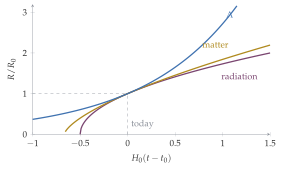
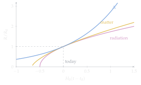

## The Einstein equations for a Robertson–Walker universe

We now impose the Einstein equations on the Robertson–Walker metric ([Definition 20.3](lecture-20.qmd#r-20-3)),
$$g_{tt} = -1, \qquad g_{ti} = 0, \qquad g_{ij} = R^2(t)\, \tilde g_{ij}, \qquad \tilde g_{rr} = \frac{1}{1 - kr^2}, \quad \tilde g_{\theta\theta} = r^2, \quad \tilde g_{\phi\phi} = r^2\sin^2\theta,$$
with $k = +1$, $0$ or $-1$. By (5) of [Lecture 5](lecture-05.qmd), the non-zero connection coefficients are
$$\Gamma^t_{ij} = \tfrac12\, \partial_t g_{ij} = R\dot R\, \tilde g_{ij}, \qquad \Gamma^i_{tj} = \tfrac12\, g^{ik}\partial_t g_{kj} = \frac{\dot R}{R}\, \delta^i_j, \qquad \Gamma^i_{jk} = \tilde\Gamma^i_{jk},$$
where $\tilde\Gamma^i_{jk}$ is the connection of $\tilde g_{ij}$; in particular $\Gamma^t_{tt} = \Gamma^i_{tt} = 0$.

::: {#r-21-1 .callout-important .proposition-box}

#### **Proposition 21.1** (Ricci tensor of the Robertson–Walker metric). [[1, Ch. 15]](#ref-1)

$$R_{tt} = \frac{3\ddot R}{R}, \qquad R_{ti} = 0, \qquad R_{ij} = -\bigl(R\ddot R + 2\dot R^2 + 2k\bigr)\, \tilde g_{ij}.$$

::: {.callout-note .proof-box collapse="true"}

#### Proof

$R_{ti} = 0$ by isotropy: it would be a maximally form invariant vector in the subspaces ([Proposition 20.5](lecture-20.qmd#r-20-5)). For the $tt$-component, using the formula of [Lecture 13](lecture-13.qmd) for $R_{\mu\nu}$,
$$R_{tt} = \partial_t\Gamma^\rho_{\rho t} + \Gamma^\rho_{\sigma t}\, \Gamma^\sigma_{\rho t} = 3\, \partial_t\Bigl(\frac{\dot R}{R}\Bigr) + 3\, \frac{\dot R^2}{R^2} = \frac{3\ddot R}{R}.$$
For the $ij$-components, the terms built from $\tilde\Gamma$ alone give the Ricci tensor $\tilde R_{ij}$ of $\tilde g_{ij}$, and the remaining terms give
$$R_{ij} = \tilde R_{ij} - \partial_t\bigl(R\dot R\, \tilde g_{ij}\bigr) + 2\Gamma^t_{il}\Gamma^l_{tj} - \Gamma^t_{ij}\Gamma^l_{tl} = \tilde R_{ij} - \bigl(R\ddot R + 2\dot R^2\bigr)\tilde g_{ij}.$$
The subspaces are three-dimensional and maximally symmetric, so by [Definition 19.5](lecture-19.qmd#r-19-5) $\tilde R_{ij} = -2k\, \tilde g_{ij}$. $\square$
:::
:::

By the cosmological principle the matter is a perfect fluid ((2) of [Lecture 20](lecture-20.qmd)), with $U^t = 1$, $U_t = -1$. The trace is $T^\lambda{}_\lambda = 3p - \rho$, so the source in (6) of [Lecture 11](lecture-11.qmd) is
$$S_{\mu\nu} = T_{\mu\nu} - \tfrac12\, g_{\mu\nu}\, T^\lambda{}_\lambda = \tfrac12(\rho - p)\, g_{\mu\nu} + (\rho + p)\, U_\mu U_\nu,$$
$$S_{tt} = \tfrac12(\rho + 3p), \qquad S_{ij} = \tfrac12(\rho - p)\, R^2\, \tilde g_{ij}.$$
The Einstein equations $R_{\mu\nu} = -8\pi G\, S_{\mu\nu}$ thus reduce to two equations:
$$3\ddot R = -4\pi G(\rho + 3p)\, R, \qquad R\ddot R + 2\dot R^2 + 2k = 4\pi G(\rho - p)\, R^2. \tag{1}$$

::: {#r-21-2 .callout-important .theorem-box}

#### **Theorem 21.2** (Friedmann equation). [[1, Ch. 15]](#ref-1)

$$\dot R^2 + k = \frac{8\pi G}{3}\, \rho\, R^2. \tag{2}$$

::: {.callout-note .proof-box collapse="true"}

#### Proof

Multiply the first equation in (1) by $R$ and the second by $3$, and subtract to eliminate $\ddot R$:
$$6\dot R^2 + 6k = 12\pi G(\rho - p)R^2 + 4\pi G(\rho + 3p)R^2 = 16\pi G\, \rho\, R^2. \qquad \square$$
:::
:::

The *Hubble parameter* is $H = \dot R/R$, and its present value $H_0 = H(t_0)$ is the *Hubble constant*. The Friedmann equation cannot be solved until we know how $\rho$ depends on $R$. Covariant conservation of the perfect fluid, $T^{\mu\nu}{}_{;\nu} = 0$, reads
$$g^{\mu\nu}\frac{\partial p}{\partial x^\mu} + \frac{1}{\sqrt g}\frac{\partial}{\partial x^\mu}\bigl[\sqrt g\, (\rho + p)\, U^\mu U^\nu\bigr] + \Gamma^\nu_{\rho\sigma}(\rho + p)\, U^\rho U^\sigma = 0,$$
and the last term vanishes since $\Gamma^\nu_{tt} = 0$. With $\sqrt g = R^3\sqrt{\tilde g}$, the $\nu = t$ component gives the following.

::: {#r-21-3 .callout-important .proposition-box}

#### **Proposition 21.3** (Continuity equation). [[1, Ch. 15]](#ref-1)

$$-\frac{dp}{dt} + \frac{1}{R^3}\frac{d}{dt}\bigl[R^3(\rho + p)\bigr] = 0, \qquad\text{equivalently}\qquad \frac{d}{dt}\bigl(\rho R^3\bigr) = -3p\, R^2\dot R.$$
:::

To close the system we need an *equation of state* $p = p(\rho)$.

## Three equations of state

::: {#fig-l21-scale}
```{=html}
<div class="themed-figure" style="max-width: 520px; margin: 0 auto;"></div>
```

The scale factor $R(t)$ of a flat universe filled with radiation ($R \propto t^{1/2}$), matter ($R \propto t^{2/3}$) or a cosmological constant ($R \propto e^{Ht}$), normalised to have the same size and expansion rate today. The first two decelerate; the last accelerates.
:::

::: {.callout-caution .example-box}

#### **Example 21.4** (Matter).

Non-relativistic matter has $p = 0$. The continuity equation gives $\rho R^3 = \text{const} = \rho_0 R_0^3$: the density is diluted as the Universe expands. For $k = 0$ the Friedmann equation becomes
$$\frac{\dot R^2}{R^2} = \frac{8\pi G}{3}\, \rho_0\, \frac{R_0^3}{R^3}, \qquad\text{with solution}\qquad R(t) = R_0\Bigl(\frac{3H_0 t}{2}\Bigr)^{2/3}.$$
By (1), $\ddot R < 0$: the expansion decelerates.
:::

::: {.callout-caution .example-box}

#### **Example 21.5** (Radiation).

Radiation has $p = \rho/3$. The continuity equation gives $\rho \propto R^{-4}$: three powers from the dilution of the number of photons and one from the redshift of each photon's energy. For $k = 0$ the Friedmann equation gives $R(t) \propto t^{1/2}$, and again $\ddot R < 0$.
:::

Since $\rho_{\text{rad}}/\rho_{\text{mat}} \propto 1/R$, radiation dominates at early times, and the Universe passes from a radiation-dominated into a matter-dominated phase as it expands.

::: {.callout-caution .example-box}

#### **Example 21.6** (A cosmological constant).

Take $p = -\rho$. The continuity equation gives $\rho = \text{const}$, and for $k = 0$ the Friedmann equation gives
$$R(t) \propto e^{Ht}, \qquad H = \sqrt{8\pi G\rho/3},$$
an exponential, accelerating expansion, $\ddot R > 0$.
:::

This equation of state is exactly that of the cosmological constant of [Definition 11.3](lecture-11.qmd#r-11-3). Moving the $\lambda$ term to the right-hand side,
$$R_{\mu\nu} - \tfrac12\, g_{\mu\nu} R = \lambda\, g_{\mu\nu} - 8\pi G\, T_{\mu\nu} = -8\pi G\bigl(T_{\mu\nu} + T^\Lambda_{\mu\nu}\bigr), \qquad T^\Lambda_{\mu\nu} = -\rho_\Lambda\, g_{\mu\nu}, \quad \rho_\Lambda = \frac{\lambda}{8\pi G},$$
and $T^\Lambda_{\mu\nu}$ is a perfect fluid with $p_\Lambda = -\rho_\Lambda$. The two readings are mathematically equivalent: either the Universe contains an exotic fluid, *dark energy*, with $p = -\rho$, or the Einstein equations are modified on large scales.

Observations of distant supernovae show that the expansion of the Universe is accelerating. This was inferred by comparing their absolute and apparent luminosities.

## Luminosity distance

The *absolute luminosity* $L$ of a source is the energy it emits per unit time; its *apparent luminosity* $l$ is the energy received per unit time and unit area. In Euclidean space, energy conservation on a sphere of radius $d$ gives
$$l = \frac{L}{4\pi d^2}.$$
In a Robertson–Walker universe this is modified in three ways. Let the source be at comoving coordinate $r_1$, emitting at $t_1$, and the observer at $r = 0$, receiving at $t_0$.

1. *The area changes.* On the sphere $t = t_0$, $r = r_1$, the line elements are $dl_\theta = R(t_0)\, r_1\, d\theta$ and $dl_\phi = R(t_0)\, r_1\sin\theta\, d\phi$, so the area element is $R^2(t_0)\, r_1^2\, d\Omega$ and the total area is $4\pi R^2(t_0)\, r_1^2$.
2. *Photons arrive more slowly than they are emitted.* By the argument of [Proposition 20.8](lecture-20.qmd#r-20-8), $\delta t_0 = (1 + z)\, \delta t_1$, so $\frac{\delta N}{\delta t_0} = \frac{1}{1 + z}\frac{\delta N}{\delta t_1}$.
3. *Each photon is redshifted*, $\nu_0 = \nu_1/(1 + z)$.

::: {#r-21-7 .callout-important .proposition-box}

#### **Proposition 21.7** (Luminosity distance). [[1, Ch. 14]](#ref-1)

$$l = \frac{L}{4\pi R^2(t_0)\, r_1^2\, (1 + z)^2}.$$
The *luminosity distance*, defined by $l = L/4\pi d_L^2$, is therefore
$$d_L(z) = R(t_0)\, r_1\, (1 + z).$$
:::

Both $z$ and, for "standard candles" of known $L$ such as type Ia supernovae, $d_L$ can be measured. Given a model for $R(t)$, $d_L(z)$ can also be calculated, and comparing the two tests the model.

## References {.unnumbered}

1. []{#ref-1}S. Weinberg, *Gravitation and Cosmology: Principles and Applications of the General Theory of Relativity*, Wiley, New York (1972).
