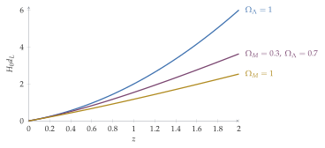
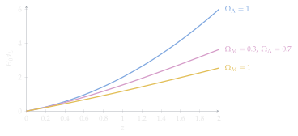

## Luminosity distance in a Friedmann model

We now express the luminosity distance of [Proposition 21.7](lecture-21.qmd#r-21-7) in terms of the redshift and the energy content of the Universe. Let a source, say a distant supernova, sit at comoving coordinate $r_1$ and emit at $t_1$, and let the observer sit at $r = 0$ and receive at $t_0$. As in [Lecture 20](lecture-20.qmd),
$$\int_0^{r_1}\frac{dr}{\sqrt{1 - kr^2}} = \int_{t_1}^{t_0}\frac{dt}{R(t)}. \tag{1}$$
Change variables to
$$x = \frac{R(t)}{R_0} = \frac{1}{1 + z}, \qquad dt = \frac{R_0}{\dot R}\, dx = \frac{dx}{xH},$$
with $R_0 = R(t_0)$ and $H = \dot R/R$ given by the Friedmann equation (2) of [Lecture 21](lecture-21.qmd). With matter, radiation and a cosmological constant together,
$$H^2 = \frac{\dot R^2}{R^2} = \frac{8\pi G}{3}\bigl(\rho_M + \rho_R + \rho_\Lambda\bigr) - \frac{k}{R^2}.$$

::: {#r-22-1 .callout-note .definition-box}

#### **Definition 22.1** (Density parameters). [[1, Ch. 15]](#ref-1)

The *density parameters*, the present densities in units of the critical density $3H_0^2/8\pi G$, are
$$\Omega_M = \frac{8\pi G}{3H_0^2}\, \rho_{M,0}, \qquad \Omega_R = \frac{8\pi G}{3H_0^2}\, \rho_{R,0}, \qquad \Omega_\Lambda = \frac{8\pi G}{3H_0^2}\, \rho_\Lambda, \qquad \Omega_k = -\frac{k}{R_0^2 H_0^2}.$$
:::

Since $\rho_M \propto x^{-3}$ and $\rho_R \propto x^{-4}$ ([Lecture 21](lecture-21.qmd)), the Friedmann equation becomes
$$H^2 = H_0^2\, E(x)^2, \qquad E(x) = \bigl(\Omega_M x^{-3} + \Omega_R x^{-4} + \Omega_\Lambda + \Omega_k x^{-2}\bigr)^{1/2},$$
and evaluating it today gives $\Omega_M + \Omega_R + \Omega_\Lambda + \Omega_k = 1$.

::: {#r-22-2 .callout-important .proposition-box}

#### **Proposition 22.2** (Luminosity distance and cosmological parameters). [[1, Ch. 15]](#ref-1)

Let
$$I(z) = \int_{1/(1+z)}^1 \frac{dx}{x^2\, E(x)}.$$
Then $R_0\, r_1(z) = I(z)/H_0$ if $k = 0$, and in general
$$R_0\, r_1(z) = \frac{1}{H_0\, \Omega_k^{1/2}}\sinh\bigl(\Omega_k^{1/2}\, I(z)\bigr), \qquad d_L(z) = (1 + z)\, R_0\, r_1(z),$$
where for $k = +1$, $\Omega_k < 0$ and the $\sinh$ becomes a $\sin$.

::: {.callout-note .proof-box collapse="true"}

#### Proof

The right-hand side of (1) is
$$\int_{t_1}^{t_0}\frac{dt}{R} = \int_{1/(1+z)}^1 \frac{dx}{R_0\, x\cdot x H_0 E(x)} = \frac{I(z)}{R_0 H_0},$$
and the left-hand side is $r_1$, $\sin^{-1} r_1$ or $\sinh^{-1} r_1$ for $k = 0, +1, -1$. For $k = -1$, $\Omega_k^{1/2} = 1/(R_0H_0)$, so $r_1 = \sinh(\Omega_k^{1/2} I)$ and $R_0 r_1 = \sinh(\Omega_k^{1/2} I)/(H_0\Omega_k^{1/2})$; the case $k = +1$ is the same with $\Omega_k^{1/2}$ imaginary. The last formula is [Proposition 21.7](lecture-21.qmd#r-21-7). $\square$
:::
:::

Measuring $d_L$ and $z$ for many supernovae thus constrains the density parameters ([@fig-l22-dl]). The result is that the Universe is close to spatially flat, with $\Omega_M \approx 0.3$ and $\Omega_\Lambda \approx 0.7$, while $\Omega_R$ and $\Omega_k$ are negligible today. About $70\%$ of the energy density of the Universe is dark energy.

::: {#fig-l22-dl}
```{=html}
<div class="themed-figure" style="max-width: 520px; margin: 0 auto;"></div>
```

The luminosity distance $H_0 d_L$ against redshift for flat universes with $\Omega_M = 1$, with $(\Omega_M, \Omega_\Lambda) = (0.3, 0.7)$, and with $\Omega_\Lambda = 1$. At a given redshift, sources are further away, and so fainter, in an accelerating universe; this is what the supernova observations showed.
:::

## The principle of least action

::: {#r-22-3 .callout-note .definition-box}

#### **Definition 22.3** (Principle of least action). [[1, Ch. 12]](#ref-1)

The *principle of least action* states that the action
$$I = \int d^4x\, \sqrt g\, \mathcal L(\phi_1, \phi_2, \dots)$$
of a physical system is stationary under all infinitesimal variations $\phi_i \mapsto \phi_i + \delta\phi_i$ of the dynamical variables that vanish on the boundary if and only if the $\phi_i$ obey the equations of motion.
:::

The factor $\sqrt g$ makes the action a scalar ([Example 7.2](lecture-07.qmd)). For the variational calculus itself, see my notes on [Noether's theorem](../noethers-wonderful-theorem/lecture-03.html).

::: {.callout-caution .example-box}

#### **Example 22.4** (Particles and the electromagnetic field).

The action of a system of charged particles in an electromagnetic field is
$$\begin{aligned}
I_M = &-\sum_n m_n \int dp\, \Bigl[-g_{\mu\nu}(x_n(p))\, \frac{dx_n^\mu}{dp}\frac{dx_n^\nu}{dp}\Bigr]^{1/2} - \frac14\int d^4x\, \sqrt g\, F_{\mu\nu}F^{\mu\nu} \\
&+ \sum_n e_n \int dp\, \frac{dx_n^\mu}{dp}\, A_\mu(x_n(p)).
\end{aligned} \tag{2}$$
The dynamical variables are the trajectories $x_n^\mu(p)$ and the potential $A_\mu$. Varying the trajectories gives the geodesic equation with the Lorentz force, and varying $A_\mu$ gives Maxwell's equations ([Lecture 8](lecture-08.qmd)). For free particles, the first term alone gives the geodesic equation.
:::

## The energy-momentum tensor from the action

In $I_M$ the metric is not a dynamical variable but an external field. Varying it, $g_{\mu\nu} \mapsto g_{\mu\nu} + \delta g_{\mu\nu}$ with $\delta g_{\mu\nu} \to 0$ at infinity, therefore does not leave $I_M$ stationary. The change must be an integral, linear in $\delta g_{\mu\nu}$, and we write it as follows.

::: {#r-22-5 .callout-note .definition-box}

#### **Definition 22.5** (Energy-momentum tensor from the action). [[1, Ch. 12]](#ref-1)

The energy-momentum tensor of matter is defined by
$$\delta I_M = \frac12\int d^4x\, \sqrt g\, T^{\mu\nu}(x)\, \delta g_{\mu\nu}(x). \tag{3}$$
:::

::: {#r-22-6 .callout-important .proposition-box}

#### **Proposition 22.6** (Properties of $T^{\mu\nu}$). [[1, Ch. 12]](#ref-1)

If $I_M$ is a scalar and the matter fields obey their equations of motion, then $T^{\mu\nu}$ defined by (3) is a symmetric tensor and is covariantly conserved, $T^{\mu\nu}{}_{;\nu} = 0$.

::: {.callout-note .proof-box collapse="true"}

#### Proof

*Symmetric tensor.* Since $\delta g_{\mu\nu}$ is symmetric, only the symmetric part of $T^{\mu\nu}$ contributes, and we may take $T^{\mu\nu}$ symmetric. Since $\delta I_M$ is a scalar, $d^4x\sqrt g$ is invariant and $\delta g_{\mu\nu}$ is a tensor, the integrand $T^{\mu\nu}\delta g_{\mu\nu}$ must be a scalar for every $\delta g_{\mu\nu}$, so $T^{\mu\nu}$ is a tensor.

*Conservation.* An infinitesimal coordinate transformation $x^\mu \mapsto x^\mu + \epsilon^\mu(x)$ changes the metric by
$$\delta g_{\mu\nu} = -\epsilon_{\mu;\nu} - \epsilon_{\nu;\mu},$$
the covariant form of (3) in [Lecture 16](lecture-16.qmd), and changes the matter fields too. Since $I_M$ is a scalar, the total change vanishes; and since the matter fields obey their equations of motion, their variation does not contribute. Hence, integrating by parts with [Proposition 7.6](lecture-07.qmd#r-7-6),
$$0 = \delta I_M = -\int d^4x\, \sqrt g\, T^{\mu\nu}\epsilon_{\mu;\nu} = \int d^4x\, \sqrt g\, T^{\mu\nu}{}_{;\nu}\, \epsilon_\mu.$$
As $\epsilon_\mu$ is arbitrary, $T^{\mu\nu}{}_{;\nu} = 0$. $\square$
:::
:::

There is no contradiction with $\delta I_M \neq 0$ for general $\delta g_{\mu\nu}$: a change of coordinates leaves a scalar invariant, while a genuine change of the metric need not. Applied to (2), Definition 22.5 reproduces the energy-momentum tensor of particles and electromagnetic fields.

## The Einstein equations from an action

To make the metric dynamical we add an action for it.

::: {#r-22-7 .callout-note .definition-box}

#### **Definition 22.7** (Einstein–Hilbert action). [[1, Ch. 12]](#ref-1)

The *Einstein–Hilbert action* is
$$I_G = -\frac{1}{16\pi G}\int d^4x\, \sqrt g\, R,$$
and the total action of matter and gravity is $I = I_M + I_G$.
:::

::: {#r-22-8 .callout-important .theorem-box}

#### **Theorem 22.8** (Einstein equations from the action). [[1, Ch. 12]](#ref-1)

$I$ is stationary under all variations of the metric if and only if the Einstein equations hold.

::: {.callout-note .proof-box collapse="true"}

#### Proof

Write $\sqrt g\, R = \sqrt g\, g^{\mu\nu} R_{\mu\nu}$. Then
$$\delta\bigl(\sqrt g\, R\bigr) = \delta\sqrt g\; R + \sqrt g\, R_{\mu\nu}\, \delta g^{\mu\nu} + \sqrt g\, g^{\mu\nu}\, \delta R_{\mu\nu}.$$
The last term is a total derivative: in locally inertial coordinates at a point, $g^{\mu\nu}\delta R_{\mu\nu} = \partial_\lambda(g^{\mu\nu}\delta\Gamma^\lambda_{\mu\nu} - g^{\mu\lambda}\delta\Gamma^\nu_{\mu\nu})$, and $\delta\Gamma$ is a tensor. It integrates to zero since $\delta g_{\mu\nu}$ vanishes at infinity. By Jacobi's formula ([Proposition 7.6](lecture-07.qmd#r-7-6)), $\delta\sqrt g = \frac12\sqrt g\, g^{\mu\nu}\delta g_{\mu\nu}$, and $\delta g^{\mu\nu} = -g^{\mu\rho}g^{\nu\sigma}\delta g_{\rho\sigma}$. Hence
$$\delta I_G = \frac{1}{16\pi G}\int d^4x\, \sqrt g\, \Bigl(R^{\mu\nu} - \tfrac12\, g^{\mu\nu}R\Bigr)\delta g_{\mu\nu},$$
and with (3),
$$\delta I = \frac{1}{16\pi G}\int d^4x\, \sqrt g\, \Bigl[R^{\mu\nu} - \tfrac12\, g^{\mu\nu}R + 8\pi G\, T^{\mu\nu}\Bigr]\delta g_{\mu\nu}.$$
This vanishes for all $\delta g_{\mu\nu}$ if and only if $R^{\mu\nu} - \frac12 g^{\mu\nu}R = -8\pi G\, T^{\mu\nu}$, which is (5) of [Lecture 11](lecture-11.qmd). $\square$
:::
:::

## Beyond general relativity

Going beyond general relativity is largely about generalising the Einstein–Hilbert action, as in the *scalar–tensor theories* of gravity.

## References {.unnumbered}

1. []{#ref-1}S. Weinberg, *Gravitation and Cosmology: Principles and Applications of the General Theory of Relativity*, Wiley, New York (1972).
