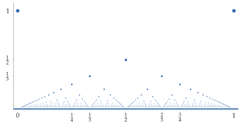
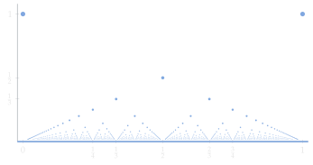

# Preface {.unnumbered}

```{=html}
<figure class="front-figure"><div class="themed-figure">


</div></figure>
```

::: {.front-caption}
Thomae's function: $f(p/q) = 1/q$ for a fraction in lowest terms, and $f(x) = 0$ for irrational $x$. It is continuous exactly at the irrationals, yet Riemann integrable with $\int_0^1 f = 0$.
:::

These are my own notes from the course **TMV101 / MMA110 Integration Theory**, taught by Jeffrey Steif at Gothenburg University in autumn 2026, and they are heavily based on his lecture notes. They cover measure theory, the Lebesgue integral, convergence theorems, and their applications.

## Course outline

The notes are organized into three parts:

**Part I — Measure Theory** (Lectures 1–4)
: σ-algebras and the Borel algebra · Carathéodory's extension theorem · Uniqueness of Lebesgue measure · Premeasures and distribution functions · The Cantor set

**Part II — Integration** (Lectures 5–9)
: Measurable functions and simple function approximation · The Lebesgue integral · Monotone and Dominated Convergence Theorems · Fatou's Lemma · Product measures and Fubini–Tonelli · Laws of Large Numbers

**Part III — Signed Measures and Differentiation** (Lectures 10–15)
: Signed measures and Radon–Nikodym · Hardy–Littlewood maximal function · Lebesgue differentiation theorem · Functions of bounded variation · The Fundamental Theorem of Calculus for the Lebesgue integral

## Notation

| Symbol | Meaning |
|--------|---------|
| $(X, \mathcal{M}, \mu)$ | Measure space |
| $\mathcal{B}(\mathbb{R})$ | Borel σ-algebra on $\mathbb{R}$ |
| $m$ | Lebesgue measure |
| $L^+(X, \mathcal M, \mu)$, or $L^+$ | Nonnegative measurable functions $f: X \to [0,\infty]$ |
| $L^1(X, \mathcal M, \mu)$, or $L^1$ | Integrable functions: measurable $f$ with $\int \lvert f\rvert \, d\mu < \infty$ |
| $L^1_{\mathrm{loc}}(\mathbb R^n)$ | Locally integrable functions on $\mathbb R^n$ |
| $\mu \ll \nu$ | $\mu$ absolutely continuous w.r.t. $\nu$ |
| $\mu \perp \nu$ | $\mu$ and $\nu$ mutually singular |
