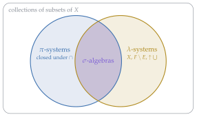
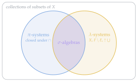

As a motivation for why we want to work with integration theory, we start with considering an example which shows that the Riemann integral is badly behaved under exchanges of limiting operations.

::: {#r-1-1 .callout-note .definition-box}

#### Definition 1.1 — An algebra or field

An algebra or field of subsets of $X$ is a family of subsets of $X$ which is closed under finite set theoretic operations, i.e.
1. $X, \phi \in \mathcal A$
2. $A_1, A_2,...,A_N$ in $\mathcal A$ implies $\bigcup A_i \in \mathcal A$ (note that the union is FINITE)
3. $A \in \mathcal A \Rightarrow A^c \in \mathcal A$
:::

A $\sigma$-field, has a similiar definition, but 2 is replaced by the stronger condition that it is closed under *countable* unions. It is thus closed under countable set theoretic operations.

We can construct a $\sigma$-algebra on any set $X$ as:

1. $\mathcal F_1 = \{X, \emptyset\}$
2. $\mathcal F_2 = \{A: \mathrm{A \ is \ countable \ or } A^c \ \text{is \ countable}\}$
3. $\mathcal F_3 = \mathcal P(X)$ (the powerset of $X$) 

::: {#r-1-2 .callout-important .proposition-box}

#### Proposition 1.2 — $\sigma$-algebra generated by a set

Given a collection $\mathcal{E}$ of subsets of $X$ (i.e., a subset of $\mathcal{P}(X)$), there is a smallest $\sigma$-algebra containing $\mathcal{E}$, denoted by $\sigma(\mathcal{E})$, called the $\sigma$-algebra generated by $\mathcal{E}$.

::: {.callout-note .proof-box collapse="true"}

#### Proof

t is easy to prove that $\sigma(\mathcal E)$ is a $\sigma$-algebra. By construction, $\mathcal E$ is contained within the generated $\sigma$-algebra as its contained in every $\mathcal F$ by construction. Every $\mathcal F$ therefore contains $\emptyset$ (as it is a $\sigma$-algebra), so they are also in the intersection. It is also straightforward to be closed under complements. The hard part is proving that its closed under countable unions. $A_i \in \mathcal F$ for every $\mathcal F$ but each $\mathcal F$ is also a $\sigma$-algebra. Thus $\bigcup_i A_i \in \mathcal F$, but if its contained in every $\mathcal F$, it must also be contained in the union of all those $\mathcal F$'s, thus $\bigcup_i A_i \in \sigma(\mathcal E)$. $\square$. It must also be the smallest $\sigma$-algebra. If $\mathcal G$ is any other $\sigma$-algebra containing $\mathcal E$ is must be one of the $\mathcal F$'s and therefore $\sigma(\mathcal E)\subseteq \mathcal G$. As a simple example, consider the sets $A,B,C$ and their intersection, then the intersection is always contained in each individual piece. $\square$
:::
:::

An example of this is the following: Take $X = \{1,2,3\}$ and $\mathcal E = \{\{1\}\}$. We need to find all $\sigma$-algebras on $X$ containing $\mathcal E$. Remember that the number of possible $\sigma$-algebras on a set $X$ is given by the Bell number (in this case 5). We know only two contain $\{1\}$, i.e. $\mathcal F_1 = \{\emptyset, \{1\}, \{2,3\}, X\}$ and $\mathcal F_2 = \mathcal P(X)$. Intersecting them all, we have $\sigma(\mathcal E) = \mathcal F_1 \cup \mathcal F_2 = \mathcal F_1$. 

::: {#r-1-3 .callout-note .definition-box}

#### Definition 1.3 — Open set

An open set in $\mathbb{R}$: $O$ is open if for all $x \in O$, there exists $\epsilon > 0$ so that $(x - \epsilon, x + \epsilon) \subseteq O$.
:::

::: {#r-1-4 .callout-note .definition-box}

#### Definition 1.4 — Borel algebra

The $\sigma$-algebra generated by the open subsets of $\mathbb{R}$ is called the **Borel $\sigma$-algebra** of $\mathbb{R}$ and is denoted by $\mathcal{B}$. The sets in $\mathcal{B}$ are called **Borel sets**.
:::

Most sets (and very likely all sets) that you have seen are Borel sets. There are other notions of sets "being closed under certain operations" which turn out to be useful. Here are two such.

::: {#r-1-5 .callout-note .definition-box}

#### Definition 1.5 — A $\pi$-system

Let $X$ be a nonempty set. A nonempty collection $\mathcal{I}$ of subsets of $X$ is called a **$\pi$-system** if it is closed under finite intersections; i.e., $A, B \in \mathcal{I}$ implies $A \cap B \in \mathcal{I}$.
:::

::: {.column-margin}
Note that both fields and $\sigma$-fields are examples of $\pi$-systems. A $\pi$-system is a weaker condition.
:::

::: {#r-1-6 .callout-note .definition-box}

#### Definition 1.6 — A $\mathcal D$ ($\lambda$)-system

Let $X$ be a nonempty set. A nonempty collection $\mathcal{D}$ of subsets of $X$ is called a $\mathcal{D}$-system if

**(a)** $X \in \mathcal{D}$

**(b)** $E, F \in \mathcal{D}$ and $E \subseteq F$ imply $F \setminus E\, (= F \cap E^c) \in \mathcal{D}$

**(c)** $E_1 \subseteq E_2 \subseteq E_3 \subseteq \cdots$ and $E_i \in \mathcal{D}$ for all $i$ imply $\bigcup_i E_i \in \mathcal{D}$.

(Note that a $\mathcal{D}$-system is closed under complementation. The way to see this is that $X \in \mathcal D$, so taking $F = X$ and $E  \subseteq X$ (which is also contained in $\mathcal D$) we have $X \setminus E = E^c$ by definition.
:::

::: {.column-margin}
Note that [Definition 1.6](lecture-01.qmd#r-1-6) above is a weaker structure than a $\sigma$-algebra (which is closed under ALL countable unions) whereas $\mathcal D$-systems are only closed under increasing countable unions.
:::

::: {#r-1-7 .callout-important .theorem-box}

#### Theorem 1.7 — $\sigma$-algebra iff $\pi$ and $\lambda$-system

If $\mathcal{M}$ is a collection of subsets of a set $X$, then $\mathcal{M}$ is a $\sigma$-algebra if and only if $\mathcal{M}$ is a $\pi$-system and a $\mathcal{D}$-system
:::

::: {#fig-l01-pi-lambda}
```{=html}
<div class="themed-figure"></div>
```

A $\sigma$-algebra is exactly a collection that is both a $\pi$-system and a $\lambda$-system.
:::

Given a collection $\mathcal{E}$ of subsets of $X$, we have previously defined $\sigma(\mathcal{E})$ as the smallest $\sigma$-algebra containing $\mathcal{E}$. We do something similar here.

::: {#r-1-8 .callout-note .definition-box}

#### Definition 1.8 — Generated $\pi$ and $\lambda$ system

We let $\pi(\mathcal{E})$ ($\mathcal{D}(\mathcal{E})$) be the smallest $\pi$-system ($\mathcal{D}$-system) containing $\mathcal{E}$.
:::

The next theorem is a very important tool, called **Dynkin's $\pi$-$\lambda$ Theorem** (a $\mathcal{D}$-system is sometimes called a $\lambda$-system). 

::: {#r-1-9 .callout-important .theorem-box}

#### Theorem 1.9 — Dynkin's $\pi$-$\lambda$ Theorem

If $\mathcal{I}$ is a $\pi$-system, then
$$\mathcal{D}(\mathcal{I}) = \sigma(\mathcal{I})$$
In other words, the smallest Dynkin-system generated by the $\pi$-system is the same as the $\sigma$-algebra generated by the $\pi$-system.
:::
