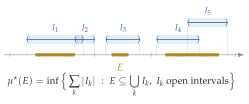
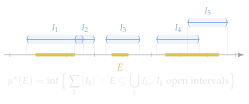

::: {#r-2-1 .callout-note .definition-box}
#### Definition 2.1 — A measure

If $(X, \mathcal{M})$ is a measurable space, a **measure** on $(X, \mathcal{M})$ is a mapping $m$ from $\mathcal{M}$ to $[0, \infty]$ satisfying the following:
1. $m(\emptyset) = 0$
2. If $A_1, A_2, \ldots$ are (pairwise) disjoint elements of $\mathcal{M}$, then
$$m\left(\bigcup_i A_i\right) = \sum_i m(A_i)$$
:::

**Remarks:**
1. The crucial second property is called **countable additivity** and implies finite additivity using 1. (Check this.)
2. For $A \in \mathcal{M}$, $m(A)$ is thought of as either the **(a)** measure, **(b)** size, **(c)** length or **(d)** probability of $A$.

A measure space is just a measurable space with a measure on it. 

::: {#r-2-2 .callout-note .definition-box}
#### Definition 2.2 — A complete measure

A complete measure is such that if $F\in \mathcal M$ (our $\sigma$-algebra) with $m(F) = 0$ and if $E \subseteq F$ then $m(E) = 0$.
:::

This definition may sound silly at first, because by monotonicity we know that $m(E) = 0$ if it is a subset. But we have to remember that the measure can only be applied to elements of the $\sigma$-algebra. A complete measure thus tells us that subsets of sets of measure zero, **are in the $\sigma$-algebra** (thus they are measurable).

::: {.column-margin}
Note that we never assumed $A$ was an element of the $\sigma$-algebra.  See [a good explanation](https://www.youtube.com/watch?v=5bZMCLnI_p4). A complete measure is a measure space where every subset of every null set is measurable. A null set is an element of the sigma-algebra whose measure is zero.
:::

::: {#r-2-3 .callout-note .definition-box}
#### Definition 2.3 — Almost Everywhere / Almost Surely

Given a measure space $(X, \mathcal{M}, m)$, a property (formally a subset of $X$ for which a statement about $x$ is either true or false, i.e. $\{x \in X : P(x)\}$, is said to occur **almost everywhere** (abbreviated **a.e.**), or **almost surely** (abbreviated **a.s.**) in probability theory, if the set of $x$'s where the property fails is contained inside a set of measure zero.
:::

::: {#r-2-4 .callout-caution .example-box}
#### Example 2.4

Take $X$ to be the closed interval from 0 to 1 and $\mathcal M$ the Borel $\sigma$-algebra on that set with Lebesgue measure. It turns out that the property that $x$ is irrational (i.e. the property that it fails corresponds to $x$ being a rational which has measure zero) holds almost everywhere. 
:::

::: {#r-2-5 .callout-note .definition-box}
#### Definition 2.5 — Finite measure space

A measure space $(X, \mathcal M, \mu)$ is called finite if $\mu(X) < \infty$ and a probability space if $\mu(X) = 1$.
:::

::: {#r-2-6 .callout-note .definition-box}
#### Definition 2.6 — $\sigma$-finite measure space

A measure space is called $\sigma$-finite if there exists subsets $A_1,A_2,...$ so that $X = \bigcup_i A_i$ with $\mu(A_i) < \infty \forall i$.
:::

$\sigma$-finite is a weaker condition, it only demands that the subsets which make up $X$ have finite measure. Finite is a stronger condition, which demands that the full set $X$ has finite measure. 

::: {#r-2-7 .callout-note .definition-box}
#### Definition 2.7 — Atoms, Atomic and Continuous Measure Spaces

Assume $(X, \mathcal{M}, \mu)$ is a measure space with all single points being measurable. An **atom** is a point $x$ with $\mu(\{x\}) > 0$.

Letting $A$ be the set of atoms:
- $(X, \mathcal{M}, \mu)$ is called **atomic** if $A \in \mathcal{M}$ and $\mu(A^c) = 0$
- $(X, \mathcal{M}, \mu)$ is called **continuous** if there is no atom, i.e. $\mu(\{x\}) = 0$ for all $x \in X$
:::

The Lebesgue measure on the Borel algebra is a continuous measure, so there are no atoms. 

For the counting measure on $\mathbb R$, it is clear that $A = \mathbb R$ where $\mathbb R^c=\emptyset$. The measure space with the counting measure is thus atomic. 

::: {#r-2-8 .callout-important .theorem-box}
#### Theorem 2.8 — Lebesgue Measure

There exists a translation invariant measure $m$ on $(\mathbb{R}, \mathcal{B})$ such that:
$$m([a,b]) = b - a \quad \text{for all } a < b$$

$m$ is the **Lebesgue measure** restricted to $\mathcal{B}$.
:::

Our length metric is not defined for all subsets, but only those reasonable ones (the Borel sets).

### Step 1

::: {#r-2-9 .callout-note .definition-box}
#### Definition 2.9 — Outer Measure

An **outer measure** on a set $X$ is a function $\mu^\star: \mathcal{P}(X) \to [0, \infty]$ satisfying:

1. $\mu^\star(\emptyset) = 0$

2. $A \subseteq B \implies \mu^\star(A) \leq \mu^\star(B)$ **(monotonicity)**

3. $\mu^\star\!\left(\bigcup_{n=1}^\infty A_n\right) \leq \sum_{n=1}^\infty \mu^\star(A_n)$ **(countable subadditivity)**
:::

::: {#fig-l02-outer-measure}
```{=html}
<div class="themed-figure"></div>
```

The outer measure of $E$ is the smallest total length of a countable cover by intervals.
:::

This is to be compared with the [Definition 2.1](lecture-02.qmd#r-2-1) earlier, where the measure only has to satisfy that the measure on the empty set is zero, and being countably additive. Here, we see that we only demand countable subadditivity and monotonicity. 

### Step 2

::: {#r-2-10 .callout-note .definition-box}
#### Definition 2.10 — Lebesgue Outer Measure

Let $X = \mathbb{R}$ and $A \subseteq \mathbb{R}$. The **Lebesgue outer measure** is:

$$\mu^\star(A) := \inf\left\{ \sum_{i=1}^\infty |I_i| : I_1, I_2, \ldots \text{ are open intervals with } A \subseteq \bigcup_i I_i \right\}$$

where $|I|$ denotes the length of an interval $I$.
:::

In other words if we have a set $A$, we consier all possible unions of open intervals for which $A$ is a subset of that union, and sum up the length contributions, and finally take the infimum (the largest lower bound), i.e. cover A by intervals as efficiently as possible. 

::: {#r-2-11 .callout-important .theorem-box}
#### Theorem 2.11 — The Lebesgue outer measure $\mu^\star$ is an outer measure on $\mathbb R$

(i) Trivially satisfied. For any $\epsilon > 0$, the empty set can be covered by a single interval $(0,\epsilon)$ with length $\epsilon$, thus $\mu^\star(\emptyset) \leq \epsilon$ and thus $\mu^\star(\emptyset) = 0$.

(ii) Since every valid cover of B is also a valid cover of A, the set of valid covers of B must be a subset of the valid covers of A ($\mathcal C_B \subseteq \mathcal C_A$). The infimum of a larger set is smaller than the infimum of the smaller set, and this the result follows, i.e.  
(iii) Case 1: In the case where $\mu^\star(A_n)=\infty$ for some $n$, the inequality holds trivially. Case 2: $\mu^\star(A_n)<\infty \forall n$. 

As additional comments: the first inequality is guaranteed by the definition of the infimum. It tells us that we can cover $A_j$ arbitrarily close.
In the second line, we first  use that $\bigcup A_j \subseteq \bigcup_{ij} I^j_i$ and $\mu^\star$ is the infimum over all covers, we get the first inequality. Ther est follows trivially.
:::

### Step 3

OK! Now we both defined the outer measure, the Lebesgue outer measure and proved that it is indeed an outer measure. Now we need to show that the Lebesgue outer measure of an interval is given the length of the interval.

::: {#r-2-12 .callout-important .theorem-box}
#### Theorem 2.12 — The Lebesgue outer measure returns length for intervals

For each finite interval $I$ we have $\mu^\star(I) = |I|$.

::: {.callout-note .proof-box collapse="true"}
#### Proof

**It suffices to show this for closed intervals**. This statement follows by monotonicity and the fact that any other interval type can be squeezed between closed intervals. Take for example $(a,b)$, then for $\epsilon >0$ we have $$[a+\epsilon, b-\epsilon]\subseteq(a,b)\subseteq[a,b]$$and using monotonicity of the outer measure and taking the limit as $\epsilon\rightarrow 0$ gives us the sought result. 
To prove $\mu^\star(I) = |I|$, we show that $\leq$ and $\geq$ inequalities hold. $\leq$: Take $\epsilon > 0$, then $[a,b]\subseteq(a-\epsilon, b+\epsilon)$ and hence $\mu^\star([a,b]) \leq b-a+2\epsilon \Rightarrow \mu^\star([a,b]) \leq (b-a)$.
Now $\geq:$ We want to show $$\mu^\star([a,b]) = \inf \{ \sum_i |I_i|: [a,b]\subseteq \bigcup_i I_i\} \geq b-a$$ Assume $[a,b] \subseteq \bigcup_{i=1}^N I_i$ by compactness (the closed interval is a subset of R that is closed and bounded). Then we need to show that $$b-a \leq \sum_{i=1}^N |I_i|$$To show this, we build a chain of intervals in the following way

Then clearly 

And since $b_k > b$ and $a_1 < a$ and the terms in last term are positive this gives desired inequality. $\square$
:::
:::

### Step 4

Now we defined the outer measure, introduced the Lebesgue outer measure (and proved that it indeed is an outer measure) and that the measure evaluated on finite intervals gives the length of the interval. Now enters step 4, where we apply Caratheodory's theorem.

::: {#r-2-13 .callout-note .definition-box}
#### Definition 2.13 — $\mu^\star$-Measurable Sets

If $\mu^\star$ is an outer measure on $X$, we call a subset $A \subseteq X$ **$\mu^\star$-measurable** if for all $E \subseteq X$:

$$\mu^\star(E) = \mu^\star(E \cap A) + \mu^\star(E \cap A^c)$$
:::

The intuition for this is that the total outer measure of $E$ equals a piece inside $A$ and a piece outside of $A$. 

::: {#r-2-14 .callout-important .theorem-box}
#### Theorem 2.14 — Carathéodory's Theorem

If $\mu^\star$ is an outer measure on $X$, then the collection $\mathcal{M}$ of $\mu^\star$-measurable sets is a $\sigma$-algebra and $\mu^\star$ restricted to $\mathcal{M}$ is a measure, which is also complete.
:::

### Step 5

We will return to the proof in a moment. For step 5, we want to show that the Lebesgue outer measure on R, the $\mathcal M$ constructed in step 4 using Carathéodory's theorem contains $\mathcal B$. 

Given $\mathcal M$ is a $\sigma$-algebra and $\mathcal B$ is the smallest $\sigma$-algebra containing all open intervals, it suffices to show that if the open intervals are a subset of $\mathcal M$ then $\mathcal B \subseteq \mathcal M$. Now $\mathcal M$ is the collection of all $\mu^\star$ measurable sets, so we only need to verify that the open intervals $(a,b$) are $\mu^\star$-measurable. It suffices to show this for the rays $(-\infty, a)$ and $(b,\infty$) as $\mathcal M$ is closed under complements and intersections, $(a,b) = (-\infty, b) \cap (-\infty, a)^c$. 

Let $E \subseteq R$ and assume $a \notin E$, we have $E = (E\cap (-\infty, a)) \cup (E \cap(a, \infty))$, then the $\leq$ follows by subadditivity. We only need to show $$\mu^\star(E) \geq \mu^\star(E \cap (-\infty, a)) + \mu^\star(E \cap (a, \infty))$$Note that 
In other words, we are considering the two regions intersected by the ray $(-\infty, a)$, and covering them with separate open intervals. The final inequality comes form the fact that the outer measure as an infimum over all coverings. Taking the infimum of the LHS, we obtain exactly what we wanted to show. Therefore indeed we have shown that any open intervals is a subset of $\mathcal M$. 

To conclude our construction of the Lebesgue measure, we defined an outer measure, by step 4 (Carathadory) we obtain a measure space $(R, \mathcal M, \mu^\star\vert_{\mathcal M})$ where $\mathcal M$ is the set of all $\mu^\star$-measurable sets. By step 3, we have that the outer measure of intervals are given by their length, and by step 5 we have the Borel set being a subset of $\mathcal M$, thus restricting $\mu^\star$ from $\mathcal M$ to $\mathcal B$ gives us the measure space $(R, \mathcal B, \mu^\star \vert_{\mathcal B})$. By definition from the outer measure, it is also translation invariant.
