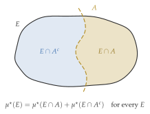

To prove Caratheodory's theorem, we first need to show that $\mathcal M$ is a $\sigma$-algebra. To do so, it suffices to first show that $\mathcal M$ is an algebra, and then show that it is closed under countable unions (remind yourself of the definitions from [Lecture 1](lecture-01.qmd)).

::: {#fig-l03-caratheodory-split}
```{=html}
<div class="themed-figure"></div>
```

The Carathéodory test: $A$ must split every test set $E$ additively into $E\cap A$ and $E\cap A^c$.
:::

### Step 1: $\mathcal M$ is an algebra
**(i)** $\emptyset \in \mathcal{M}$ is immediate.

**(ii)** $\mathcal{M}$ is closed under complementation since the definition of $\mu^*$-measurability is symmetric in $A$ and $A^c$.

**(iii)** We need to show $A, B \in \mathcal{M}$ implies $A \cup B \in \mathcal{M}$ (the actual definition for an algebra is that it is closed under finite unions, but it suffices to show it holds for union of two sets by induction) Fix $E \subseteq X$. Note that:

$$A \cup B = (A \cap B) \cup (A^c \cap B) \cup (A \cap B^c)$$

This is a disjoint union of three regions — sets in both $A$ and $B$, sets only in $B$, and sets only in $A$ — which together cover everything in $A \cup B$. Using subadditivity:

$$\mu^*(E \cap (A \cup B)) + \mu^*(E \cap (A \cup B)^c) \leq \mu^*(E \cap (A \cap B)) + \mu^*(E \cap (A^c \cap B)) + \mu^*(E \cap (A \cap B^c)) + \mu^*(E \cap (A^c \cap B^c))$$

Applying measurability of $A$ to $E \cap B$ for the first two terms:

$$\mu^*(E \cap (A \cap B)) + \mu^*(E \cap (A^c \cap B)) = \mu^*(E \cap B)$$

and to $E \cap B^c$ for the last two terms:

$$\mu^*(E \cap (A \cap B^c)) + \mu^*(E \cap (A^c \cap B^c)) = \mu^*(E \cap B^c)$$

Hence the right hand side equals $\mu^*(E \cap B) + \mu^*(E \cap B^c) = \mu^*(E)$, where the last equality follows from measurability of $B$. This gives:

$$\mu^*(E \cap (A \cup B)) + \mu^*(E \cap (A \cup B)^c) \leq \mu^*(E)$$

The reverse inequality $\mu^*(E) \leq \mu^*(E \cap (A \cup B)) + \mu^*(E \cap (A \cup B)^c)$ follows immediately from subadditivity, since $(E \cap (A \cup B)) \cup (E \cap (A\cup B)^c) = E$. Together these give equality, so $A \cup B \in \mathcal{M}$. $\square$

### Step 2: $\mu^\star$ is finitely additive on $\mathcal M$
If $A, B \in \mathcal{M}$ are disjoint, then applying the Carathéodory criterion for $A$ with test set $E = A \cup B$:

$$\mu^*(A \cup B) = \mu^*((A \cup B) \cap A) + \mu^*((A \cup B) \cap A^c) = \mu^*(A) + \mu^*(B)$$

where $(A \cup B) \cap A = A$ and $(A \cup B) \cap A^c = B$ by disjointness. Finite additivity for $n$ disjoint sets $A_1, \ldots, A_n \in \mathcal{M}$ follows by induction.

### Step 3: $\mathcal{M}$ is a $\sigma$-algebra
The only additional criterion imposed by the $\sigma$-algebra over the algebra is closure under countable unions.

Since $\mathcal{M}$ is already an algebra, it suffices to show that if $A_1, A_2, \ldots \in \mathcal{M}$ are disjoint, then $\bigcup_i A_i \in \mathcal{M}$. This is without loss of generality since any countable union can be made disjoint via:

$$\bigcup_i A_i = \bigcup_i \left(A_i \setminus \bigcup_{j < i} A_j\right)$$

where each piece $A_i \setminus \bigcup_{j<i} A_j \in \mathcal{M}$ since $\mathcal{M}$ is an algebra.

Now define $B_n := \bigcup_{i=1}^n A_i$ and $B := \bigcup_i A_i$. Applying measurability of $A_n$ with test set $E \cap B_n$:

$$\mu^*(E \cap B_n) = \mu^*(E \cap B_n \cap A_n) + \mu^*(E \cap B_n \cap A_n^c) = \mu^*(E \cap A_n) + \mu^*(E \cap B_{n-1})$$

where we used $B_n \cap A_n = A_n$ and $B_n \cap A_n^c = B_{n-1}$ by disjointness. Repeating inductively:

$$\mu^*(E \cap B_{n-1}) = \mu^*(E \cap A_{n-1}) + \mu^*(E \cap B_{n-2})$$
$$\vdots$$
$$\mu^*(E \cap B_1) = \mu^*(E \cap A_1)$$

Chaining everything together:

$$\mu^*(E \cap B_n) = \sum_{i=1}^n \mu^*(E \cap A_i) \tag{2}$$
which is what we would expect (but note that this doesnt follow immediately from the definition of an outer measure, since its only countably subadditive)

where we inserted (2) and then used countable subadditivity of the outer measure to get the inequality in the last line since $B^c \subseteq B_n^c$. 

Using measurability of $B_n$ together with (2) and subadditivity and definition of B in last step. 

### Step 4: Show that $\mu^\star$ is countably additive on $\mathcal M$ and thus a measure space
Remember that a measure space is the triple $(X, \mathcal M, \mu^\star)$ where $\mu^\star(\emptyset) = 0$ and $\mu^\star(\bigcup_i A_i) = \sum_i \mu^\star(A_i)$. $\mu^\star(\emptyset) = 0$ is satisfied definitionally. From the earlier proof, we had 

Now we can take $E = B$ as defined earlier, and that gives us $\mu^\star(B) = \sum_{i=1}^\infty \mu^\star(A_i)$. 

### Step 5: Show that the measure space is complete
A measure space is considered complete if subsets of nullsets are also nullsets, see [Lecture 2](lecture-02.qmd).

What we want to show is that if we have $B \in \mathcal M$ where $\mu^\star(B) = 0$ and $A \subseteq B$, then $A \in \mathcal M$, that is, $A$ satisfies
$$\mu^\star(E) = \mu^\star(E \cap A) + \mu^\star(E \cap A^c)$$
for any $E \subseteq X$.

::: {.callout-note .proof-box collapse="true"}

#### Proof

The $\leq$ direction follows immediately from countable subadditivity of $\mu^\star$, since $(E\cap A)\cup(E\cap A^c) = E$.

For $\geq$: since $A\subseteq B$ and $\mu^\star(B)=0$, monotonicity gives
$$\mu^\star(E\cap A) \leq \mu^\star(A) \leq \mu^\star(B) = 0$$
so $\mu^\star(E\cap A) = 0$. Also $E\cap A^c \subseteq E$, so by monotonicity $\mu^\star(E\cap A^c)\leq\mu^\star(E)$. Therefore:
$$\mu^\star(E\cap A) + \mu^\star(E\cap A^c) = 0 + \mu^\star(E\cap A^c) \leq \mu^\star(E)$$
Combining both directions gives equality, so $A\in\mathcal{M}$, and since $\mu^\star(A)=0$ the measure is complete. $\square$
:::

## Relationship between the Borel set and $\mathcal M$. 

There are Lebesgue measurable sets that are not Borel sets. We will prove this later.

*One way to characterize the Lebesgue measure is to first define it on Borel sets, that is, all sets obtained by countably unions, complements, and intersections, from the open intervals, s.t. it assigns usual length to open intervals. The Lebesgue measure can then be obtained by completing the Borel measure by assigning zero measure to all subsets of Borel sets that already have zero measure. From this perspective, we understand that the Borel sigma algebra is a proper subsets of the Lebesgue sigma algebra (see the earlier lecture). The construction we just derived based on Caratheodory, i.e. $(\mathbb R, \mathcal M, \mu^\star \vert_{\mathcal M})$ is a complete measure space, whereas $(\mathbb R, \mathcal B, \mu^\star \vert_{\mathcal B})$ is not (both measures are identical except they are restricted to different domains). For example, the Cantor set has the same cardinality as the reals, and its powerset (collection of all subsets) has greater cardinality of the reals, which exceed the number of Borel sets. Thus, there are more subsets than $\mathcal B$ can contain, and thus fails completeness. We will also see in [Theorem 3.2](#r-3-2) that it is not possible to extend the Lebesgue measure to all $\mathcal P(\mathbb R)$ while retaining translation invariance and countable additivity; the obstruction is the [Vitali set](#nonmeasurable-sets), a set that cannot be assigned any length.*

## The uniqueness of the Lebesgue measure on $\mathcal B$.

The uniqueness is shown using Dynkin's $\pi-\lambda$ theorem.

::: {#r-3-1 .callout-important .theorem-box}

#### Theorem 3.1 — Uniqueness theorem for measure on $(X, \sigma(I))$

Let $X$ be a set and $\mathcal{I}$ be a $\pi$-system on $X$. If $\mu_1$ and $\mu_2$ are two measures on $(X, \sigma(\mathcal{I}))$ such that:

$$\mu_1(X) = \mu_2(X) < \infty$$

and

$$\mu_1(I) = \mu_2(I) \quad \forall I \in \mathcal{I}$$

then $\mu_1 = \mu_2$.

::: {.callout-note .proof-box collapse="true"}

#### Proof

Define $$D = \{A \in \sigma(I) : \mu_1(A) = \mu_2(A)\}$$in other words the collection of all subsets of the sigma-algebra generated by the $\pi$-system $I$ such that the measures agree. We want to show that $D = \sigma(I)$, in other words, that all measurable sets of the sigma algebra agree irrespective of $\mu_1$ or $\mu_2$. 

As per usual, to prove that two sets are identical, we have to show that they are contained in each other. Clearly from the way we defined $D$, we have $D \subseteq \sigma(I)$, and thus what remains is to prove the opposite containment $\sigma(\mathcal I) \subseteq D$. This requires three steps:

1. We observe that $D$ is a $\mathcal D$-system.

See [Definition 1.6](lecture-01.qmd#r-1-6) in [Lecture 1](lecture-01.qmd). By assumption we have that $X \in \mathcal D$ as $\mu_1(X) = \mu_2(X)$ by assumption. Let now $E,F \in \mathcal D$, i.e. they satisfy $\mu_1(E) = \mu_2(E)$ and $\mu_1(F) = \mu_2(F)$, and $E\subseteq F$, our question is whether $F\setminus E \in \mathcal D$. So we check

$$\mu_1(F\setminus E)  = \mu_1(F) - \mu_1(E) =\mu_2(F) - \mu_2(E) = \mu_2(F\setminus E) $$
Finally we have to check whether $E_1 \subseteq E_2 \subseteq E_3 \subseteq \cdots$ and $E_i \in \mathcal{D}$ for all $i$ imply $\bigcup_i E_i \in \mathcal{D}$. Using continuity from below we have
$$\mu_1(\bigcup_i E_i) = \lim_{n\rightarrow \infty} \mu_1(E_n) = \lim_{n\rightarrow \infty} \mu_2(E_n) = \mu_2(\bigcup_i E_i) $$
and thus $D$ is a Dynkin-system. 

2. We observe that $\mathcal I \subseteq D$ by assumption

By assumption $\mu_1 = \mu_2$ on all open intervals and thus $\mathcal I \in \mathcal D$. 

3. And finally we apply Dynkin's $\pi-\lambda$ theorem for the equality and steps 1 and 2 for the containment, we have $\sigma(I) = \mathcal D(I)\subseteq D$

Since we are given that $\mathcal I$ is a $\pi$-system, we can apply Dynkin's $\pi-\lambda$ theorem to state 
$$\mathcal{D}(\mathcal{I}) = \sigma(\mathcal{I})$$
Remember now that $\mathcal D(\mathcal I)$ is the *smallest* $\lambda$-system containing $\mathcal I$, and since we showed that D (also a $\lambda$-system) contains $\mathcal I$, we must have $\sigma(\mathcal{I}) = \mathcal D(\mathcal I) \subseteq \mathcal D$.  This completes the proof. $\square$
:::
:::

Applying this to $X = [0, 1]$ and $I$ being the set of open intervals implies that there is only one measure on $([0, 1], B[0,1])$ which agrees with "length" on intervals. Note that the set of open intervals is a $\pi$-system, as finite intersections of open intervals remain open. Thus, the Lebesgue measure is the unique measure that assigns length to intervals. 

### Nonmeasurable sets {#nonmeasurable-sets}

It is natural to ask if $\mathcal M$ (the set of all $\mu^\star$-measurable sets) contains all sets, that is, whether all sets are Lebesgue measurable. It will turn out that $\mathcal M$ can not be everything (assuming the axiom of choice)^[Early set theory let any property $P$ define a set $\{x : P(x)\}$. *Russell's paradox* shows that this is inconsistent: the set $R = \{x : x \notin x\}$ satisfies $R \in R$ if and only if $R \notin R$. This led to the *Zermelo–Fraenkel axioms* (ZF), which only allow new sets to be built from existing ones in controlled ways. The *axiom of choice* (AC) adds that from any collection of nonempty sets one can pick one element from each set simultaneously, even when there are infinitely many sets and no rule for making the choices. AC is independent of ZF: it can be neither proved nor disproved from the other axioms (Gödel 1938, Cohen 1963). ZF together with AC is called *ZFC* and is the standard foundation of mathematics. AC is still debated, since it asserts that objects exist without saying how to construct them. The nonmeasurable Vitali set below is one such object, and without AC it is consistent that every subset of $\mathbb R$ is Lebesgue measurable (Solovay 1970).], in particular, it will fail countable additivity under disjoint sets. 

::: {#r-3-2 .callout-important .theorem-box}

#### Theorem 3.2 — Non-existence of translation invariant measure on R

There does not exist a translation invariant measure on all subsets of R which gives length for intervals.

::: {.callout-note .proof-box collapse="true"}

#### Proof

Assume $\mu$ is such a measure. Then, define an equivalence relation on $[0,1]$ where we identify $x \sim y$ if $x-y \in \mathbb Q$. The equivalence class of $x$ is then given by all points shifted by some rational contained in $[0,1]$, i.e. $$[x] = \{x + q: q \in \mathbb Q\} \cap [0,1]$$ 
Since the rationals are countable, $[x]$ is countable, but the number of equivalence classes is uncountable since the reals are uncountable. Let $A$ consist of one element from each equivalence class (**this assumes the axiom of choice, meaning if you have an infinite number of sets, the axiom says you can still make a single choice from every single set at the same time**). This set is known as the *Vitali set*. We ask ourselves what $\mu(A)$ is. We will see that we will arrive at a contradiction.
Step 1: $\mu(A) > 0$.
We first claim: $$[0,1] \subseteq \bigcup_{q \in [-1,1] \cap \mathbb{Q}} (A + q) $$ To see this, take $x\in[0,1]$ and $y \in A$ with $x-y \in \mathbb Q$, then $x = y + (X-y) \in A + (x-y)$ but since $x-y \in [-1, 1] \cap Q$, we obtain (4). Assuming the measure is translation invariant however means $\mu(A+q) = \mu(A)$, therefore if $\mu(A) = 0$ and countable additivity, the measure of the RHS of $(4)$ would be 0, but this can not be since $\mu$ of the LHS is 1. Hence $\mu(A) > 1$ at least, since $[0,1]$ is a subset.
Step 2: $\mu(A) = 0$.
Clearly we have that $$\bigcup_{q \in [0,1] \cap \mathbb{Q}} (A + q) \subseteq[0,2]$$
Note that the sets in the union of the LHS are disjoint. Assume some $u \in A + q_1$ and in $A + q_2$ we would have $u = a_1 + q_1 = a_2 + q_2$ with $a_1, a_2 \in A$, then $a_1-a_2 = q_1-q_2 \in \mathbb Q$ which would imply that $a_1 \sim a_2$. But remember that the Vitali set only contains a single element from the equivalence class, and thus we arrive at a contradiction. Each term therefore has measure $\mu(A)$. We therefore have an infinite sum of $\mu(A)$, which if $\mu(A)>0$ diverges to infinity. Since the RHS has measure $2$, this is clearly a contradiction.
The two steps give us a contraction. QED. $\square$
:::
:::
