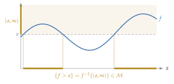
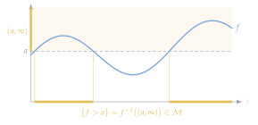

## Riemann versus Lebesgue integration

The Lebesgue integral makes a simple but essential change to the construction of the Riemann integral. Recall how the Riemann integral is built: we partition the domain $[a,b]$ into small intervals, evaluate the function at a point in each interval, and add up these values weighted by the lengths of the intervals. Then we let the intervals shrink. If these Riemann sums converge to the same limit no matter which points we pick, the function is called **Riemann integrable**, and the limit is its integral.

The key **shift in perspective** is:

> **Riemann integration cares about how a function behaves on intervals; Lebesgue integration cares about how large the sets are on which the function takes each value.**

::: {#r-5-1 .callout-important .theorem-box}

#### **Theorem 5.1** (A bounded function is RI iff).

If $f$ is a bounded function, then $f$ is RI iff the set $\{x: f\  \text{is not continous at}\  x\}$ has Lebesgue measure 0.
:::

This set is a Borel set in $[0,1]$, and since every Borel-set is Lebesgue measurable, we can assign a Lebesgue measure to that set, which is what the theorem above does. In other words, it is RI iff $f$ is continuous (Lebesgue) a.e. 

The classical example of a function which is not RI is the Dirichlet function, but it will be Lebesgue integrable. The Dirichlet function is bounded, but is discontinuous everywhere, and is thus consistent with [Theorem 5.1](lecture-05.qmd#r-5-1) above.  

Another example of a function which is Riemann integrable, but very much reminds about the Dirichlet function is Thomae's function. See this Stack Exchange discussion [[1]](#ref-1).

The idea of the Lebesgue integral is to partition the $y$-axis, and approximate the integral by $$\sum a_i m(\{x: f(x) \in [a_i, a_{i+1}]\})$$*Note that when we break up the y-axis this way, the structure of the domain is irrelevant for us, which is why we can perform the integration on any measure space.*

## Measurable functions
::: {#r-5-2 .callout-note .definition-box}

#### **Definition 5.2** (A measurable function).

If $(X,\mathcal{M})$ is a measurable space, a mapping $f:X\to\mathbb{R}$ is called measurable if for all $B\in\mathcal{B}$ (recall that $\mathcal{B}$ is the collection of Borel sets in $\mathbb{R}$), we have $$f^{-1}(B):=\{x\in X:f(x)\in B\}\in\mathcal{M}$$
:::

::: {#fig-l05-measurable-function}
```{=html}
<div class="themed-figure">a must belong to the sigma-algebra.">a must belong to the sigma-algebra."></div>
```

Measurability: every set $\{f>a\}$ must belong to the $\sigma$-algebra.
:::

The idea of a function being measurable is that every preimage of any Borel set is an element of the $\sigma$-algebra, and can thus be assigned a measure. 

::: {#r-5-3 .callout-note .definition-box}

#### **Definition 5.3** (A measurable mapping between two sets).

More generally, if $(X,\mathcal{M})$ and $(Y,\mathcal{N})$ are measurable spaces, a mapping $f:X\to Y$ is called measurable if for all $E\in\mathcal{N}$,
$$f^{-1}(E)\in\mathcal{M}.$$
:::

If the mapping is from the Lebesgue $\sigma$-algebra to the Borel $\sigma$-algebra, we simply call it Lebesgue measurable. Similarly, if the mapping is from the Borel $\sigma$-algebra to itself, it is simply called Borel measurable. 

::: {#r-5-4 .callout-important .proposition-box}

#### **Proposition 5.4** (Sum of measurable functions and product of measurable functions).

If $f,g$ are measurable, then $f+g$ and $fg$ are measurable.^[The composition of two Lebesgue measurable functions is not Lebesgue measurable necessarily (this is a consequence of the fact the Borel sigma algebra is contained (without equality) in the Lebesgue measurable $\sigma$-algebra).]

::: {.callout-note .proof-box collapse="true"}

#### Proof

A map $h$ is called measurable if $h^{-1}(B) \in \mathcal M$ $\forall B$. Now take $h=f+g$, then $(f+g)^{-1}((\alpha, \infty)) =\{x: (f+g)(x) >\alpha\} \in \mathcal M$ $\forall \alpha \in \mathbb R$. In other words, it suffices to check whether the rays $(\alpha, \infty$) are contained in $\mathcal M$- Note that the set can be written as $$\bigcup_{q\in \mathbb Q}( \{x: f(x) > q\} \cap \{x: g(x) > \alpha - q\})$$ (the containment is shown in the lecture notes). 
Each piece on the RHS is in $\mathcal M$ since $f,g$ are measurable, and thus their intersection is also in $\mathcal M$. The right side is thus a countable union of measurable sets which is thus in $\mathcal M$.
As for $fg$ we have $$fg = 1/2((f+g)^2 - f^2 - g^2)$$As it is trivial that the negated function is measurable, and we already know that the sum of two measurable functions is measurable, it suffices to show that $h=f^2$ is also measurable. Again we have that $$(f^2)^{-1}(B) = \{x: f^2(x) > \alpha\} \in \mathcal M$$ $\forall \alpha \in \mathbb R$. Note that for $\alpha \leq 0$ we have that the preimage is simply $X$. For $\alpha \geq 0$ we have $$\{x: f^2(x) > \alpha\} = \{x : f(x) > \alpha^{1/2}\} \cup  \{x : f(x) < -\alpha^{1/2}\}$$ which is a union of two measurable two sets (assuming $f$ is measurable), which is still measurable. $\square$
:::
:::

**Notation:** $\overline{\mathbb R} = \mathbb R \cup \{-\infty, +\infty\}$. 

We want limits of measurable functions to be measurable. From now on, we restrict to real-valued measurable functions.

::: {#r-5-5 .callout-important .proposition-box}

#### **Proposition 5.5** (Supremum of sequence of measurable functions is measurable).

If $(f_n)_n$ is a sequence of measurable functions, then $\sup_j f_j$ is a measurable function where $$(\sup_j f_j) (x) := \sup_j (f_j(x))$$with the same definition for $\inf_j f_j$.
The proof follows by defining $\tilde f := (\sup_j f_j)(x)$ and $\{x \in X: \tilde f(x) > \alpha\} \in \mathcal M$ $\forall \alpha \in \mathbb R$. Clearly if $\tilde f(x) > \alpha$ then there exists some $j$ (or multiple) where $f_j(x) > \alpha$, hence we have $$\{x \in X: \tilde f(x) > \alpha\} = \bigcup_j \{x \in X: f_j(x) > \alpha\}$$which is a possibly countable union of measurable sets, and thus it is a measurable function. The proof for the infimum is identical, except we replace the union with intersection over all $j$.
:::

The above example shows that 

because a supremum does not necessarily have to be attained. 

So far we have shown that the supremum of a sequence of measurable functions is measurable. Now we will take it a step further, and define the measurability of the $\limsup$ of a sequence of measurable functions. 

::: {#r-5-6 .callout-important .proposition-box}

#### **Proposition 5.6** (Measurability of $\limsup$ of Functions).

If $f_1, f_2, \ldots$ is a sequence of measurable functions, then $\limsup_j f_j$ is a measurable function, where:
$$\left(\limsup_j f_j\right)(x) := \limsup_j (f_j(x))$$

In particular, if $(f_k)$ converges to $f_\infty$ pointwise, then $f_\infty$ is measurable.

::: {.callout-note .proof-box collapse="true"}

#### Proof

We have that $\lim\sup_j f_j = \inf_k(\sup_{n\geq k} f_n)$ where $\sup_{n\geq k} f_n \equiv g_k$ are measurable functions by [Proposition 5.5](lecture-05.qmd#r-5-5). We also know that the infimum of a sequence of measurable functions is measurable by the same proposition, hence we are done. $\square$
:::
:::

We will now proceed with introducing simple functions. That we also introduced in  but in a probabilistic context. The definition is identical, but the indicator function is no longer interpreted as a Bernoulli random variable.

## Simple functions

::: {#r-5-7 .callout-note .definition-box}

#### **Definition 5.7** (Simple function).

A simple function on a measurable space is a function of the form $f(x) = \sum c_i I_{E_i}$ where $c_i \in \mathbb R$ and$E_i$ are pairwise disjonit sets in $\mathcal M$, with $I_{E_1}$ being the indicator function of $E_i$.
:::

Simple functions can approximate any measurable function pointwise.

## References {.unnumbered}

1. []{#ref-1}Mathematics Stack Exchange, question on why the Dirichlet function is not Riemann integrable while Thomae's function is. <https://math.stackexchange.com/questions/1458139>
