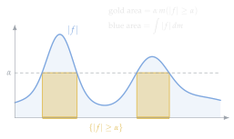

::: {#r-7-1 .callout-important .lemma-box}
#### Lemma 7.1 — Collection of points where $f_n\rightarrow f$ p.w. forms a measurable set

If $(f_n)$ and $f$ are measurable functions on $(X,\mathcal M, m)$ then $\{x: f_n(x) \rightarrow f(x)\}\in \mathcal M$.

::: {.callout-note .proof-box collapse="true"}
#### Proof

The definition of the limit is that $\forall m \exists k : \forall k \geq n ,|f_n(x) - f(x)| < 1/m$, which can be written as $$\{x: f_n(x)\rightarrow f(x)\} = \bigcap_{m=1}^\infty \bigcup_{k=1}^\infty \bigcap_{n\geq k} \{x: |f_n(x)-f(x)| < 1/m\}$$where the set to which we apply countable set operations to is measurable as difference of measurable functions is measurable, and the absolute value of a measurable function is zero. Thus the end result is in $\mathcal M$. $\square$
:::
:::

The lemma essentially says that the set of points where $f_n(x)$ converge to $f(x)$ constitutes a measurable set.

::: {#r-7-2 .callout-note .definition-box}
#### Definition 7.2 — Convergence a.e. and in measure

If the sequence $(f_n)$ and $f$ are measurable functions on $(X, \mathcal M, m)$, then we say (i) $f_n$ converges to $f$ a.e. if $$m(\{x: f_n(x) \nrightarrow f(x)\}) = 0$$ (in other words, the set of points which do not converge to $f$ have measure zero). (ii) $f_n$ converges to $f$ in *measure* if $\forall \epsilon > 0$ we have $$\lim_{n\rightarrow \infty} m(\{x: |f_n(x) - f(x)| > \epsilon\}) = 0$$
:::

These two notions in probability theory are called almost sure and convergence in probability (we are familiar from this from the course in stochatic calculus!) 

In the various convergence theorems we have encountered so far, e.g. LDC, one only demands convergence a.e. In fact, one only requires convergence in measure in the LDC.

::: {#r-7-3 .callout-important .proposition-box}
#### Proposition 7.3 — Relation between convergence in measure and a.e

Relation between convergence in measure and  convergence a.e. with examples.
1. There is an example where convergence almost everywhere (a.e.) occurs but not convergence in measure.
**Example:**
For example, if we take $f_n = 1_{[n, n+1]}$ we have that $f_n \rightarrow 0$ a.e. For example, for any $x$, we have that eventually $n > x$ such that $x\notin[n,n+1]$ and thus $f_n(x) \rightarrow 0$ a.e. but $m(\{f_n > \epsilon\})$ $\forall \epsilon > 0$. By taking $\epsilon = 1/2$, we have that $\{|f_n| > 1/2 \} = [n, n+1]$ whose measure is $1$, which does not go to zero. The reason it works is that the interval keeps moving to the right towards infinity, and so every fixed $x$ eventually gets left behind, but the interval still has measure 1.   

2. Convergence a.e. implies convergence in measure if the measure space is finite.

::: {.callout-note .proof-box collapse="true"}
#### Proof

Fix $\epsilon > 0$ and let $E_N = \{x: |f_n(x) - f(x)| \geq \epsilon, n\geq N\}$. We note that $E_1 \supseteq E_2 \supseteq E_3$ and $\bigcap_k E_k \subseteq \{x: f_n(x) \nrightarrow f(x)\}$ and by assumption $m(\bigcap_k E_k) = 0$. From continuity from above we have $m(\bigcap_k E_k) = \lim_{N\rightarrow \infty} m(E_N)$ assuming $m(E_1) < \infty$ (which followws from the fact that $m(X) < \infty$ since $E_1 \subseteq X$) and thus $m(E_N)\rightarrow 0$, which is precisely the definition of convergence in measure. 

3. Convergence in measure does not imply convergence a.e., even if the measure space is finite.
A nice construction is the typewriter sequence. See also this [discussion of the typewriter sequence](https://math.stackexchange.com/questions/1412091/the-typewriter-sequence)
$$f_n(x) = \mathbb 1_{[\frac{n-2^k}{2^k}, \frac{n-2^k + 1}{2^k}]}$$:
where $k = \lfloor \log_2 n\rfloor$
It converges to $0$ in measure as for any $\epsilon > 0$ we have that $\{f_n > \epsilon\} = \{f_n = 1\}$ which has length $1/2^k$ at stage $k$ and clearly goes to zero in limit as $k\rightarrow \infty$. But it does not converge a.e. since at very stage $k$ there is an interval that eventually hits the point. 
4. Convergence in measure implies that there exists a subsequence for which one has convergence a.e
In light of the typewriter sequence above, we can certainly select a subsequence of this sequence such that it converges a.e., in particular in such a way that the intervals are not moving but rather zooming in on for example $x=1/2$. This statement is proven more formally in the lecture notes. $\square$
:::
:::

::: {#r-7-4 .callout-important .theorem-box}
#### Theorem 7.4 — Egoroff's theorem

:::

It tells us that we will have uniform convergence except on a small set. This is useful in probability theory (which is the canonical example of a finite measure space). It tells us that we can pick an arbitrarily small set for which on the remaining good set $E^c$, convergence is uniform. We can thus promote the state of pw or a.e. convergence to the statement of uniform convergence on an arbitrarily large region. In this sense, finite measure spaces are well-behaved. 

### Markov and Chebyshev inequalities

::: {#r-7-5 .callout-important .theorem-box}
#### Theorem 7.5 — Markov's inequality

Let $f$ be a nonnegative measurable function on $(X, \mathcal M, m)$, then $\forall \alpha >0$ one has $$m(\{x: f(x) \geq \alpha \}) \leq \frac{\int f dm}{\alpha}$$

::: {.callout-note .proof-box collapse="true"}
#### Proof

$$\int f dm =\int f I_{x:f(x) \geq \alpha} dm + \int f I_{x:f(x) < \alpha} dm \geq \alpha \int I_{x:f(x) \geq \alpha} dm = \alpha m(\{ x:f(x) \geq \alpha\})$$ $\square$
:::
:::

::: {#fig-l07-markov}
```{=html}
<div class="themed-figure"></div>
```

Markov’s inequality: the gold rectangles of height $\alpha$ fit under the graph of $|f|$.
:::

::: {#r-7-6 .callout-important .theorem-box}
#### Theorem 7.6 — Chebyshev's inequality

Let $f$ be a measurable function on $(X, \mathcal M, m)$ with $\int |f| dm < \infty$, then for any $\alpha > 0$ one has $$m(\{x:|f(x) - \int f dm| \geq \alpha\}) \leq \frac{\int (f- \int f dm)^2 dm}{\alpha^2}$$
The proof follows by applying Markov's inequality to the nonnegative function $(f(x)-\int f dm)^2$.
:::

From a probabilistic view, the Chebyshev inequality has both the mean and variance baked in it, whereas the Markov inequality only has the mean baked into it. So we may therefore expect to get tighter bounds on the probabilities if we apply Chebyshev (assuming we also have the information about the variance). We can extend the above to higher moments by applying Markov's inequality to the nonnegative function $|f(x) - \int f dm|^p$ and taking $\alpha = \epsilon^p$. 

::: {#r-7-7 .callout-important .theorem-box}
#### Theorem 7.7 — Hölder's inequality

Let $(X, \mathcal M, \mu)$ be a measure space and $p,q \in [1,\infty]$ with $1/p + 1/q = 1$, then for all measurable functions $f,g$ on $X$ $$||fg||_1 \leq ||f||_p ||g||_q$$
:::
