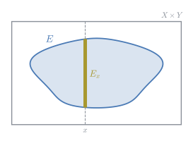

## Product measures

Our goal of this new chapter is to, given two measure spaces, define a product of them. For the product space, we should obviously use ($X\times Y$). For the $\sigma$-algebra, it should be the smallest which contains the so-called "rectangles" $$\mathcal R = \{A \times B : A \in \mathcal M, B \in \mathcal N\}$$whose $\sigma$-algebra $\mathcal M \otimes \mathcal N \equiv \sigma(\mathcal R)$ we denote as $\mathcal M \otimes \mathcal N$. It is clear that if we did have a product measure, then it should satisfy $$(\mu \times \nu)(A \times B) = \mu(A) \nu(B) \qquad \forall A \in \mathcal M, B \in \mathcal N$$

::: {#r-8-1 .callout-important .theorem-box}

#### **Theorem 8.1** (Existence of product measures).

There exists a measure $\mu \times \nu$ on the measurable space
$(X\times Y, \mathcal M \otimes \mathcal N)$ such that

$$
(\mu \times \nu)(A \times B) = \mu(A)\nu(B).
$$

Moreover, $\mu\times\nu$ is the unique measure satisfying these
properties if both $\mu,\nu$ are $\sigma$-finite.
:::

## Sections

::: {#r-8-2 .callout-note .definition-box}

#### **Definition 8.2** (Sections).

If $E\subseteq X \times Y$, the $x$-section of $E$ is

$$E_x := \{y\in Y : (x,y) \in E\}$$

and the $y$-section of $E$ is

$$E^y := \{x \in X : (x,y) \in E\}$$
:::

{#fig-l08-product-slice fig-alt="The section E_x is the slice of E above the point x; Fubini integrates these slices." width="85%"}

::: {#r-8-3 .callout-note .definition-box}

#### **Definition 8.3** (Sections of functions).

If $f : X \times Y \rightarrow \mathbb{R}$, we let for a fixed $x\in X$

$$f_x: Y \rightarrow \mathbb{R} \quad \text{given by} \quad f_x(y) := f(x,y)$$

and for a fixed $y\in Y$

$$f^y: X \rightarrow \mathbb{R} \quad \text{given by} \quad f^y(x) := f(x,y)$$
:::

::: {#r-8-4 .callout-important .proposition-box}

#### **Proposition 8.4** (Sections of measurable sets are measurable and sections of functions are measurable).

**(i)** If $E \in \mathcal{M} \otimes \mathcal{N}$ then for all $x\in X$,
$$E_x \in \mathcal{N}$$ and for all $y\in Y$, $$E^y \in \mathcal{M}$$

**(ii)** If $f: X \times Y \rightarrow \mathbb{R}$ is $\mathcal{M}\otimes \mathcal{N}$-measurable, then for all $x\in X$, $f_x$ is $\mathcal{N}$-measurable and for all $y \in Y$, $f^y$ is $\mathcal{M}$-measurable.
:::

## Fubini's theorem for sets

::: {#r-8-5 .callout-important .theorem-box}

#### **Theorem 8.5** (Fubini's theorem for sets).

Let $(X,\mathcal M, \mu)$ and $(Y,\mathcal N, \nu)$ be $\sigma$-finite measure spaces. If $E\in\mathcal M \otimes \mathcal N$, then the maps $x\rightarrow \nu(E_x)$ and $y\rightarrow \mu(E^y)$ are measurable functions on $X$ and $Y$ respectively, furthermore

$$(\mu \times \nu)(E) = \int_X \nu(E_x) d\mu(x) = \int_Y \mu(E^y) d\nu(y)$$^[$x\rightarrow \nu(E_X)$ is a map from $X\rightarrow [0,\infty]$ since $E_x$ is a subset of $Y$ and $\nu(E_x) \in [0,\infty]$.]

::: {.callout-note .proof-box collapse="true"}

#### Proof

We first prove it where we assume the spaces are finite. By symmetry, it is enough to show that $x\rightarrow \nu(E_x)$ is measurable and $(\mu\times \nu)(E) = \int_X \nu(E_x) d\mu(x)$. Let $$\mathcal C := \{E \in \mathcal M \otimes \mathcal N : \text{the above claim holds}\}$$. Our goal is to show that $\mathcal C = \mathcal M \otimes \mathcal N$. Note that $\mathcal C \subseteq \mathcal M \otimes \mathcal N$ trivially. We are therefore left with proving the reverse containment. 

**Step 1** $\mathcal R \subseteq \mathcal C$. $\nu((A\times B)_x) = \nu(B)1_A(x)$ hence $x\rightarrow \nu((A\times B)_x)$ is measurable (constant times a measurable function). In addition
$$(\mu \times \nu)(A \times B) = \int_X 1_A(x) \nu(B) d\mu(x) = \int_X \nu((A\times B)_x) d\mu(x)$$

**Step 2**: $\mathcal C$ is a $\mathcal D$-system. We check each axiom. 

(a) $X\times Y\in\mathcal C$. $(X\times Y)_x = Y$ for all $x$, so $x\mapsto\nu(Y)$ is constant, hence measurable (M). For (I): $(\mu\times\nu)(X\times Y) = \mu(X)\nu(Y) = \int_X\nu(Y)\,d\mu(x)$.

(b) Closed under proper differences. Let $E\subseteq F$ with $E,F\in\mathcal C$. Then $(F\setminus E)_x = F_x\setminus E_x$ and $E_x\subseteq F_x$, so $\nu((F\setminus E)_x) = \nu(F_x)-\nu(E_x)$, valid since finiteness gives $\nu(F_x)<\infty$. Both maps are measurable by assumption ($E,F\in\mathcal C$), so their difference is measurable (M). For (I):  $$\int_X\nu((F\setminus E)_x)\,d\mu = \int_X\nu(F_x)\,d\mu - \int_X\nu(E_x)\,d\mu = (\mu\times\nu)(F) - (\mu\times\nu)(E) = (\mu\times\nu)(F\setminus E)$$ 

(c) Closed under increasing unions. Let $E_n\nearrow E$ with each $E_n\in\mathcal C$. Then $(E_n)_x\nearrow E_x$ for every $x$, so by continuity from below $\nu((E_n)_x)\nearrow\nu(E_x)$. Each $x\mapsto\nu((E_n)_x)$ is measurable by assumption, and a pointwise limit of measurable functions is measurable by [Proposition 5.6](lecture-05.qmd#r-5-6) in [Lecture 5](lecture-05.qmd) (M). For (I), apply MCT (the functions are nonneg, measurable, and increasing): $$\int_X\nu(E_x)\,d\mu = \int_X\lim_n\nu((E_n)_x)\,d\mu = \lim_n\int_X\nu((E_n)_x)\,d\mu = \lim_n(\mu\times\nu)(E_n) = (\mu\times\nu)(E)$$ > > where the last equality is continuity from below of $\mu\times\nu$. 

**Step 3** Since $\mathcal R$ is a $\pi$-system, the Dynkin $\pi$-$\lambda$ theorem gives $\mathcal M \otimes \mathcal N = \sigma(\mathcal R) = \mathcal D(\mathcal R)\subseteq C$. The last inclusion follows from the fact that $\mathcal R \subseteq C$ and $\mathcal C$ is a $\mathcal D$-system, where $\mathcal D(\mathcal R)$ is the smallest $\mathcal D$-system generated by $\mathcal R$. Thus we have that the statement holds for the finite case.

**Step 4.** Moving to the $\sigma$-finite case, let $X_1\subseteq X_2\ldots$ have finite measure with $X=\bigcup X_i$ and $Y_1\subseteq Y_2\ldots$ with $Y = \bigcup Y_i$. **NTS: Note that this is different from the sigma-finite definition where we do not demand an increasing sequence of subsets, however, given any exhaustion $\{A_n\}$ we can simply replace it with $X_n:= \bigcup_{i=1}^n A_i$.** Consider the measure $(\mu \times \nu)\vert_{X_n \times Y_n}$ which is a finite measure on $(X \times Y, \mathcal M \otimes \mathcal N)$. It is easy to see that $(\mu \times \nu)\vert_{X_n \times Y_n} = \mu \vert_{X_n} \times \nu \vert_{Y_n}$ (this follow from the fact that $\mu \vert_{X_n}(A) = \mu(X_n \cap A) \leq \mu(X_n) < \infty$, and thus we have a product of finite measures which is finite).
By the finite case, for each $E \in \mathcal M \otimes \mathcal N$, the map $x\rightarrow \nu \vert_{Y_n}(E_x) = \nu(Y_n\cap E_x)$ is measurable on $(X, \mathcal M)$ and
$$\mu\times\nu((X_n\times Y_n)\cap E) = (\mu\times\nu)|_{X_n\times Y_n}(E) = \int_X \nu|_{Y_n}(E_x)\,d\mu|_{X_n}(x) = \int_X \mathbf{1}_{X_n}\nu(Y_n\cap E_x)\,d\mu(x)$$ {#eq-l08-truncated}

Using continuity from below and letting $n\to\infty$, we conclude that $x\to\nu(E_x)$ is measurable on $(X,\mathcal{M})$. Also, letting $n\to\infty$ in ([-@eq-l08-truncated]), using continuity from below, the fact that product of two measurable functions is measurable, and the MCT, we conclude that
$$(\mu\times\nu)(E) = \int_X \nu(E_x)\,d\mu(x)$$
as desired. $\square$
:::
:::

### Counterexample without $\sigma$-finiteness

Consider two measurable spaces on $[0,1]$ with the Borel sets with the first endowed with a measure $\mu$ being the Lebesgue measure and the second endowed with a measure $\nu$ being the counting measure (the latter not being $\sigma$-finite).
Let $\mathcal D:= \{(x,x) : x\in[0,1]\}$ be the diagonal. We first check that $\mathcal D$ lies in the product $\sigma$-algebra. The complement $\mathcal D^c$ is open in $[0,1]^2$ (open balls are taken relative to the square). For any point $(x,y) \in \mathcal D^c$ there is an $\epsilon>0$ such that the open ball of radius $\epsilon$ around $(x,y)$ lies in $\mathcal D^c$, so we can find rationals $a,b,c,d\in\mathbb Q$ with $(x,y) \in (a,b) \times (c,d) \subseteq \mathcal D^c$. The collection $\mathcal B$ of all such rectangles is countable, since it is indexed by $\mathbb Q^4$, and
$$\mathcal D^c = \bigcup \{B \in \mathcal B : B \subseteq \mathcal D^c\}.$$
Each open interval is a Borel set, so each $B$ is a measurable rectangle. The product $\sigma$-algebra is closed under countable unions and complements, so $\mathcal D^c$, and hence $\mathcal D$, belongs to it.
Note that $\mathcal D_x = \{x\}$ for each $x\in X$ and $\mathcal D^y = \{y\}$ for each $y\in Y$. The map $x\rightarrow \nu(\mathcal D_x)$ is the constant function 1 (which is measurable) whereas $y\rightarrow \mu(\mathcal D^y)$ is the constant function 0 (which is measurable). However, we now have $$\int_X \nu(\mathcal D_x)\, d\mu(x) = 1 \neq 0 = \int_Y \mu(\mathcal D^y)\, d\nu(y).$$

## The Fubini and Tonelli theorems
[Theorem 8.5](lecture-08.qmd#r-8-5) was a special case of a more general theorem which we now present. 

::: {#r-8-6 .callout-important .theorem-box}

#### **Theorem 8.6** (Tonelli and Fubini).

Let $(X,\mathcal M, \mu)$ and $(Y, \mathcal N, \nu)$ be $\sigma$-finite measure spaces.

**(a) (Tonelli)** If $f\in L^+(X\times Y, \mathcal M \otimes \mathcal N, \mu \times \nu)$ then
$$g(x) := \int_Y f_x(y) d\nu(y) \in L^+(X, \mathcal M, \mu)$$
and
$$\int_{X \times Y} f(x,y) d(\mu \times \nu)(x,y) = \int_X g(x) d\mu(x)$$

**(b) (Fubini)** If $f\in L^1(X\times Y, \mathcal M \otimes \mathcal N, \mu \times \nu)$ then $f_x \in L^1(Y, \mathcal N, \nu)$ for $\mu$-a.e. $x\in X$. Furthermore,
$$g(x) = \int_Y f_x(y) d\nu(y) \in L^1(X, \mathcal M, \mu)$$
which is defined $\mu$-a.e. x, belongs to $L^1(X, \mathcal M, \mu)$ and
$$\int_{X\times Y} f(x,y) d(\mu \times \nu)(x,y) = \int_X g(x) d\mu(x)$$^[For Tonelli, we assume $f\in L^+$, i.e. $f\geq 0$ and measurable in the product space. It thus follows from [Proposition 8.4](lecture-08.qmd#r-8-4) that each section $f_x$ is $\mathcal N$-measurable, and since $f_x \geq 0$ (from $f \geq 0$), we also have $f_x \in L^+(Y,\mathcal N, \nu)$ for free.]
:::

::: {.callout-caution .example-box}

#### **Example** (Fubini needs integrability).

Let $X = Y = \mathbb N$ with the counting measure on the power set, and
$$f(m,n) = \begin{cases} 1 & m = n, \\ -1 & m = n+1, \\ 0 & \text{otherwise.} \end{cases}$$
In the infinite matrix $(f(m,n))$, each row contains a $1$ on the diagonal, and every row except the first also contains a $-1$ just left of it. Summing each row first, row $1$ gives $1$ and every other row gives $0$, so the iterated sum is $1$. Summing each column first, every column contains one $1$ and one $-1$ and gives $0$, so the iterated sum is $0$. Both iterated integrals are finite but different. This does not contradict [Theorem 8.6](#r-8-6), because $f \notin L^1(\mathbb N \times \mathbb N)$:
$$\int_{\mathbb N \times \mathbb N} |f| \, d(\mu \times \nu) = \infty.$$
:::

In the Tonelli case, there is no integrability requirement, i.e the double integral could be infinite, but the iterated integral formula holds unconditionally. In the Fubini case, $f$ is Lebesgue integrable, (remember that $f\in L^1$ implies that it is Lebesgue integrable. See [Lecture 6](lecture-06.qmd)). 

Finally, note the consequence that $f_x \in L^1$. This follows by applying Tonelli to $|f| \geq 0$ meaning $$\int_{X\times Y} |f| d(\mu\times \nu) = \int_X \int_Y |f_x| d\nu d\mu(x) < \infty$$since $f\in L^1$ and thus $\int_Y |f_x| d\nu := h(x)$ must be finite $\mu$-a.e., meaning that $f_x \in L^1$ $\mu$-a.e..

**Fubini from Tonelli.**

Take $f\in L^1$, so $f = f^+ - f^-$ with both $f^+, f^-\in L^+$. Apply Tonelli to each separately:

$$\int_{X\times Y} f^+\, d(\mu\times\nu) = \int_X\left(\int_Y f^+_x\, d\nu\right)d\mu$$

$$\int_{X\times Y} f^-\, d(\mu\times\nu) = \int_X\left(\int_Y f^-_x\, d\nu\right)d\mu$$

Since $f\in L^1$, both sides are finite, so we can subtract:

$$\int_{X\times Y} f\, d(\mu\times\nu) = \int_X\left(\int_Y f^+_x\, d\nu - \int_Y f^-_x\, d\nu\right)d\mu = \int_X\left(\int_Y f_x\, d\nu\right)d\mu$$

The subtraction inside the inner integral is valid for $\mu$-a.e. $x$ — specifically those $x$ where $\int_Y f^-_x\,d\nu < \infty$ (i.e. it is fine to be infinite on nullsets).  

The $L^1$ assumption is stronger than $L^+$, which is why Fubini gives more, not only can we swap integrals, but also that the sections are integrable a.e.
