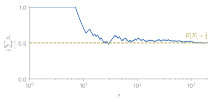

::: {#r-9-1 .callout-note .definition-box}
#### Definition 9.1 — Probability space

A probability space is a measure space $(\Omega, \mathcal M, P)$ with $P(\Omega) = 1$.
:::

$\Omega$ is our set of outcomes of some random experiment, $\mathcal M$ is the set of events to which we will assign a probability, and $P(A)$ is the probability that an event occurs. 

::: {.column-margin}
Note that a probability space thus automatically qualifies as finite, and therefore also $\sigma$-finite. This means that we can apply properties of the probability measure such as continuity from above without having to think twice.
:::

::: {#r-9-2 .callout-note .definition-box}
#### Definition 9.2 — Random variable

Given a probability space, a random variable is a measurable real-valued function $X$ on $(\Omega, \mathcal M, P)$.
:::

A random variable is not random as it is just a function, but if the input $\omega$ is random, then certainly $X(\omega)$ is random. Hence we call it a random variable. 

::: {#r-9-3 .callout-note .definition-box}
#### Definition 9.3 — Expectation

If $X$ is a R.V. on a probability space, its expectation is defined by $$E(X) =\int X dP$$ provided it exists, meaning at least one of $\int X^+ dP$ and $\int X^- dP$ is finite.
:::

::: {#r-9-4 .callout-note .definition-box}
#### Definition 9.4 — Distribution / Law of a Random Variable

Given a r.v. $X$ on a probability space, the distribution or law of $X$ is the probability measure $\mu$ on $(R, \mathcal B)$ given by $$\mu(A) = P(X^{-1}(A))$$
:::

::: {.column-margin}
Note that we demand $X$ to be measurable, hence the preimage of $A\subseteq R$ is contained in $\mathcal M$ and we can thus assign a meaningful probability to that event.
:::

::: {#r-9-5 .callout-note .definition-box}
#### Definition 9.5 — Independent random variables

(Independent) $n$ r.vs. $X_1, X_2,...,X_n$ on a probability space $(\Omega, \mathcal M, P)$ are called independent if for all Borel sets $B_1, B_2,...,B_n$ $$P(\bigcap_{i=1}^n X_{i}^{-1}(B_i)) = \prod_{i=1}^n P(X_i^{-1}(B_i))$$
:::

In other words, if we take the intersection of the preimages of our Borel sets (which we know is also an element of the sigma-algebra $\mathcal M$), which we can think of as the probability of all events happening simultaneously, is the same as evaluating the probability for each event, i.e. joint probability factorizes into marginals.

::: {#r-9-6 .callout-note .definition-box}
#### Definition 9.6 — Infinite collection of independent random variables

An **infinite** collection of r.vs. on a probability space $(\Omega, \mathcal M, P)$ is called independent if each finite collection is independent, as above.
:::

## The law of large numbers

::: {#r-9-7 .callout-important .theorem-box}
#### Theorem 9.7 — Weak and strong law of large numbers (special case)

Let $X_1, X_2,\ldots$ be independent r.v.s on some probability space such that the distribution of each $X_i$ is $(\delta_1 + \delta_{-1})/2$, i.e. for all $i$,
$$P(\{\omega : X_i(\omega) = 1\}) = P(\{\omega : X_i(\omega) = -1\}) = 1/2$$
Then:
- **(WLLN)** $S_n/n = \frac{\sum_{i=1}^n X_i}{n}$ converges in measure (in probability) to zero.
- **(SLLN)** $S_n/n = \frac{\sum_{i=1}^n X_i}{n}$ converges a.e. (almost surely) to zero.

::: {.callout-note .proof-box collapse="true"}
#### Proof

**Proof of WLLN.**

We first compute $E[S_n^2]$:
$$E[S_n^2] = \sum_{i,j=1}^n E[X_iX_j] = n$$
since $E[X_i^2]=1$ and $E[X_iX_j]=0$ for $i\neq j$ by independence (as $E[X_i]=0$). By linearity:
$$E\!\left[\left(\frac{S_n}{n}\right)^2\right] = \frac{1}{n}$$
Applying Markov's inequality:
$$P\!\left(\left|\frac{S_n}{n}\right| \geq \epsilon\right) = P\!\left(\left(\frac{S_n}{n}\right)^2 \geq \epsilon^2\right) \leq \frac{E[(S_n/n)^2]}{\epsilon^2} = \frac{1}{n\epsilon^2} \to 0$$
as $n\to\infty$, so $S_n/n$ converges to $0$ in probability. (This makes sense — we assigned equal probability to $\pm 1$, so gains and losses cancel.)

**Proof of SLLN.**

**Step 1: From summability to a.s. convergence via Borel–Cantelli.**

Assume we can establish:
$$\sum_{n=1}^\infty P\!\left(\left|\frac{S_n}{n}\right| \geq \epsilon\right) < \infty \tag{16}$$
The sets $E_n(\epsilon) := \{|S_n/n| \geq \epsilon\}$ are measurable (preimages of $[\epsilon,\infty)$ under the measurable function $|S_n/n|$, where $S_n$ is just a sum of r.vs. which by definition are real-valued measurable functions, and a sum of measurable functions is also measurable, and the composition of a continuous function $|\cdot |$ with a measurable function is also measurable), so Borel–Cantelli applies:
$$P\!\left(\left|\frac{S_n}{n}\right| \geq \epsilon \text{ i.o.}\right) = 0 \quad \forall \epsilon > 0$$
For each integer $k$, define $A_k := \{|S_n/n| \geq 1/k \text{ i.o.}\}$. Then $P(A_k)=0$ for every $k$, and by countable additivity $P(\bigcup_k A_k) = 0$. Taking complements via De Morgan:
$$P\!\left(\bigcap_k A_k^c\right) = 1$$
Since $A_k^c = \{\text{eventually } |S_n/n| < 1/k\}$, an outcome $\omega\in\bigcap_k A_k^c$ means: for every $k$ there exists $N$ such that $|S_n(\omega)/n| < 1/k$ for all $n\geq N$. This is exactly the $\epsilon$-$N$ definition of $S_n(\omega)/n\to 0$, for any epsilon we can just pick k sufficiently large s.t. $1/k < \epsilon$ and then $\omega \in A_k^c$ we have $|S_n(\omega)/n|<1/k< \epsilon$. Hence:
$$P\!\left(\{ \omega : \frac{S_n(\omega)}{n}\to 0\}\right) = 1$$

**Step 2: Second moments are not enough.**

From the WLLN we had $P(|S_n/n|\geq\epsilon)\leq 1/(n\epsilon^2)$, but $\sum_n 1/n = \infty$, so (16) fails and Borel–Cantelli cannot be applied with second moments.

**Step 3: Fourth moment bound.**

We instead show $E(S_n^4)\leq 3n^2$. Expanding:
$$E(S_n^4) = \sum_{i,j,k,\ell} E(X_iX_jX_kX_\ell)$$
Split into three groups:

**(a) $i=j=k=\ell$:** Each term equals $E(X_i^4)=1$, giving $n$ terms.

**(b) Exactly two distinct values each appearing twice:** Each term equals $E(X_i^2)E(X_j^2)=1$ by independence. Count: $\binom{n}{2}$ ways to pick two distinct indices, times $\binom{4}{2}=6$ ways to assign them to the four slots, giving $6\binom{n}{2} = 3n(n-1)$ terms.

**(c) All other cases:** Any index appearing an odd number of times factors out $E(X_i)=0$, so all such terms vanish.

Hence:
$$E(S_n^4) = n + 3n(n-1) = 3n^2 - 2n \leq 3n^2$$

**Step 4: Applying Markov with fourth moments.**

By Markov applied to $(S_n/n)^4$:
$$P\!\left(\left|\frac{S_n}{n}\right|\geq\epsilon\right) \leq \frac{E[(S_n/n)^4]}{\epsilon^4} \leq \frac{3}{n^2\epsilon^4}$$
Since $\sum_{n=1}^\infty \frac{3}{n^2\epsilon^4} < \infty$ by the $p$-series test, condition (16) holds and we are done. $\blacksquare$
:::
:::

{#fig-l09-law-of-large-numbers fig-alt="Sample averages of fair coin flips settle at the mean tfrac12." width="85%"}

Remember that a.e. convergence implies convergence in measure on *finite* measure spaces, and thus (ii) implies (i). Proof of WLLN is simpler than for SLLN and WLLN holds in certain cases where the SLLN does not. 

WLLN says something like: if you flip a coin a zillion times, then with high probability, percentage of heads will be in some small interval around $1/2$. The SLLN tells us that if you were to flip a coin an infinite number of times, then with probability 1, the percentage of heads would converge to 1/2. 

::: {#r-9-8 .callout-important .theorem-box}
#### Theorem 9.8 — Strong law of large numbers: General case

Let $X_1, X_2,...$ be independent r.vs. with the same distribution (i.i.d.) on some probability space $(\Omega, \mathcal F, P)$ with $E(|X|) < \infty$, then $$\frac{S_n}{n} = \frac{\sum X_i}{n}$$ converges a.e. to $E[X]$.
:::

Remember that two r.vs. can have the same probability distribution but still live in different probability spaces. For example, the outcome of a fair coin on $\Omega = \{H, T\}$ and the outcome of a fair die being even or odd on $\Omega' = \{1,2,3,4,5,6\}$ have the same Bernoulli$(1/2)$ distribution but live on different spaces.

::: {.column-margin}
**Independent events.** Events $E_1, E_2, \ldots$ are independent if their indicator functions $1_{E_1}, 1_{E_2}, \ldots$ are independent random variables in the sense of [Definition 9.5](lecture-09.qmd#r-9-5) and [Definition 9.6](lecture-09.qmd#r-9-6). Equivalently, $P(E_{i_1}\cap\cdots\cap E_{i_k}) = P(E_{i_1})\cdots P(E_{i_k})$ for every finite set of distinct indices $i_1, \ldots, i_k$.
:::

::: {#r-9-9 .callout-important .lemma-box}
#### Lemma 9.9 — Second Borel–Cantelli Lemma

Let $(\Omega, \mathcal F, P)$ be a probability space and let $E_1, E_2, \ldots$ be **independent** events. If
$$\sum_{n=1}^\infty P(E_n) = \infty,$$
then $P(\limsup E_n) = 1$, i.e. with probability one infinitely many of the $E_n$ occur.

::: {.callout-note .proof-box collapse="true"}
#### Proof

Taking complements, $(\limsup E_n)^c = \bigcup_{n\ge1}\bigcap_{k\ge n} E_k^c$, so it suffices to show that $P\big(\bigcap_{k\ge n}E_k^c\big)=0$ for every $n$. The complements $E_k^c$ are again independent, and $1-x\le e^{-x}$ for all $x$, so for $N\ge n$
$$P\Big(\bigcap_{k=n}^{N}E_k^c\Big)=\prod_{k=n}^{N}\big(1-P(E_k)\big)\le \exp\Big(-\sum_{k=n}^{N}P(E_k)\Big)\xrightarrow[N\to\infty]{}0,$$
since every tail of the series diverges. By continuity from above, $P\big(\bigcap_{k\ge n}E_k^c\big)=0$, and a countable union of null sets is null. $\square$

Independence cannot be dropped: for $E_n=[0,\tfrac1n]$ in $[0,1]$ with Lebesgue measure, $\sum_n m(E_n)=\infty$, but $\limsup E_n=\{0\}$ has measure $0$. $\square$
:::
:::

One consequence of the second Borel–Cantelli lemma ([Lemma 9.9](lecture-09.qmd#r-9-9)) is the infinite monkey theorem below.

::: {#side-the-infinite-monkey-theorem .side-topic}
**Side topic: The infinite monkey theorem**

Say a monkey types on a keyboard with 26 letters, hitting each key uniformly at random, producing an infinite sequence of letters like `XQBTHZAM...`

A **string** is a specific finite sequence of letters — say `HAMLET` (6 letters), or in the extreme case the entire text of Hamlet (~130,000 characters). **Position $n$** means the $n$-th character in the infinite sequence the monkey produces.

Define $E_n$ to be the event that starting at position $n$, the next $k$ characters spell out exactly the target string. For example if the target is `HAMLET`:

$$E_n = \{\text{characters } n, n+1, n+2, n+3, n+4, n+5 \text{ are H, A, M, L, E, T}\}$$

Each $E_n$ has probability $p = (1/26)^6 > 0$, small but positive, and the same for every $n$ since keystrokes are independent. The events $E_1, E_{k+1}, E_{2k+1},\ldots$ at non-overlapping blocks are independent since they depend on disjoint sets of keystrokes. Since:

$$\sum_{n=1}^\infty P(E_n) = \sum_{n=1}^\infty p = \infty$$

the second Borel–Cantelli lemma ([Lemma 9.9](lecture-09.qmd#r-9-9)) gives $P(E_n \text{ i.o.}) = 1$ — the monkey types `HAMLET` infinitely often with probability 1. This holds for any target string, no matter how long: even a full textbook of $N$ characters has $(1/26)^N > 0$, so the sum still diverges and the conclusion is the same.
:::
