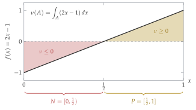
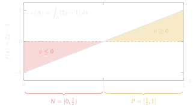

## Signed measures

So far, we have discussed nonnegative measures. But can we also introduce a well-defined concept of a signed measure? Indeed we can.

::: {#r-10-1 .callout-note .definition-box}

#### **Definition 10.1** (A signed measure).

If $(X, \mathcal M)$ is a measurable space, a signed measure is a map $\nu: \mathcal M \rightarrow [-\infty, \infty]$ satisfying
(i) $\nu(\emptyset) = 0$
(ii) At most one of the values $\pm \infty$ are assumed.
(iii) If $A_1, A_2,...$ pairwise disjoint elements of $\mathcal M$, then $$\nu(\bigcup_i A_i) = \sum_i \nu(A_i)$$ where the sum on the RHS converges absolutely when the LHS is finite.
:::

We compare this to the definition of a measure. First, note the additional criterion (ii), and the additional comment in (iii) that the RHS converges absolutely when the LHS is finite. The reason is related to what we discussed earlier, namely that there is no intrinsic ordering of the elements of the set, and consequently, neither should the measure of the union depend on that ordering. Absolute convergence is thus required.  

For unsigned series, conditional convergence is not possible, so either the series is absolutely convergent or diverges to $+\infty$. For signed measures, we can have conditional convergence. Therefore whenever the LHS is finite, we require the RHS to converge absolutely: the union $\bigcup_i A_i$ does not depend on the order in which we list the $A_i$, but the value of a conditionally convergent series does, as the side topic below shows.

::: {#side-the-riemann-rearrangement-theorem .side-topic}
**Side topic: The Riemann rearrangement theorem**

The Riemann rearrangement theorem [[1]](#ref-1) says that if a real series $\sum_n a_n$ converges but not absolutely, then for every $L \in [-\infty, \infty]$ there is a rearrangement $\sigma$ of $\mathbb N$ such that
$$\sum_{n=1}^\infty a_{\sigma(n)} = L.$$
One can even choose $\sigma$ so that the partial sums oscillate and approach no limit at all, finite or infinite.

The idea of the proof is simple. Since the series converges conditionally, $a_n \to 0$, while the positive terms alone sum to $+\infty$ and the negative terms alone sum to $-\infty$. To reach a finite $L$, take positive terms until the partial sum first exceeds $L$, then negative terms until it first drops below $L$, then positive terms again, and so on. Every term is eventually used, and since $a_n \to 0$ the overshoots shrink, so the partial sums converge to $L$.

A concrete example is the alternating harmonic series,
$$1 - \tfrac12 + \tfrac13 - \tfrac14 + \tfrac15 - \cdots = \ln 2.$$
Taking one positive term followed by two negative terms gives
$$\Big(1 - \tfrac12\Big) - \tfrac14 + \Big(\tfrac13 - \tfrac16\Big) - \tfrac18 + \cdots = \tfrac12 - \tfrac14 + \tfrac16 - \tfrac18 + \cdots = \tfrac12 \ln 2,$$
the same terms with half the sum.

Absolutely convergent series behave well: every rearrangement converges to the same value. This is why condition (iii) of [Definition 10.1](#r-10-1) asks for absolute convergence. If $\nu(A_i) = a_i$ for disjoint sets $A_i$, relabelling the sets does not change their union, so it must not change $\sum_i \nu(A_i)$ either.
:::

Some remarks that follow from the definition:

- A measure is a signed measure.
- If $\mu_1, \mu_2$ are finite measures (or at least one is finite) then $\mu_1-\mu_2$ is a signed measure.
- Condition (ii) is there to avoid having $\infty - \infty$. For example if $A, B$ are disjoint sets where $\nu(A) = \infty$ and $\nu(B) = -\infty$ then $\nu(A \bigcup B)$ is undefined. 

So far, a signed measure can feel somewhat uncomfortable, especially if we have made ourselves comfortable with the idea that a measure is something that assigns volumes to sets. However, it differences of measures turn out to be very common, and a difference of (finite) measures produces a signed measure, as shown below.

::: {#r-10-2 .callout-tip .remark-box}

#### **Remark 10.2**.

If $\mu_1, \mu_2$ are finite measures (or at least one is finite), then the difference $\mu_1-\mu_2$ is a signed measure.

::: {.callout-note .proof-box collapse="true"}

#### Proof

Properties (i) and (ii) are clearly satisfied. Let $\Delta \mu := \mu_1 - \mu_2$, then we have $$\Delta \mu (\bigcup_i A_i) = \mu_1(\bigcup_i A_i) - \mu_2(\bigcup_i A_i) = \sum_i \mu_1(A_i) - \sum_i \mu_2(A_i) = \sum_i (\mu_1 - \mu_2)(A_i) = \sum_i \Delta \mu(A_i)$$
where subtracting the series is only possible if at least one of them is finite (ok by assumption). Finally, when the LHS is finite, and at least one of measures is finite (say $\mu_1$) we have $\sum_i \mu_1(A_i) < \infty$ since $A_i\subseteq X$ are disjoint and thus $$\sum_i |\Delta \mu(A_i) |\leq \sum_i \mu_1(A_i) + \sum_i \mu_2(A_i) < \infty$$ and thus it converges absolutely. $\square$
:::
:::

It turns out that every signed measure has the form $\mu_1 - \mu_2$, both being measures with at least one being finite. This is the **Jordan Decomposition Theorem**. Before that, we first prove the Hahn Decomposition Theorem.

## Positive and negative sets

::: {#r-10-3 .callout-note .definition-box}

#### **Definition 10.3** (A positive and negative set).

If $\nu$ is a signed measure on $(X,\mathcal M)$, a set $A \in \mathcal M$ is called a *positive set* if $\nu(B) \geq 0$ $\forall B \subseteq A$ with $B\in \mathcal M$. A is called a negative set (a null set) if $\nu(B) \leq (=) 0$ $\forall B \subseteq A$ with $B\in \mathcal M$.
:::

Two facts about signed measures that we use below:

1. Continuity from below and from above hold for signed measures, just as for measures.
2. A measurable subset of a positive set is positive, and a countable union of positive sets is positive.

## The Hahn decomposition

::: {#r-10-4 .callout-important .theorem-box}

#### **Theorem 10.4** (Hahn Decomposition Theorem).

If $\nu$ is a signed measure on $(X, \mathcal M)$ then $X$ can be partitioned into two sets $P, N \in \mathcal M$ (meaning $P \cup N = X, P \cap N = \emptyset$) with $P$ being a positive set and $N$ a negative set. There is "almost uniqueness" in that if $(P', N')$ is another such partition, then $P \Delta P'$ and $N\Delta N'$ are each null sets.
:::

::: {.callout-caution .example-box}

#### **Example** (A Hahn decomposition).

On $([0,1], \mathcal B_{[0,1]})$ with Lebesgue measure $m$, let $\nu(A) = m(A \cap [0, 3/4]) - m(A \cap (3/4, 1])$. A Hahn decomposition is $P = [0, 3/4]$, $N = (3/4, 1]$. It is not unique: $P' = [0, 3/4)$, $N' = [3/4, 1]$ also works, since $P' \,\Delta\, P = \{3/4\}$ is a null set for $\nu$. So does $P'' = [0, 3/4] \cup C$, $N'' = (3/4, 1] \setminus C$ with $C$ the Cantor set, since $P'' \,\Delta\, P \subseteq C$ is again a null set. The theorem guarantees uniqueness only up to such null sets.
:::

::: {#fig-l10-hahn-decomposition}
```{=html}
<div class="themed-figure"></div>
```

Hahn decomposition for $\nu(A)=\int_A(2x-1)dx$: $\nu\ge 0$ on $P$ and $\nu\le 0$ on $N$.
:::

By definition we have $A \Delta B = (A \setminus B) \cup (B \setminus A)$ which are the points which belong to exactly one of the two sets $A$ and $B$. In other words, given a *signed measure space*, we can cleanly partition our $X$ into a positive and negative measurable part, and this decomposition is unique up to nullsets. 

::: {#r-10-5 .callout-important .lemma-box}

#### **Lemma 10.5** (Existence of positive subset).

Let $\nu$ be a signed measure on $(X, \mathcal M, \nu)$ which does not take the value $\infty$. If $\nu(A) > 0$, then there exists a measurable $B \subseteq A$ where $\nu(B) > 0$ and $B$ is a positive set.
:::

::: {#r-10-6 .callout-caution .example-box}

#### **Example 10.6**.

Take $X = \{1,2,3\}$ and $\mathcal M = 2^X$ then take $\nu(\{1\}) = 3$ and $\nu(\{2\}) = -1$ and same for $3$. Then $\nu(X) = 1>0$ but $\{2\}\subseteq X$ and $\nu(\{2\}) = -1$, thus $X$ is not a positive set, although it has positive measure. But if we take $B = \{1\}$ then indeed we have a subset which is also a positive set. From this perspective it makes sense, the positive and negative parts of $A$ may give a positive contribution, but we can find a subset of these which only contribute positively. We can do this using a greedy algorithm, by just at each stage remove the most negative measurable subsets, define that as our new subset, remove the negative measurable subsets, and repeat until the resulting subset is positive. 
:::

::: {#r-10-7 .callout-caution .example-box}

#### **Example 10.7**.

Take $([0,1], \mathcal B_{[0,1]})$ with $\nu(A) = \int_A (2x-1) dm(x)$. If we take $A = [1/4, 1]$ then $\nu(A) > 0$ but it is not a positive set since the density $2x-1 < 0$ on $[1/4, 1/2)$, so why just not remove that interval and define $B = [1/2,1]\subseteq A$ which is measurable and also a positive set. 
:::

This is different from the two facts we mentioned earlier. The lemma says that we only know that the measure of $A$ is positive, not that it is a positive set. However, it does guarantee that we can always find a subset of $A$ which is positive.

## Mutual singularity and the Jordan decomposition

::: {#r-10-8 .callout-note .definition-box}

#### **Definition 10.8** (Mutually singular measures).

Two measures $\mu, \nu$ on a measurable space $(X, \mathcal M)$ are mutually singular if $X$ can be partitioned into two disjoint sets $E, F$ in $\mathcal M$ so that $\mu(E) = 0 = \nu(F)$. This is denoted by $\mu \perp \nu$.
:::

::: {#r-10-9 .callout-important .theorem-box}

#### **Theorem 10.9** (Jordan decomposition theorem).

If $\nu$ is a signed measure on $(X, \mathcal M)$, then there exists unique measures $\nu^+$ and $\nu^-$ so that $\nu^+ \perp \nu^-$ and $$\nu = \nu^+ - \nu^-$$
:::

The measure $\nu^+ + \nu^-$ is called the total variation of $\nu$ and is denoted by $|\nu|$. The Jordan decomposition theorem is essentially a corollary of the Hahn decomposition theorem where we define $\nu^\pm$ as the restriction of $\nu$ to $P$ (+) $N$ (-) respectively. This is similiar to the decomposition of a function $$f(x) = \max(f(x), 0) - \max(-f(x), 0) \equiv f^+(x) - f^-(x)$$

::: {#r-10-10 .callout-caution .example-box}

#### **Example 10.10**.

Why is $\nu(A) = \int_A (2x-1) dx$ a signed measure?

- $\nu(\emptyset) = 0$
- Since $2x-1$ is bounded on $[0,1]$, it is a finite signed measure and thus never takes $\pm \infty$.
- Countable additivity follows from the fact that the integral and infinite sum can be interchanged by the Lebesgue dominated convergence theorem. $$\nu(\bigcup_i A_i) = \int f 1_A dx = \int \lim_{n\rightarrow \infty} f \cdot 1_{\bigcup_{i=1}^n A_i}$$
	and in order to swap limit and integral, we need the LDCT. Since $g_n \rightarrow f \cdot 1_A$ pw and $|f_n| \leq |f|$ for all n we can simply take $f$ as our majorant function, and clearly $\int |f| dx < \infty$ so $f$ is also integrable. We may therefore write $$=\lim_{n\rightarrow \infty} \int f_n dx = \lim_{n\rightarrow \infty} \sum_{i=1}^n \int_{A_i} f dx = \sum_{i=1}^\infty \nu(A_i)$$
:::

::: {#r-10-11 .callout-caution .example-box}

#### **Example 10.11** (Cantor measure minus Lebesgue).

Define $$\nu = \mu_c - m$$on the measurable space $([0,1], \mathcal B_{[0,1]})$ then the Hahn decomposition is simply $P = \mathfrak C$ (the Cantor set) and $N= \mathfrak C^c$ and then we simply have $\nu^+(A) = \mu_c(A \cap \mathfrak C)$ and $\nu^{-1}(A) = m(A \cap \mathfrak C^c)$ for the Jordan decomposition. 
:::

## References {.unnumbered}

1. []{#ref-1}Riemann series theorem, *Wikipedia*. <https://en.wikipedia.org/wiki/Riemann_series_theorem>
