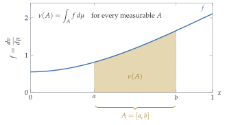
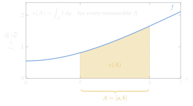

::: {#r-11-1 .callout-note .definition-box}
#### Definition 11.1 — Absolute continuity

Given two measures $\nu, \mu$ on $(X, \mathcal M)$ we say that $\nu$ is absolutely continuous with respect to $\mu$, written $\nu << \mu$, if for all $A \in \mathcal M$ $$\mu(A) = 0$$ implies $\nu(A) = 0$.
:::

::: {.column-margin}
Note that it does not mean that $\nu \leq \mu$ or vice versa. For example if we have $\mu$ is the Lebesgue measure on $[0,1]$ and $\nu$ is two times the Lebesgue measure on the same interval, we have both $\nu << \mu$ and $\mu << \nu$.
:::

::: {#r-11-2 .callout-caution .example-box}
#### Example 11.2 — Measures given by a density

Consider a measure space $(X, \mathcal M, \mu)$ and a function $f\in L^+((X, \mathcal M, \mu))$ then take $$\nu(A) := \int_A f(x) d\mu(x) \tag{1}$$
Proving that it is a measure can be done by defining $g_n : = f 1_{\bigcup_{i=1}^n A_i}$ which forms an increasing sequence of measurable functions that converge to $f \cdot 1_{\bigcup_i A_i}$ pw which allows us to apply the MCT $$\nu\left(\bigcup_i A_i\right) = \int f \cdot \mathbf{1}_{\bigcup_i A_i} \, d\mu = \int \lim_{n\to\infty} g_n \, d\mu \underbrace{=}_{\text{MCT}} \lim_{n\to\infty} \int g_n \, d\mu = \lim_{n\to\infty} \sum_{i=1}^n \int_{A_i} f \, d\mu = \sum_{i=1}^\infty \nu(A_i)$$
If $\mu(A) = 0$, then $\nu(A) = \int_A f d\mu = 0$ and thus $\nu << \mu$. 
:::

The measure $\nu$ in (1) is often denoted simply by $f\mu$. In fact, any measure which is absolutely continuous with respect to $\mu$ has this form assuming $\sigma$-finiteness.

::: {#r-11-3 .callout-important .theorem-box}
#### Theorem 11.3 — The Radon-Nikodym theorem

Let $\nu, \mu$ be two measures on $(X, \mathcal M)$ with $\nu << \mu$ and with $\nu, \mu$ being $\sigma$-finite. Then, there exists a measurable function $f_0: X \rightarrow [0,\infty)$ such that $\forall A \in \mathcal M$ we have $$\nu(A) = \int_A f_0(x) d\mu(x)$$
Morever, $f_0$ is unique in the sense that if $g_0$ is another such function, then $$\mu(\{x:f_0(x) \neq g_0(x)\})=0$$In other words $\mu$ is defined up to a $\mu$-null set. Thus any two $f_0, g_0$ agree $\mu$-a.e.

::: {.callout-note .proof-box collapse="true"}
#### Proof

We prove this under the assumption that $\mu, \nu$ are finite, and only outline the extension to the $\sigma$-finite case. First define $$\mathcal F := \{f: X \rightarrow [0, \infty):\int_A f(x) d\mu(x) \leq \nu(A) \forall A \in \mathcal M\}$$
Note that $\mathcal F$ is nonempty since $f \equiv 0$ is in $\mathcal F$. Therefore, the supremum is defined, and we let $$m:=\sup \{ \int f(x) d\mu(x) : f\in \mathcal F\}$$where $m\leq \nu(X) < \infty$. 

**Claim:** There exists $f_0 \in \mathcal F$ for which $\int f_0(x) d\mu(x) = m$, i.e. the supremum is achieved. 

Note that if $h_1, h_2 \in \mathcal F$, then so does $\max\{h_1, h_2\}$, since $$\int_A \max\{h_1, h_2\} d\mu(x) = \int_{A \cap \{h_1 \geq h_2\}} h_1(x) d\mu(x) + \int_{A \cap \{h_1 < h_2\}} h_2(x) d\mu(x) \leq \nu(A \cap \{h_1 \geq h_2\}) + \nu(A \cap \{h_1 > h_2\}) = \nu(A)$$Now we choose $h_1, h_2, ... \in \mathcal F$ so that $$\lim_{n\rightarrow \infty} \int h_n(x) d\mu(x) = m \tag{2}$$**Why can we do this?** Well, by the definition of the supremum, for every $\epsilon > 0$ there exists some $f\in \mathcal F$ with $\int f d\mu > m -\epsilon$, we may thus take $\epsilon = 1/n$ to construct our sequence $h_n \in \mathcal F$.

If we let $g_n:= \max\{h_1,...,h_n\}$, then each $g_n \in \mathcal F$ (by induction) and $g_n$ is increasing and $$\int h_n(x) d\mu(x) \leq \int g_n d\mu \leq m$$
where the left inequality holds since $g_n \geq h_n$ by definition. The right inequality holds because $g_n \in \mathcal F$ and thus $\int g_n d\mu \leq m$ by definition of m. By the squeeze theorem of (2), we thus have

$$\lim_{n\rightarrow \infty} \int g_n d\mu  = m$$

If we can move $\lim_{n\rightarrow \infty}$ inside the integral, we have found our $f_0$. In particular, by setting $f_0 := \lim_{n\rightarrow \infty} g_n$. Are we allowed to make this exchange of limiting operations? Well clearly the $g_n$'s form a sequence of nonnegative increasing measurable functions (being the maximum of elements in $\mathcal F$) which allows us to apply MCT $$\int f_0(x) d\mu(x) = m$$What remains to show for the claim is that $f_0 \in \mathcal F$. For this, fix $A \in \mathcal A$. We want to apply MCT to $g_n 1_A$ whose limit is given by $f_0 1_A$ and thus we have $$\int_A f_0 d\mu =  \int f_0 1_A d\mu = \lim_{n\rightarrow \infty} \int g_n 1_A d\mu = \lim_{n\rightarrow \infty} \int_A g_n d\mu$$ but since every $g_n \in \mathcal F$, for every $n$ we have $$\int_A g_n d\mu \leq \nu(A)$$ and thus taking the limit we still have $$\int_A f_0 d\mu = \lim_{n\rightarrow \infty} \int_A g_n d\mu \leq \nu(A)$$Which proves the claim.

Now we define $$\nu_0 := \nu - f_0 \mu$$and our goal is to show that it is the zero measure, meaning that $\nu_0(A) = 0 \forall A \in \mathcal M$. Note that by construction of $f_0$, we have $\nu_0(A) \geq 0$. 

By showing $\nu_0(X) = 0$ is true, and using the fact that $\nu_0$ is a positive measure by construction, we have $\nu_0(A) = 0 \forall A \in \mathcal M$. Thus, from now on, assume for sake of contradiction that $\nu_0(X) > 0$. This is just a finite number, and since $\mu$ is finite by assumption, there exists an $\epsilon > 0$ so that $$\nu_0(X) - \epsilon \mu(X) > 0 \tag{3}$$
Now let $(P,N)$ be the Hahn decomposition for the signed measure $$\nu_0 - \epsilon \mu$$which is just the difference of two positive measures. This construction always exists, so far so good!

When constructing the Hahn decomposition, we either have $\mu(P) = 0$ or $\mu(P) > 0$, since $\mu$ is a measure. We will see that both cases leads to a contradiction, assuming $\nu_0(X) > 0$ (or equivalently statement (3)).

**Case 1:** $\mu(P) = 0$, then since $\nu << \mu$ we have that $\nu(P) = 0$ and hence $(\nu_0 - \epsilon \mu)(P) = (\nu - f_0 \mu - \epsilon \mu)(P) = 0$, contradicting (3) since $$(\nu_0 - \epsilon \mu)(X) = (\nu_0 - \epsilon \mu)(P) + (\nu_0 - \epsilon \mu)(N) = (\nu_0 - \epsilon \mu)(N)$$but by the Hahn decomposition that is $\leq 0$ and not $>0$. 

**Case 2:** $\mu(P) > 0$. Note that $$g_0 = f_0 + \epsilon 1_P \in \mathcal F$$As follows from$$\int_A (f_0 + \epsilon 1_p) d\mu(x) = \int_A f_0 d\mu(x) + \epsilon \mu(P \cap A) \leq \int_A f_0 d\mu(x) + \nu_0(P \cap A) \leq \int_A f_0 d\mu(x) + \nu_0(A) = \nu(A)$$
where we used that $\nu_0(P \cap A) \geq \epsilon \mu(P\cap A)$ since $P \cap A \subseteq P$ is a positive subset and similarly $\nu_0(P \cap A) \leq \nu_0(A)$ by monotonicity (with $\nu_0$ being a positive measure). 

Next, since $\mu(P) > 0$ we have $$\int g_0 d\mu(x) = m + \epsilon \mu(P) > m$$contradicting the definition of $m$, since $g_0 \in \mathcal F$. Hence $\nu_0$ is the zero measure. 

**Outline for the $\sigma$-finite extension:**

- Break up $X$ into countably many pieces, each piece with finite $\mu, \nu$ measure. Then one can do the above on each piece separately and put it together in the end. $\square$
:::
:::

::: {#fig-l11-radon-nikodym}
```{=html}
<div class="themed-figure"></div>
```

The Radon–Nikodym derivative is the density whose area over $A$ is $\nu(A)$.
:::

::: {#r-11-4 .callout-tip .remark-box}
#### Remark 11.4 — About the Radon–Nikodym theorem

1. We call $f_0$ in the above theorem for the Radon-Nikodym derivative of $\nu$ with respect to $\mu$.
2. If $\mu$ is Lebesgue measure on $(R, \mathcal B)$ and $\nu$ is the distribution of a random variable which is absolutely continuous with respect to $\mu$, then $f_0$ is simply the probability density function from elementary probability.
3. The theorem is false in general without the $\sigma$-finite assumption on $\mu$. 
4. It turns out that $\sigma$-finiteness on $\nu$ is not needed provided that $f_0$ is allowed to take the value $\infty$.
:::

Note that every random variable $X$ has a cumulative distribution function (CDF), defined from its distribution $\mu_X$ ([Definition 9.4](lecture-09.qmd#r-9-4)) by $$F_X(x) = \mu_X\big((-\infty, x]\big) = P\big(X^{-1}((-\infty, x])\big).$$ By [Proposition 4.3](lecture-04.qmd#r-4-3) it is weakly increasing and right continuous. A probability density function (PDF), on the other hand, only exists when $\mu_X$ is absolutely continuous with respect to the Lebesgue measure ([Definition 11.1](lecture-11.qmd#r-11-1)), and it is then the Radon–Nikodym derivative $d\mu_X/dm$ (see the remarks after [Theorem 11.3](lecture-11.qmd#r-11-3)).

Conversely, given a function $F$ with these properties, [Proposition 4.4](lecture-04.qmd#r-4-4) gives a unique finite Borel measure $\mu_F$ whose CDF is $F$, and from $\mu_F$ we can construct a random variable whose law is $\mu_F$. Since $\mu_F$ is finite it is $\sigma$-finite, but it need not be absolutely continuous, so it need not have a PDF. The Cantor measure $\mu_C$ ([Theorem 4.8](lecture-04.qmd#r-4-8)) is an example: its CDF is the Cantor function, but $\mu_C$ is singular, so it has no density.

::: {#r-11-5 .callout-caution .example-box}
#### Example 11.5 — Sampling from a distribution via its CDF

The fact that every CDF comes with a random variable is also useful in practice, for simulating random variables with a given distribution. Generate $U \sim \mathcal U(0,1)$ and set $X = F_X^{-1}(U)$. When $F_X$ is continuous and strictly increasing,
$$P(X \le x) = P\big(U \le F_X(x)\big) = F_X(x),$$
so $X$ has the CDF $F_X$. This requires being able to evaluate $F_X^{-1}$, which is not always easy (see [simulation via the CDF](https://data140.org/textbook/content/chapter-16/simulation-via-the-cdf/)).

For example, one way to generate a normal $\mathcal N(\mu, \sigma^2)$ random variable is to start from $U \sim \mathcal U(0,1)$, set $Z = \Phi^{-1}(U)$, which has the standard normal distribution, and finally let $X = \sigma Z + \mu$. Here $\Phi^{-1}$ has no closed form, but it is easy to evaluate numerically.
:::

::: {#side-the-kullback-leibler-divergence .side-topic}
**Side topic: The Kullback–Leibler divergence**

Radon–Nikodym derivatives give a natural way to compare two probability distributions. Let $(\Omega, \mathcal T)$ be a measurable space and let $\mu, \nu$ be probability measures on it with $\mu \ll \nu$. The **Kullback–Leibler (KL) divergence** of $\mu$ from $\nu$ is

$$KL(\mu \,\|\, \nu) = \int \log\frac{d\mu}{d\nu}\, d\mu,$$

where $\frac{d\mu}{d\nu}$ is the Radon–Nikodym derivative of $\mu$ with respect to $\nu$ ([Theorem 11.3](lecture-11.qmd#r-11-3)). If $\mu \not\ll \nu$, the KL divergence is set to $+\infty$ by convention.

**What it measures.** The KL divergence measures how different $\mu$ is from the reference distribution $\nu$, so it plays the role of a distance between two distributions. The integrand $\log\frac{d\mu}{d\nu}$ compares, point by point, how much mass $\mu$ puts somewhere relative to $\nu$, and the integral averages this log-ratio over $\mu$. It is always nonnegative and equals $0$ exactly when $\mu = \nu$. In information theory, $KL(\mu \,\|\, \nu)$ is the expected extra information needed to describe samples from $\mu$ when using a code designed for $\nu$.

**The familiar formula with densities.** Suppose both $\mu, \nu \ll m$, with $m$ the Lebesgue measure. By the Radon–Nikodym theorem they have densities $p = \frac{d\mu}{dm}$ and $q = \frac{d\nu}{dm}$, and these are exactly the probability density functions from elementary probability (see the remarks after [Theorem 11.3](lecture-11.qmd#r-11-3)). Then $\frac{d\mu}{d\nu} = \frac{p}{q}$ where $q > 0$, and $d\mu = p\,dm$, so substituting gives

$$KL(\mu \,\|\, \nu) = \int p(x)\log\frac{p(x)}{q(x)}\, dx.$$

The KL divergence is also the standard training objective for normalizing flows, where one minimizes the KL divergence between a target distribution and a transformed base distribution; see the review by [Papamakarios et al. (2021)](https://jmlr.org/papers/v22/19-1028.html).
:::

::: {#fig-viz-normalizingflow-1}
```{=html}
<div id="viz-normalizingflow-1" class="viz"></div>
<script>
(function() {
  if (typeof React === 'undefined') return;
  const { useState, useEffect, useRef } = React;
  function NormalizingFlow() {
    const ACCENT = "#b08a1e";
    const BG = "transparent";
    const BORDER = "rgba(128,128,128,0.35)";
    const TEXT = "var(--bs-body-color, #222)";
    const MUTED = "var(--bs-secondary-color, #777)";
    const BLUE = "#4a7ab5";
    
    // ---- one-dimensional flow: base N(0,1) -> two-bump target, via the monotone map T = Q^{-1} o Phi ----
    const SQ2PI = Math.sqrt(2 * Math.PI);
    const phi = (z) => Math.exp(-z * z / 2) / SQ2PI;
    const erf = (x) => {                                   // Abramowitz & Stegun 7.1.26
      const s = x < 0 ? -1 : 1, a = Math.abs(x), t = 1 / (1 + 0.3275911 * a);
      const y = 1 - (((((1.061405429 * t - 1.453152027) * t) + 1.421413741) * t - 0.284496736) * t + 0.254829592) * t * Math.exp(-a * a);
      return s * y;
    };
    const Phi = (z) => 0.5 * (1 + erf(z / Math.SQRT2));
    const MIX = [{ w: 0.4, m: -1.6, s: 0.55 }, { w: 0.6, m: 1.4, s: 0.6 }];
    const q = (x) => MIX.reduce((a, c) => a + c.w * phi((x - c.m) / c.s) / c.s, 0);
    const Q = (x) => MIX.reduce((a, c) => a + c.w * Phi((x - c.m) / c.s), 0);
    const Qinv = (u) => { let lo = -10, hi = 10; for (let k = 0; k < 60; k++) { const mid = (lo + hi) / 2; if (Q(mid) < u) lo = mid; else hi = mid; } return (lo + hi) / 2; };
    
    const pre = useRef(null);
    if (!pre.current) {
      const N = 401, zs = [], Tz = [];
      for (let i = 0; i < N; i++) { const z = -4 + 8 * i / (N - 1); zs.push(z); Tz.push(Qinv(Phi(z))); }
      const M = 36, pz = [];                               // particles at evenly spaced quantiles of the base
      for (let k = 0; k < M; k++) { const u = (k + 0.5) / M; let lo = -6, hi = 6; for (let j = 0; j < 50; j++) { const mid = (lo + hi) / 2; if (Phi(mid) < u) lo = mid; else hi = mid; } const z = (lo + hi) / 2; pz.push([z, Qinv(Phi(z))]); }
      pre.current = { zs, Tz, pz, dz: 8 / (N - 1) };
    }
    const { zs, Tz, pz, dz } = pre.current;
    
    const [t, setT] = useState(0);
    const [playing, setPlaying] = useState(false);
    useEffect(() => {
      if (!playing) return;
      const id = setInterval(() => setT((v) => { if (v >= 1) { setPlaying(false); return 1; } return Math.min(1, +(v + 0.01).toFixed(2)); }), 30);
      return () => clearInterval(id);
    }, [playing]);
    
    // pushforward density by change of variables: p_t(T_t(z)) = phi(z) / T_t'(z)
    const xs = zs.map((z, i) => (1 - t) * z + t * Tz[i]);
    const dens = xs.map((x, i) => {
      const a = Math.max(0, i - 1), b = Math.min(xs.length - 1, i + 1);
      return phi(zs[i]) / Math.max(1e-6, (xs[b] - xs[a]) / (zs[b] - zs[a]));
    });
    let KL = 0;
    for (let i = 0; i < zs.length; i++) KL += phi(zs[i]) * dz * (Math.log(dens[i]) - Math.log(Math.max(1e-300, q(xs[i]))));
    KL = Math.max(0, KL);
    
    const W = 600, H = 300, L = 24, R = 586, T0 = 30, B = 246, XM = 4.5, YM = 0.62;
    const sx = (x) => L + (x + XM) / (2 * XM) * (R - L);
    const sy = (y) => B - Math.min(y, YM) / YM * (B - T0);
    const path = (pts) => pts.filter(([x]) => x >= -XM && x <= XM).map(([x, y], k) => (k ? "L" : "M") + sx(x).toFixed(1) + " " + sy(y).toFixed(1)).join(" ");
    const grid = Array.from({ length: 361 }, (_, i) => -XM + 2 * XM * i / 360);
    const cur = path(xs.map((x, i) => [x, dens[i]]));
    const curArea = cur ? cur + " L" + sx(Math.min(XM, xs[xs.length - 1])).toFixed(1) + " " + B + " L" + sx(Math.max(-XM, xs[0])).toFixed(1) + " " + B + " Z" : "";
    
    const el = React.createElement;
    const legend = (x, y, dash, col, label) => el("g", { key: label },
      el("line", { x1: x, y1: y - 4, x2: x + 26, y2: y - 4, stroke: col, strokeWidth: 2.2, strokeDasharray: dash }),
      el("text", { x: x + 32, y, fill: col, fontSize: 14, fontStyle: "italic", fontFamily: "inherit" }, label));
    
    return el("div", { style: { fontFamily: "inherit", color: TEXT } },
      el("div", { style: { display: "flex", gap: 14, alignItems: "center", flexWrap: "wrap", marginBottom: 4, fontSize: 15 } },
        el("button", { onClick: () => { if (t >= 1) setT(0); setPlaying(!playing); },
          style: { fontFamily: "inherit", fontSize: 15, padding: "2px 12px", borderRadius: 4, cursor: "pointer", background: "transparent", color: ACCENT, border: "1px solid " + ACCENT, fontWeight: 700 } },
          playing ? "Pause" : "Play"),
        el("input", { type: "range", min: 0, max: 1, step: 0.01, value: t, onChange: (e) => { setPlaying(false); setT(+e.target.value); },
          style: { width: 180, accentColor: ACCENT } }),
        el("span", null, el("i", null, "t"), " = " + t.toFixed(2)),
        el("span", { style: { color: ACCENT } }, el("i", null, "KL"), "(", el("i", null, "p"), el("sub", null, "t"), " ‖ target) = " + KL.toFixed(3))
      ),
      el("svg", { width: "100%", viewBox: "0 0 " + W + " " + H, style: { display: "block", background: "transparent" } },
        el("line", { x1: L, y1: B, x2: R, y2: B, stroke: MUTED, strokeWidth: 1 }),
        [-4, -2, 0, 2, 4].map((v) => el("g", { key: "tk" + v },
          el("line", { x1: sx(v), y1: B, x2: sx(v), y2: B + 5, stroke: MUTED, strokeWidth: 1 }),
          el("text", { x: sx(v), y: B + 40, fill: MUTED, fontSize: 13, textAnchor: "middle", fontFamily: "inherit" }, String(v)))),
        el("path", { d: path(grid.map((x) => [x, phi(x)])), fill: "none", stroke: MUTED, strokeWidth: 1.6, strokeDasharray: "2 4" }),
        el("path", { d: path(grid.map((x) => [x, q(x)])), fill: "none", stroke: ACCENT, strokeWidth: 2, strokeDasharray: "7 5" }),
        el("path", { d: curArea, fill: BLUE, opacity: 0.16, stroke: "none" }),
        el("path", { d: cur, fill: "none", stroke: BLUE, strokeWidth: 2.6 }),
        // particles: base quantiles carried along by the flow
        pz.map(([z, Tq], k) => el("circle", { key: "p" + k, cx: sx((1 - t) * z + t * Tq), cy: B + 16, r: 2.8, fill: BLUE, opacity: 0.85 })),
        legend(R - 150, 18, "none", BLUE, "flow"),
        legend(R - 150, 40, "7 5", ACCENT, "target"),
        legend(R - 150, 62, "2 4", MUTED, "base N(0,1)")
      )
    );
  }
  var el = document.getElementById('viz-normalizingflow-1');
  if (el) ReactDOM.createRoot(el).render(React.createElement(NormalizingFlow));
})();
</script>
```

Interactive: a one-dimensional normalizing flow $T_t$ carries the base distribution $\mathcal N(0,1)$ to a two-bump target. The density $p_t$ follows from the change of variables formula, and $KL(p_t \,\|\, \text{target})$ drops to $0$ at $t=1$.
:::

::: {#r-11-6 .callout-important .theorem-box}
#### Theorem 11.6 — Lebesgue Decomposition Theorem

Let $\nu, \mu$ be two measures on $(X, \mathcal M)$, with $\nu, \mu$ being $\sigma$-finite. Then there exists unique measures $\nu_{ac}, \nu_s$ so that $$\nu = \nu_{ac} + \nu_s$$where $$\nu_{ac} << \mu$$ and $$\nu_s \perp \mu$$
:::

The decompositions is relate to the measure $\mu$. The measure is split into an absolutely continuous part, which can be written as $f_0 \mu$ for some $f_0$ by Radon-Nikodyn, and one singular component to which $\mu$ is "blind to". 

We mention some other important but simple decompositions. Given any $\sigma$-finite mesure space $(X, \mathcal M, \mu)$ with single points being measurable, we can decompose $\mu$ into an atomic peice and continuous piece. If $\mathcal A$ is the set of atoms, we write $$\mu = \mu\vert_{A} + \mu\vert_{A^c}$$and it is easy to check that these are mutually singular.

::: {#r-11-7 .callout-important .proposition-box}
#### Proposition 11.7 — Measure-theoretic analogue of $\epsilon-\delta$ continuity

Let $\mu, \nu$ be measures with $\nu$ finite. Then $\nu <<  \mu$ iff $\forall \epsilon > 0$, there exists $\delta > 0$ so that for all measurable sets $A$ we have $$\mu(A) < \delta$$ implies $$\nu(A) < \epsilon$$

::: {.callout-note .proof-box collapse="true"}
#### Proof

$\Rightarrow :$ Assume the $\epsilon-\delta$ condition. Suppose $\mu(A) = 0$. Fix $\epsilon > 0$. By the condition, we have that $\mu(A) < \delta$ implies $\nu(A) < \epsilon$. Since $\mu(A) = 0 < \delta$ we have $\nu(A) < \epsilon$. Since $\epsilon > 0$ arbitrary and $\nu(A) \geq 0$ we have $\nu(A) = 0$.
$\Leftarrow:$ We prove the contrapositive argument. If the $\epsilon-\delta$ condtion fails, we have $\nu \not\ll \mu$. If it fails, it means $\exists \epsilon_0 > 0$ and sets $(A_n)$ with $\mu(A_n) < 1/2^n$ and $\nu(A_n) \geq \epsilon_0$. Now consider $A = \limsup A_n$. Borel Cantelli says that $\mu(A) = 0$. On the other hand, $\nu(A) \geq \epsilon_0$ since for every n $\nu(\bigcup_{k\geq n} A_k) \geq \epsilon_0$ and taking limit as $n\rightarrow \infty$ and using continuity from above for $\nu$ (valid since $\nu$ is finite measure) we have that $\nu \not \ll \mu$. $\square$
:::
:::

This is the measure-theoretic analogue of $\epsilon-\delta$ continuity, where the role of distance bw points is replaced by $\mu$ and the distance between function values is played by $\nu(A)$. So the propositoin $\nu << \mu$ is equivalent to $\nu$ being continuous with respect to $\mu$.
