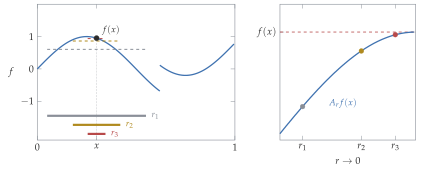
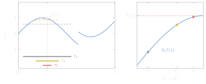

::: {#r-14-1 .callout-important .theorem-box}

#### Theorem 14.1 — The differentiation theorem for functions

If $f \in L^1_\mathrm{loc}(\mathbb R^n)$ then for Lebesgue a.e. point $x$ we have $$\lim_{r\rightarrow 0} A_r f(x) = f(x)$$

::: {.callout-note .proof-box collapse="true"}

#### Proof

It suffices to show this a.e. point in $[- N, N]^n$. If it holds for every N, it also holds for the full $\mathbb R^n$ since countable union of nullset is still a nullset. Therefore we may assume $f$ is 0 outside of $[-N-1, N+1]^n$ since we are anyways taking the limit as $r\rightarrow 0$ in the end, in which case we have that $f\in L^1(\mathbb R^n)$. This will be needed when we apply Hardy-Littlewoods maximal theorem. 
For any $\alpha >  0$ let $$E_\alpha = \{ x : \limsup_{r\rightarrow 0} |A_rf(x) - f(x)| > \alpha\}$$If we can show that $m(E_\alpha)  =0$ for each $\alpha$, then this implies the theorem since the set of points where the conclusion of the theorem fails is equal to $\bigcup_n E_{1/n}$ which then also has measure zero (which is just the definition of the statement being true a.e.)

It is not obvious a priori that $E_\alpha$ is Lebesgue measurable, however we will show it is contained inside a measurable sets of arbitrarily small measure, and its outer measure is thus zero and by completeness it will be Lebesgue measurable. 

Now fix $\alpha > 0$ and show $m(E_\alpha) = 0$. Fix $\epsilon > 0$. By [Theorem 12.3](lecture-12.qmd#r-12-3) we can find a continuous integrable function $g$ such that $$\int_{\mathbb R^n} |f(x) -g(x)| dm(x) < \epsilon$$ and thus$f-g \in L^1(\mathbb R^N$).
Observe that $$\limsup_{r\rightarrow 0}|A_r f(x) - f(x)| \leq \limsup_{r\rightarrow 0}|A_r(f-g)(x)| + \limsup_{r\rightarrow 0}|A_rg(x) - g(x)| + \limsup_{r\rightarrow 0}|g(x) - f(x)|$$ by the triangle inequality. The first term is at most $H(f-g)(x)$, and the second term is zero since the theorem is easily checked for continuous functions. Hence $$\limsup_{r\rightarrow 0}|A_r f(x) - f(x)| \leq H(f-g)(x) + |g(x)-f(x)|$$If the first term is larger than $\alpha$, then at least one of the terms on the RHS have to be larger than $\alpha/2$, i.e. $$E_\alpha \subseteq \{x: H(f-g)(x) > \alpha/2\} \cup \{x: |g(x) - f(x)| > \alpha/2\}$$
which is the union of two measurable sets, being preimages of measurable functions of Borel sets, and thus the outer measure and Lebesgue measure agree (being measurable)
Hence $$m^\star(E_\alpha) \leq m^\star(U) = m(\{x: H(f-g)(x) > \alpha/2\}) +m( \{x: |g(x) - f(x)| > \alpha/2\})$$
Using [Theorem 13.3](lecture-13.qmd#r-13-3) for the first term and Markov's inequality for the second we obtain $$m(E_\alpha) \leq \frac{2)(3)^n}{\alpha} \epsilon + \frac{2}{\alpha}\epsilon$$And since $\epsilon > 0$ arbitrary and the outer measure of $E_\alpha$ is zero, and the measure space is complete, $E_\alpha$ is also Lebesgue measurable with measure $m(E_\alpha) = 0$. $\square$
:::
:::

::: {#fig-l14-differentiation}
```{=html}
<div class="themed-figure"></div>
```

Left: the averages (dashed) of $f$ over the shrinking intervals $B(x,r)$. Right: the averages $A_rf(x)$ converge to $f(x)$ as $r\to0$, which happens at almost every point.
:::

What the above theorem tells us is that for any locally integrable function $f$, one has for Lebesgue a.e. $x$:
$$\lim_{r\to 0} \frac{1}{m(B(x,r))} \int_{B(x,r)} (f(y) - f(x))\, dm(y) = 0$$

This might be due to some cancellation. The following stronger result shows that this is not the case.

::: {#r-14-2 .callout-important .theorem-box}

#### Theorem 14.2 — Lebesgue points

For any locally integrable function $f$, one has for Lebesgue a.e. $x$:
$$\lim_{r\to 0} \frac{1}{m(B(x,r))} \int_{B(x,r)} |f(y) - f(x)|\, dm(y) = 0$$

The set of $x$ where this holds is called the **Lebesgue set** of $f$, denoted $\mathcal{L}_f$.
:::

The Lebesgue points of a function $f$ are therefore interpreted as points where $f$ does not oscillate too much, in an average sense. Finally, [Theorem 14.2](lecture-14.qmd#r-14-2) is a stronger version of [Theorem 14.1](lecture-14.qmd#r-14-1), and will allow us to replace balls by other types of sets (see [Corollary 14.4](lecture-14.qmd#r-14-4)).

::: {#r-14-3 .callout-note .definition-box}

#### Definition 14.3 — Shrinks Nicely

A collection of Borel sets $\{E_r\}_{0<r\leq 1}$ is said to **shrink nicely** to $x$ if for all $r \in (0,1]$:

1. $E_r \subseteq B(x,r)$
2. There exists $\alpha > 0$ such that $m(E_r) \geq \alpha\, m(B(x,r))$ for all $r$.

The second condition says that each $E_r$ occupies a substantial proportion of $B(x,r)$. Note there is no requirement that $x \in E_r$.
:::

::: {#r-14-4 .callout-important .corollary-box}

#### Corollary 14.4 — Lebesgue Points and Nicely Shrinking Sets

Let $f$ be locally integrable. If $x \in \mathcal{L}_f$ (and hence for $m$-a.e. $x$) and $\{E_r\}_{0<r\leq 1}$ are Borel sets shrinking nicely to $x$, then:
$$\lim_{r\to 0} \frac{1}{m(E_r)} \int_{E_r} |f(y) - f(x)|\, dm(y) = 0$$
and
$$\lim_{r\to 0} \frac{1}{m(E_r)} \int_{E_r} f(y)\, dm(y) = f(x)$$
:::

As a special case if $f\in L^1([0,1])$ and letting $E_r(x) = [x, x+r]$ one has $$(\int_0^x f(t) dm(t))'(x) =f(x)$$ for a.e. x. 

::: {#r-14-5 .callout-important .theorem-box}

#### Theorem 14.5 — Differentiation Theorem for Measures

Let $\nu$ be a regular Borel measure on $\mathbb{R}^n$ whose Lebesgue decomposition with respect to Lebesgue measure is given by $\nu = \nu_s + fm$. Then
$$\lim_{r\to 0} \frac{\nu(B(x,r))}{m(B(x,r))}$$
exists and equals $f(x)$ for Lebesgue a.e. $x$.

**Remark:** If $\nu \ll m$, this reduces to [Theorem 14.1](lecture-14.qmd#r-14-1).
:::

The intuition for the above result is that $\nu_s(N^c) = 0$ and $m(N)=0$ (by singularity), so $\nu_s$ puts all its mass on $N$, which is a Lebesgue null set. Thus, the ratio tells us that if we zoom into the measure $\nu$ by looking at how much mass it puts in a tiny ball around $x$, normalized by the volume, we recover the density $f$ at almost every point. 

It turns out we can generalize the above theorem to nicely shrinking sets.

::: {#r-14-6 .callout-important .corollary-box}

#### Corollary 14.6 — Differentiation for Measures over Nicely Shrinking Sets

Let $\nu$ be a regular Borel measure on $\mathbb{R}^n$ whose Lebesgue decomposition with respect to Lebesgue measure is given by $\nu = \nu_s + fm$. Then for Lebesgue a.e. $x$, if $\{E_r\}_{0<r\leq 1}$ are Borel sets shrinking nicely to $x$, then
$$\lim_{r\to 0} \frac{\nu(E_r)}{m(E_r)} = f(x)$$
:::

::: {#r-14-7 .callout-important .theorem-box}

#### Theorem 14.7 — Right continuous function has finite derivative

Let $F$ be a right continuous increasing function on $[0,1]$. Then $F$ has a finite derivative at Lebesgue a.e. $x$.
:::
