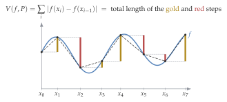
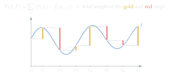

## Functions of bounded variation

::: {#r-15-1 .callout-note .definition-box}

#### **Definition 15.1** (Total variation, bounded variation and unbounded variation).

If $f:[0,1]\rightarrow \mathbb R$ we define the total variation of $f$ on $[a,b] \subseteq [a,b]$ to be $$TV_{[a,b]}(f) := \sup \{\sum_{i=1}^n |f(x_i) - f(x_{i-1}) \} : a = x_0 < x_1 < x_2 <...<x_n = b\}$$
We say $f$ is of bounded variation on $[a,b]$ if $TV_{[a,b]}f < \infty$ and of unbounded variation otherwise.
:::

Some basic facts about total variation:

1. If $f$ is increasing, then $TV_{[a,b]}(f) = f(b) - f(a)$.
2. $TV_{[a,b]}(-f) = TV_{[a,b]}(f)$.
3. The indicator function of the rationals has unbounded variation on every nontrivial interval.

For example, $f(x) = x \cos(\pi / (2x))$ (with $f(0) = 0$) has unbounded variation on $[0, 1]$, since it oscillates infinitely often near $0$ with amplitudes that decay too slowly. On $[\epsilon, 1]$ for any $\epsilon > 0$ it has a continuous derivative and hence bounded variation. The paths of Brownian motion are another standard example of unbounded variation.

::: {#fig-l15-bounded-variation}
```{=html}
<div class="themed-figure"></div>
```

The variation of $f$ over a partition $P$: the total length of the vertical steps between consecutive partition points.
:::

::: {#fig-viz-totalvariation-1}
```{=html}
<div id="viz-totalvariation-1" class="viz"></div>
<script>
(function() {
  if (typeof React === 'undefined') return;
  const { useState, useEffect, useRef } = React;
  function TotalVariation() {
    const ACCENT = "#b08a1e";
    const BG = "transparent";
    const BORDER = "rgba(128,128,128,0.35)";
    const TEXT = "var(--bs-body-color, #222)";
    const MUTED = "var(--bs-secondary-color, #777)";
    const BLUE = "#4a7ab5";
    const RED = "#b84a4a";
    
    // same function as the static figure
    const f = (x) => 0.5 + 0.33 * Math.sin(2 * Math.PI * 2.1 * x + 0.3) * (1 - 0.25 * x) + 0.18 * x;
    
    // total variation, computed on a very fine grid
    const TV = (() => { let s = 0, p = f(0); for (let i = 1; i <= 20000; i++) { const v = f(i / 20000); s += Math.abs(v - p); p = v; } return s; })();
    
    const W = 600, H = 300;
    const L = 40, Rr = 470, T = 18, B = 262;           // plot frame
    const GX = 535, GW = 26;                           // gauge for V(f,P)
    const yMin = 0.05, yMax = 1.05;
    const sx = (x) => L + x * (Rr - L);
    const sy = (y) => B - (y - yMin) / (yMax - yMin) * (B - T);
    
    const [k, setK] = useState(1);                     // partition into 2^k equal pieces (nested refinements)
    const n = Math.pow(2, k);
    const xs = Array.from({ length: n + 1 }, (_, i) => i / n);
    const ys = xs.map(f);
    let V = 0; for (let i = 1; i <= n; i++) V += Math.abs(ys[i] - ys[i - 1]);
    
    const curve = Array.from({ length: 301 }, (_, i) => { const x = i / 300; return (i ? "L" : "M") + sx(x).toFixed(1) + " " + sy(f(x)).toFixed(1); }).join(" ");
    const chords = xs.map((x, i) => (i ? "L" : "M") + sx(x).toFixed(1) + " " + sy(ys[i]).toFixed(1)).join(" ");
    
    const gTop = T + 10, gBot = B;                     // gauge scale 0 .. 1.15 TV
    const gy = (v) => gBot - v / (1.15 * TV) * (gBot - gTop);
    
    const el = React.createElement;
    return el("div", { style: { fontFamily: "inherit", color: TEXT } },
      el("div", { style: { display: "flex", gap: 14, alignItems: "center", flexWrap: "wrap", marginBottom: 4, fontSize: 15 } },
        el("button", { onClick: () => setK(Math.max(0, k - 1)), disabled: k === 0,
          style: { fontFamily: "inherit", fontSize: 15, padding: "2px 10px", borderRadius: 4, cursor: "pointer", background: "transparent", color: TEXT, border: "1px solid " + BORDER } }, "Coarser"),
        el("button", { onClick: () => setK(Math.min(7, k + 1)), disabled: k === 7,
          style: { fontFamily: "inherit", fontSize: 15, padding: "2px 10px", borderRadius: 4, cursor: "pointer", background: "transparent", color: ACCENT, border: "1px solid " + ACCENT, fontWeight: 700 } }, "Refine"),
        el("span", null, el("i", null, "n"), " = " + n + " intervals"),
        el("span", { style: { color: ACCENT } }, el("i", null, "V(f, P)"), " = " + V.toFixed(3)),
        el("span", { style: { color: MUTED } }, el("i", null, "TV(f)"), " = " + TV.toFixed(3))
      ),
      el("svg", { width: "100%", viewBox: "0 0 " + W + " " + H, style: { display: "block", background: "transparent" } },
        el("line", { x1: L, y1: B, x2: Rr + 8, y2: B, stroke: MUTED, strokeWidth: 1 }),
        el("line", { x1: L, y1: B, x2: L, y2: T, stroke: MUTED, strokeWidth: 1 }),
        el("path", { d: curve, fill: "none", stroke: BLUE, strokeWidth: 2.4, opacity: 0.9 }),
        el("path", { d: chords, fill: "none", stroke: TEXT, strokeWidth: 1.2, strokeDasharray: "5 4", opacity: 0.8 }),
        xs.slice(1).map((x, i) => {
          const a = ys[i], b = ys[i + 1];
          return el("line", { key: "s" + i, x1: sx(x), y1: sy(a), x2: sx(x), y2: sy(b), stroke: b >= a ? ACCENT : RED, strokeWidth: n > 32 ? 2 : 4, opacity: 0.95 });
        }),
        n <= 32 && xs.map((x, i) => el("circle", { key: "p" + i, cx: sx(x), cy: sy(ys[i]), r: 2.6, fill: TEXT })),
        n <= 16 && xs.map((x, i) => el("line", { key: "t" + i, x1: sx(x), y1: B - 4, x2: sx(x), y2: B + 4, stroke: MUTED, strokeWidth: 1 })),
        el("text", { x: sx(1) + 6, y: sy(f(1)) - 4, fill: BLUE, fontSize: 16, fontStyle: "italic", fontFamily: "inherit" }, "f"),
    
        // gauge: V(f, P) grows towards TV(f) under refinement
        el("rect", { x: GX, y: gTop, width: GW, height: gBot - gTop, fill: "none", stroke: MUTED, strokeWidth: 1 }),
        el("rect", { x: GX, y: gy(V), width: GW, height: gBot - gy(V), fill: ACCENT, opacity: 0.75 }),
        el("line", { x1: GX - 6, y1: gy(TV), x2: GX + GW + 6, y2: gy(TV), stroke: TEXT, strokeWidth: 1.5, strokeDasharray: "4 3" }),
        el("text", { x: GX - 10, y: gy(TV) + 4, fill: TEXT, fontSize: 13, fontStyle: "italic", textAnchor: "end", fontFamily: "inherit" }, "TV(f)"),
        el("text", { x: GX + GW / 2, y: B + 18, fill: ACCENT, fontSize: 13, fontStyle: "italic", textAnchor: "middle", fontFamily: "inherit" }, "V(f,P)")
      )
    );
  }
  var el = document.getElementById('viz-totalvariation-1');
  if (el) ReactDOM.createRoot(el).render(React.createElement(TotalVariation));
})();
</script>
```

Interactive: refining the partition (each refinement halves every interval) can only increase $V(f,P)$, which climbs to $TV(f)$.
:::

::: {#r-15-2 .callout-important .theorem-box}

#### **Theorem 15.2** ($f$ is of bounded variation iff).

$f$ is of bounded variation if and only if there exist increasing functions $g,h$ so that $f = g-h$
:::

Writing a function of bounded variation as $f = g - h$ with $g, h$ increasing lets us integrate against $f$. The *Lebesgue–Stieltjes integral* of $r$ with respect to $f$ is
$$\int r(x) \, df(x) := \int r(x) \, d\mu_g(x) - \int r(x) \, d\mu_h(x),$$
where $\mu_g, \mu_h$ are the measures associated with $g, h$. It is not defined when $f$ has unbounded variation. When $f$ is continuously differentiable, $\int r(x) \, df(x) = \int r(x) f'(x) \, dx$.

There is a one-to-one correspondence between signed measures and right-continuous functions of bounded variation, which we discuss hereafter.

## Absolutely continuous functions

::: {#r-15-3 .callout-note .definition-box}

#### **Definition 15.3** (Absolutely continuous function).

$f : [0,1] \rightarrow \mathbb{R}$ is absolutely continuous if for all $\epsilon > 0$, there exists $\delta > 0$ so that if $0 \leq x_1 < y_1 < x_2 < y_2 < \ldots < x_n < y_n \leq 1$ and $$\sum_{i=1}^n (y_i - x_i) < \delta$$, then $$\sum_{i=1}^n |f(y_i) - f(x_i)| < \epsilon$$
:::

Absolute continuity says that if the total length of a collection of intervals is small, then the total change of $f$ over them is small too. Since a null set can be covered by intervals of arbitrarily small total length, $f$ cannot increase on a set of measure zero. Taking $n = 1$ in the definition shows that an absolutely continuous function is continuous, and hence uniformly continuous on the compact interval $[0,1]$.

::: {.callout-caution .example-box}

#### **Example** (The Cantor function is not absolutely continuous).

At stage $n$ of the Cantor set construction, $2^n$ closed intervals $[x_i, y_i]$ remain, of total length $(2/3)^n \to 0$. The Cantor function $F_C$ is constant on each removed middle third and increasing, so all of its growth happens on the remaining intervals:
$$\sum_{i=1}^{2^n} |F_C(y_i) - F_C(x_i)| = F_C(1) - F_C(0) = 1.$$
With $\epsilon = 1/2$, no $\delta > 0$ works: choosing $n$ with $(2/3)^n < \delta$ gives intervals of total length below $\delta$ on which $F_C$ changes by $1 > \epsilon$.
:::

::: {#r-15-4 .callout-important .proposition-box}

#### **Proposition 15.4** (Absolute continuity of a function).

Let $f$ be a nonnegative right-continuous increasing function on $[0,1]$ with $f(0) = 0$. Then $f$ is absolutely continuous if and only if $\mu_f << m$ where $m$ is the Lebesgue measure.
:::

This is consistent with the result for Cantor ternary function (which is n.n. right continuous and increasing). The corresponding Cantor ternary measure (which again is a unique finite Borel measure) where $\mu_C(C) = 1$ and $m(C) = 0$ so clearly $\mu_C$ is not absolutely continuous wrt to $m$. By contrapositive, $F_c$ is therefore not absolutely continuous. 

::: {#r-15-5 .callout-important .proposition-box}

#### **Proposition 15.5** (Absolute continuity implies bounded variation).

If $f:[0,1] \rightarrow \mathbb R$ is absolutely continuous, then it has bounded variation.
:::

## The second fundamental theorem of calculus
If $f:[0,1] \rightarrow \mathbb R$ is increasing, does $$\int_0^1 f'(x) dx = f(1) - f(0) ?$$
Recall that an increasing function has a derivative a.e ([Theorem 14.7](lecture-14.qmd#r-14-7)).

::: {#r-15-6 .callout-caution .example-box}

#### **Example 15.6** (The FTC fails for the Cantor function).

The Cantor ternary function $F_C$ ([Theorem 4.6](lecture-04.qmd#r-4-6)) is increasing and continuous, with $F_C(0) = 0$ and $F_C(1) = 1$. By [Corollary 4.7](lecture-04.qmd#r-4-7) (c), $F_C' = 0$ almost everywhere: $F_C$ is constant on each open interval removed in the construction of the Cantor set, and these intervals have total length $1$. Hence
$$\int_0^1 F_C'(x)\,dx = 0 < 1 = F_C(1) - F_C(0).$$
So the answer to the question above is no in general: being increasing, and even continuous, is not enough, and the inequality in the next theorem can be strict. The missing ingredient is absolute continuity, see [Theorem 15.8](lecture-15.qmd#r-15-8) (3): $F_C$ is not absolutely continuous, since the Cantor measure $\mu_C$ lives on the Cantor set, which has Lebesgue measure zero.
:::

::: {#r-15-7 .callout-important .theorem-box}

#### **Theorem 15.7** (The fundamental theorem of calculus for monotone increasing functions).

If $f:[0,1]\rightarrow \mathbb R$ is monotone increasing, then $$\int_0^1 f'(x) dx \leq f(1) - f(0)$$
:::

::: {#r-15-8 .callout-important .theorem-box}

#### **Theorem 15.8**.

Let $f$ be a nonneg right-continuous monotone increasing function on $[0,1]$ with $f(0) = 0$. Let $\mu_f$ be the associated measure on $[0,1]$ and consider the Lebesgue decomposition $\mu_f = \mu_s + \mu_{ac}$ with respect to Lebesgue measure. Then:

1. The Radon-Nikodym derivative of $\mu_{ac}$ with respect to Lebesgue measure is given by $f'$.

2. $\mu_{ac}[0,1] = \int_0^1 f'(x)\, dx$.

3. $f$ is absolutely continuous if and only if $\int_0^1 f'(x)\, dx = f(1) - f(0)$. (So the second FTC holds if and only if $f$ is absolutely continuous.)

4. $\mu_f$ is singular if and only if $f'(x) = 0$ a.e.
:::

::: {#r-15-9 .callout-caution .example-box}

#### **Example 15.9** (A singular measure).

By [Theorem 15.8](lecture-15.qmd#r-15-8), we have that $\mu_C$ is singular iff $F'_C(x) = 0$ lebesgue a.e., which we know is true. So the Cantor measure is a singular measure. 
:::
