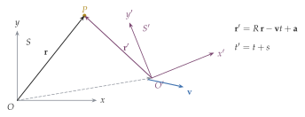
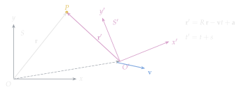

## What is a symmetry?

A symmetry can, qualitatively speaking, be thought of as a transformation which leaves a physical system unchanged. A simple example of a symmetry is rotating a ball in 3D space, or some 2D shape which is symmetric under reflections along some axis, like a square.

::: {#r-1-1 .callout-note .definition-box}

#### **Definition 1.1** (Symmetry).

A symmetry of a physical system is a transformation which leaves the system unchanged.
:::

What is considered a symmetry is also theory-dependent. For example, in the theory of Newtonian mechanics, one of the three axioms is Newton's second law, which relates the acceleration experienced by a material object to the total external force acting on it:
$$m \ddot{\mathbf{r}} = \mathbf{F}.$$ {#eq-newton}
In the forceless case $\mathbf{F} = 0$, the equation is left invariant by any spatial transformation of the form
$$\mathbf{r}' = \underbrace{R}_{\text{rotation}}\,\mathbf{r} - \underbrace{\mathbf{v}t}_{\text{boost}} + \underbrace{\mathbf{a}}_{\text{translation}},$$ {#eq-galilean}
where the second contribution is the transformation between coordinates of two reference frames that only differ by a constant relative motion. The equation is also left invariant under the time translation
$$t' = t + s.$$

::: {#fig-galilean-frames}
```{=html}
<div class="themed-figure"></div>
```

The same point $P$ seen from two frames. $S'$ is rotated relative to $S$, its origin is shifted, and it moves with constant velocity $\mathbf v$. In the absence of forces, Newton's second law takes the same form in both frames.
:::

In total, there are 10 free parameters which describe the full symmetry of this equation: 3 for rotations,[^1] 3 for boosts since the velocity vector is 3-dimensional, 3 for spatial translations, and 1 for time translation. This symmetry of Newtonian mechanics goes under the name of **Galilean invariance**. In the theory of special relativity, Galilean invariance is replaced by **Poincaré invariance** (which we will discuss later).

In these notes, we will learn that each symmetry of a theory is related to some conservation law. Translation invariance in space is related to conservation of momentum, whereas translation invariance in time is related to conservation of energy. This goes under the more general name of **Noether's theorem**.

## A first simple example

For a conservative force field, we have $\mathbf{F} = -\nabla V(\mathbf{r})$, and thus Newton's law ([-@eq-newton]) reduces to
$$\dot{\mathbf{p}} = -\nabla V(\mathbf{r}).$$ {#eq-conservative}
Now apply an infinitesimal spatial translation $\mathbf{r} \to \mathbf{r} + \boldsymbol{\epsilon}$ and perform a Taylor expansion of the potential:
$$V(\mathbf{r} + \boldsymbol{\epsilon}) = V(\mathbf{r}) + \boldsymbol{\epsilon} \cdot \nabla V(\mathbf{r}) + \mathcal{O}(\epsilon^2).$$
Under this translation, the change in the potential is, to first order in $\epsilon$,
$$\delta V = \boldsymbol{\epsilon} \cdot \nabla V(\mathbf{r}).$$
If the physics remains the same under translations in every direction $\boldsymbol\epsilon$, we must have $\delta V = 0$, which holds if and only if $\nabla V = 0$, which by ([-@eq-conservative]) in turn implies that momentum is conserved. Therefore, translation symmetry of the potential is related to conservation of momentum. This makes sense: if there is no gradient of the underlying force field, it looks the same everywhere, and there is no preferred direction for a force to act.

## Invariance and conservation

::: {#r-1-2 .callout-note .definition-box}

#### **Definition 1.2** (Invariance).

A quantity is **invariant** under a transformation if its numerical value is unchanged by that transformation. Invariance compares quantities *between reference frames*.
:::

::: {#r-1-3 .callout-note .definition-box}

#### **Definition 1.3** (Conservation).

A quantity is **conserved** during a process if its value does not change throughout that process. Conservation compares a quantity *before and after a process within a fixed frame*.
:::

Noether's theorem relates conservation laws to invariance, and thereby to symmetries. In the following example, we highlight the distinction between invariance and conservation.

::: {.callout-caution .example-box}

#### **Example** (Threshold energy for $p + p \rightarrow 3p + \bar{p}$).

**Problem.** A proton of mass $m$ with kinetic energy $K$ strikes a proton at rest in the lab frame. Find the minimal threshold energy $K_\text{th}$ to induce the reaction $p + p \rightarrow 3p + \bar{p}$.

In solving this problem, we make use of the fact that conservation of 4-momentum means the quantity $E^2 - p^2c^2$ is preserved during the process, and Lorentz invariance means it takes the same value in all inertial frames. We will compute the quantity in both the lab frame and the centre of mass frame.

*Lab frame.* The total energy of the two particles before the collision is $K + mc^2$ for the moving proton and $mc^2$ for the stationary proton. The total momentum is simply the momentum $p$ of the moving particle, with $p^2c^2 = (K + mc^2)^2 - m^2c^4$:
$$E_\text{tot}^2 - p_\text{tot}^2c^2 = (K+2mc^2)^2 - p^2c^2 = 4m^2c^4 + 2Kmc^2.$$ {#eq-lab-invariant}

*CM frame at threshold.* The total momentum is zero by definition. At threshold, none of the original kinetic energy goes into kinetic energy of the products. It is instead entirely converted into the rest energy of the three protons and the single antiproton, with total rest energy $4mc^2$:
$$E_\text{tot}^2 - p_\text{tot}^2c^2 = (4mc^2)^2 = 16m^2c^4.$$ {#eq-cm-invariant}

Since the quantity is Lorentz invariant, we equate ([-@eq-lab-invariant]) and ([-@eq-cm-invariant]), which gives $2Kmc^2 = 12m^2c^4$, so the threshold energy is $K_\text{th} = 6mc^2$.
:::

## Covariance

Before proceeding, we also have to discuss the concept of covariance. Returning to ([-@eq-newton]), it is important to stress that $\mathbf{F} = m\mathbf{a}$ is a relation between two abstract vectors $\mathbf{a}$ (acceleration) and $\mathbf{F}$ (force) and a scalar $m$.[^2] A vector is simply an element of an abstract vector space, and one cannot speak of its components without first introducing a basis. A basis, in turn, defines a coordinate system: a useful construct for solving problems, but not part of the physics itself.

::: {#r-1-4 .callout-note .definition-box}

#### **Definition 1.4** (Covariance).

An equation is **covariant** if it takes the same form in all reference frames, i.e. it is independent of the choice of coordinate system.
:::

If we aim to write physical laws that transcend a specific choice of coordinate system (which we do, since the equations governing the universe should hold irrespective of our coordinate choice), we must write them in a covariant way. For example, in Cartesian coordinates the equation reads
$$m\ddot{x} = F_x, \quad m\ddot{y} = F_y, \quad m\ddot{z} = F_z,$$
while in polar coordinates the same law takes the form
$$m(\ddot{r} - r\dot{\theta}^2) = F_r, \quad m(r\ddot{\theta} + 2\dot{r}\dot{\theta}) = F_\theta.$$
The components look different, but both sets of equations express the one coordinate-free statement $m\mathbf a = \mathbf F$.

[^1]: A rotation is always defined with respect to an axis. An axis is defined as normal to a plane spanned by two basis vectors, and in 3-dimensional space there are $\binom{3}{2} = 3$ ways to choose such a plane.

[^2]: It is difficult not to read $\mathbf{F} = m\mathbf{a}$ as a statement about vectors in three-dimensional space, and indeed, knowing the space is three-dimensional already implies something about the basis: the dimension of a vector space is defined as the cardinality of a basis. So in naming the dimension we have implicitly acknowledged that a basis exists, even if we have not chosen one explicitly. The notion of a basis typically introduced in introductory linear algebra courses is a so-called Hamel basis: a subset $B\subseteq V$ is a (Hamel) basis if (1) every *finite* $\{e_1,\ldots,e_n\} \subseteq B$ is linearly independent, i.e. $\sum_{i=1}^n \lambda_i e_i = 0$ iff $\lambda_i=0$ for all $i$, and (2) for every $v\in V$ there is a *finite* subset $\{e_1,\ldots,e_n\}\subseteq B$ and complex numbers $v_1,\ldots,v_n$ such that $v=\sum_{i=1}^n v_i e_i$ (based on [this lecture](https://www.youtube.com/watch?v=5OGCIwx0phI&list=PLPH7f_7ZlzxQVx5jRjbfRGEzWY_upS5K6&index=3)).
