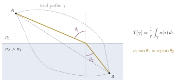
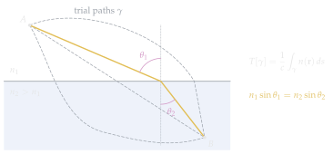

## Functionals and the action

As we will see shortly, the quantities whose invariance leads to conservation laws are called functionals. We define a functional more formally below.

::: {#r-2-1 .callout-note .definition-box}

#### **Definition 2.1** (Functional).

A **functional** $F$ is a map $F: V\rightarrow \mathbb F$ from some vector space $V$ to some field $\mathbb F$.
:::

In what follows, $V$ will represent a space of functions and we will take the field to be $\mathbb R$. This will allow us to map functions (or if you will, curves) to real numbers.

::: {#r-2-2 .callout-note .definition-box}

#### **Definition 2.2** (Action and Lagrangian).

Let $V$ be the space of twice continuously differentiable paths
$$C^2([a,b],\, \mathbb{R}^N) = \bigl\{\, q : [a,b] \to \mathbb{R}^N \;\big|\; q \text{ is twice continuously differentiable}\,\bigr\},$$
where $t \in [a,b]$ is time, and $q^\mu(t)$, $\mu = 1,\ldots, N$, denotes $N$ dependent variables (which we will later refer to as generalized coordinates). The **action** is the functional $S: C^2([a,b], \mathbb{R}^N) \to \mathbb{R}$ given by
$$S[q^\mu] = \int_a^b L\bigl(q^\mu(t),\, \dot{q}^\mu(t),\, t\bigr)\, dt,$$ {#eq-action}
where the integrand $L : \mathbb{R}^N \times \mathbb{R}^N \times \mathbb{R} \to \mathbb{R}$ is called the **Lagrangian**. We take $L$ to be twice continuously differentiable in all its arguments. The action assigns a single real number to every path $q^\mu$.
:::

It will become clearer later why we require the $q^\mu$ and $L$ to be twice continuously differentiable; for everything that follows, this much smoothness will suffice. To spoil it for the reader: a Lagrangian depending on up to $k$-th order time derivatives yields equations of motion (to be defined later) involving derivatives of order up to $2k$. Since we will take $L$ to depend on $q^\mu$ and $\dot{q}^\mu$ only, the resulting equations involve at most second-order time derivatives, which is the typical situation in physics.[^3]

So far, the functional seems rather abstract, and we will postpone our discussion of the Lagrangian for now. To get a better feeling for the purpose of a functional, we consider some examples.

## Fermat's principle

::: {.callout-caution .example-box}

#### **Example** (Light travelling through a medium).

Consider light travelling through a medium with refractive index $n(\mathbf{r})$, where $c$ is the speed of light in vacuum, so that the local speed of light in the medium is $c/n(\mathbf{r})$. It turns out that the path light takes is the one that minimises the travel time. To each curve $\gamma$ connecting two fixed points in space we can associate the travel time
$$T[\gamma] = \frac{1}{c}\int_\gamma n(\mathbf{r})\, ds,$$ {#eq-fermat}
where $ds$ is the arc length element along $\gamma$. The actual path of light is the one that minimises $T$. This result is known as **Fermat's principle**, and $T$ is an example of a functional: it takes a whole curve as input and returns a single number.
:::

::: {#fig-fermat-paths}
```{=html}
<div class="themed-figure"></div>
```

Every curve $\gamma$ from $A$ to $B$ gets a travel time $T[\gamma]$. Light follows the one with the least travel time: straight in each medium, bent at the interface according to Snell's law.
:::

For two uniform media, the functional ([-@eq-fermat]) becomes easy to work with. Within each medium $n$ is constant, so the fastest path is straight there, and the only freedom left is where the path crosses the interface. The functional then reduces to an ordinary function $T(x)$ of the crossing point $x$, and setting $T'(x) = 0$ gives Snell's law $n_1 \sin\theta_1 = n_2 \sin\theta_2$. You can find this minimum by hand below.

::: {#fig-viz-fermat}
```{=html}
<div id="viz-fermat" class="viz"></div>
<script>
(function() {
  if (typeof React === 'undefined') return;
  const { useState, useEffect, useRef } = React;
  // Light from A (above the interface) to B (below). The path is two straight pieces meeting the
  // interface at x; the travel time T(x) is a function of one number, and its minimum is Snell's law.
  function Fermat() {
    const ACCENT = "#b08a1e", PLUM = "#9a5a8f", BLUE = "#3f72b0";
    const BORDER = "rgba(128,128,128,0.35)";
    const TEXT = "var(--bs-body-color, #222)";
    const MUTED = "var(--bs-secondary-color, #777)";
    const [n1, setN1] = useState(1.0);
    const [n2, setN2] = useState(1.5);
    const [x, setX] = useState(0.25);
    const anim = useRef(null), svg = useRef(null), dragging = useRef(false);
    const A = { x: 0, y: 1 }, B = { x: 1, y: -1 };                // units of the drawing; c = 1
    const T = (u) => n1 * Math.hypot(u - A.x, A.y) + n2 * Math.hypot(B.x - u, B.y);
    let best = 0.5;                                                 // golden-section search for the minimum of T
    { let lo = 0, hi = 1; for (let i = 0; i < 60; i++) { const m1 = hi - (hi - lo) / 1.618, m2 = lo + (hi - lo) / 1.618; if (T(m1) < T(m2)) hi = m2; else lo = m1; } best = (lo + hi) / 2; }
    const s1 = (x - A.x) / Math.hypot(x - A.x, A.y), s2 = (B.x - x) / Math.hypot(B.x - x, B.y);
    const atMin = Math.abs(x - best) < 0.004;
    const glide = () => {
      cancelAnimationFrame(anim.current);
      const from = x, t0 = performance.now();
      const tick = (t) => { const u = Math.min(1, (t - t0) / 800), e = 1 - Math.pow(1 - u, 3);
        setX(from + (best - from) * e); if (u < 1) anim.current = requestAnimationFrame(tick); };
      anim.current = requestAnimationFrame(tick);
    };
    useEffect(() => () => cancelAnimationFrame(anim.current), []);

    // left panel: the two media and the path; right panel: T as a function of the crossing point
    const W = 660, H = 330, PL = 30, PR = 330, PT = 24, PB = 306;
    const mx = (u) => PL + 25 + u * (PR - PL - 50), my = (v) => (PT + PB) / 2 - v * (PB - PT - 40) / 2;
    const GL = 390, GR = 640, GT = 40, GB = 280;
    const xs = Array.from({ length: 121 }, (_, i) => i / 120), Ts = xs.map(T);
    const tmin = Math.min(...Ts), tmax = Math.max(...Ts);
    const gx = (u) => GL + u * (GR - GL), gy = (v) => GB - (v - tmin) / Math.max(1e-6, tmax - tmin) * (GB - GT);
    const curve = xs.map((u, i) => (i ? "L" : "M") + gx(u).toFixed(1) + "," + gy(Ts[i]).toFixed(1)).join("");
    const fromEvent = (ev) => {
      const r = svg.current.getBoundingClientRect(), px = (ev.clientX - r.left) / r.width * W;
      return Math.max(0, Math.min(1, (px - (px > (PR + GL) / 2 ? GL : mx(0))) / ((px > (PR + GL) / 2 ? GR - GL : mx(1) - mx(0)))));
    };
    const down = (ev) => { cancelAnimationFrame(anim.current); dragging.current = true; ev.currentTarget.setPointerCapture(ev.pointerId); setX(fromEvent(ev)); };
    const move = (ev) => { if (dragging.current) setX(fromEvent(ev)); };
    const up = () => { dragging.current = false; };
    const el = React.createElement;
    const PAL = '"Palatino Linotype", Palatino, "Book Antiqua", "URW Palladio L", "TeX Gyre Pagella", P052, serif';
    const btn = { font: "inherit", fontFamily: PAL, fontSize: 16, padding: "1px 2px", background: "transparent", color: TEXT, border: "none", borderBottom: "1.5px solid " + ACCENT, borderRadius: 0, cursor: "pointer", fontStyle: "italic" };
    const slider = (label, v, set) => el("label", { style: { display: "flex", alignItems: "center", gap: 8 } },
      el("i", null, label[0]), el("sub", { style: { marginLeft: -6 } }, label[1]),
      el("input", { type: "range", min: 1, max: 2.5, step: 0.01, value: v, onChange: (e) => set(+e.target.value), style: { width: 110, accentColor: BLUE } }),
      el("span", { style: { minWidth: 34 } }, v.toFixed(2)));

    return el("div", { style: { fontFamily: PAL, color: TEXT } },
      el("div", { style: { display: "flex", gap: 20, flexWrap: "wrap", alignItems: "center", fontSize: 15, marginBottom: 6 } },
        slider("n1", n1, setN1), slider("n2", n2, setN2),
        el("button", { type: "button", style: btn, onClick: glide }, "find the fastest path")),
      el("svg", { ref: svg, width: "100%", viewBox: "0 0 " + W + " " + H, style: { display: "block", background: "transparent", touchAction: "none", cursor: "ew-resize" },
          onPointerDown: down, onPointerMove: move, onPointerUp: up, onPointerCancel: up },
        el("rect", { x: PL, y: my(0), width: PR - PL, height: PB - my(0), fill: BLUE, opacity: 0.06 + 0.1 * (n2 - 1) / 1.5 }),
        el("rect", { x: PL, y: PT, width: PR - PL, height: my(0) - PT, fill: BLUE, opacity: 0.06 + 0.1 * (n1 - 1) / 1.5 }),
        el("line", { x1: PL, y1: my(0), x2: PR, y2: my(0), stroke: BORDER, strokeWidth: 1.2 }),
        el("text", { x: PL + 6, y: my(0) - 8, fill: MUTED, fontSize: 13, fontFamily: PAL, fontStyle: "italic" }, "n₁"),
        el("text", { x: PL + 6, y: my(0) + 20, fill: MUTED, fontSize: 13, fontFamily: PAL, fontStyle: "italic" }, "n₂"),
        // the fastest path, faintly, for comparison
        !atMin && el("polyline", { points: [mx(A.x), my(A.y), mx(best), my(0), mx(B.x), my(B.y)].join(","), fill: "none", stroke: ACCENT, strokeWidth: 1, strokeDasharray: "4 4", opacity: 0.6 }),
        el("line", { x1: mx(x), y1: my(0.85), x2: mx(x), y2: my(-0.85), stroke: BORDER, strokeDasharray: "2 3" }),
        el("polyline", { points: [mx(A.x), my(A.y), mx(x), my(0), mx(B.x), my(B.y)].join(","), fill: "none", stroke: atMin ? ACCENT : PLUM, strokeWidth: 2.2, strokeLinejoin: "round" }),
        el("circle", { cx: mx(x), cy: my(0), r: 7, fill: atMin ? ACCENT : PLUM, stroke: "var(--bs-body-bg, #fff)", strokeWidth: 1.5, style: { cursor: "ew-resize" } }),
        el("circle", { cx: mx(A.x), cy: my(A.y), r: 3.5, fill: TEXT }), el("text", { x: mx(A.x) - 10, y: my(A.y) - 6, fill: TEXT, fontSize: 14, fontStyle: "italic", fontFamily: PAL }, "A"),
        el("circle", { cx: mx(B.x), cy: my(B.y), r: 3.5, fill: TEXT }), el("text", { x: mx(B.x) + 6, y: my(B.y) + 16, fill: TEXT, fontSize: 14, fontStyle: "italic", fontFamily: PAL }, "B"),
        // T(x)
        el("line", { x1: GL, y1: GB, x2: GR, y2: GB, stroke: BORDER }),
        el("line", { x1: GL, y1: GT - 10, x2: GL, y2: GB, stroke: BORDER }),
        el("text", { x: GL + 6, y: GT - 16, fill: MUTED, fontSize: 13, fontFamily: PAL, fontStyle: "italic" }, "travel time  T"),
        el("text", { x: GR, y: GB + 20, fill: MUTED, fontSize: 13, fontFamily: PAL, fontStyle: "italic", textAnchor: "end" }, "crossing point  x"),
        el("path", { d: curve, fill: "none", stroke: BLUE, strokeWidth: 1.8 }),
        el("line", { x1: gx(best), y1: gy(tmin), x2: gx(best), y2: GB, stroke: ACCENT, strokeDasharray: "3 3", opacity: 0.8 }),
        el("circle", { cx: gx(x), cy: gy(T(x)), r: 6, fill: atMin ? ACCENT : PLUM, stroke: "var(--bs-body-bg, #fff)", strokeWidth: 1.5 })
      ),
      el("div", { style: { display: "flex", gap: 22, flexWrap: "wrap", fontSize: 15, marginTop: 4, justifyContent: "center" } },
        el("span", { style: { color: atMin ? ACCENT : PLUM } }, "T = " + T(x).toFixed(3) + "   (fastest " + tmin.toFixed(3) + ")"),
        el("span", null, "n₁ sin θ₁ = " + (n1 * s1).toFixed(3)),
        el("span", null, "n₂ sin θ₂ = " + (n2 * s2).toFixed(3)),
        el("span", { style: { color: atMin ? ACCENT : MUTED, fontStyle: "italic" } }, atMin ? "Snell's law holds exactly here" : "drag the crossing point"))
    );
  }
  var el = document.getElementById('viz-fermat');
  if (el) ReactDOM.createRoot(el).render(React.createElement(Fermat));
})();
</script>
```

Interactive: drag the crossing point (or the point on the curve) to change the path from $A$ to $B$. The right panel shows the travel time of each path; at its minimum, $n_1\sin\theta_1 = n_2\sin\theta_2$.
:::

## Exercises

To conclude this relatively short chapter, we work through some problems from the book.

::: {.callout-caution .example-box}

#### **Exercise Q2.a** (When are these functionals non-trivial?).

When are the following functionals non-trivial, that is, when does their value depend on the full path rather than just the endpoints?

**(a)** Mechanical work as a particle moves from position $\mathbf{a}$ to position $\mathbf{b}$, acted upon by force $\mathbf{F}$:
$$W = \int_{\mathbf a}^{\mathbf b} \mathbf{F} \cdot d\mathbf{r}.$$

::: {.callout-note .proof-box collapse="true"}

#### Solution

For non-conservative force fields, the work becomes path-dependent. For conservative force fields, the work depends only on the endpoints.
:::

**(b)** The voltage induced by Faraday's law, $\oint_\mathcal{C} \mathbf{E} \cdot d\mathbf{r}$, where $\mathbf{E}$ is the electric field and $\mathcal{C}$ a closed path.

::: {.callout-note .proof-box collapse="true"}

#### Solution

Same as in (a). $\mathbf{E}$ is conservative if and only if $\nabla \times \mathbf{E} = 0$, which by Faraday's law $\nabla\times\mathbf E = -\partial_t\mathbf B$ holds exactly when $\partial_t \mathbf{B} = 0$. So once $\partial_t \mathbf{B} \neq 0$, the integral is a non-trivial functional.
:::

**(c)** The flux of an electric, magnetic, or gravitational vector field through a specific surface.

::: {.callout-note .proof-box collapse="true"}

#### Solution

The flux is $\Phi = \int_S \mathbf{F} \cdot d\mathbf{S}$ over some surface $S$. If $\nabla \cdot \mathbf{F} = 0$, the flux depends only on the boundary of $S$ by Gauss's theorem. So it is only a non-trivial functional whenever $\nabla \cdot \mathbf{F} \neq 0$.
:::
:::

::: {.callout-caution .example-box}

#### **Exercise Q2.c** (Functionals that are not definite integrals).

Construct one or more functionals that are *not* definite integrals.

::: {.callout-note .proof-box collapse="true"}

#### Solution

Two examples: $S[f] := \sup_{t \in [a,b]} f(t)$, which returns the maximum value of $f$ on the interval, and $S[f] := \#\{t \in [a,b] \mid f(t) = 0\}$, which counts the number of zeros of $f$.
:::
:::

::: {.callout-caution .example-box}

#### **Exercise 2.2** (Hamilton's principle).

According to Hamilton's principle, the action functional
$$\Gamma = \int_0^T (K - U)\, dt,$$ {#eq-hamilton}
when minimized, determines the particle's trajectory. Define the total mechanical energy $E = K + U$ and the kinetic energy $K = \frac{1}{2}m\dot{x}^2$.

**(b)** Show that $\Gamma = \displaystyle\int_{x(0)}^{x(T)} p\, dx - \int_0^T E\, dt$, where $p = m\dot x$.

::: {.callout-note .proof-box collapse="true"}

#### Solution

Since $K - U = 2K - E$, we have $\Gamma = \int_0^T 2K\,dt - \int_0^T E\,dt$. Since $p = m\dot{x}$, we have $2K = p\dot{x}$, so
$$\int_0^T 2K\,dt = \int_0^T p\dot{x}\,dt = \int_{x(0)}^{x(T)} p\,dx$$
by substituting $dx = \dot{x}\,dt$.
:::

**(c)** Show that $p = \dfrac{\partial \Gamma}{\partial x}$ and $E = -\dfrac{\partial \Gamma}{\partial t}$.

::: {.callout-note .proof-box collapse="true"}

#### Solution

Differentiating with respect to the upper limit $x$ gives $p$ by the first fundamental theorem of calculus (see [Theorem 12.2](../integration-theory/lecture-12.html#r-12-2) in the Integration Theory notes), whereas differentiating with respect to the upper limit $t$ gives $-E$ from the second integral, by the same theorem.
:::

**(d)** If $E = \text{const.}$, show that Hamilton's principle reduces to $\displaystyle\int_{x(0)}^{x(T)} p\, dx = \min$.

::: {.callout-note .proof-box collapse="true"}

#### Solution

If $E = \text{const.}$, then $\int_0^T E\,dt = ET$ is a constant independent of the path. Minimising $\Gamma$ in ([-@eq-hamilton]) therefore reduces to minimising $\int_{x(0)}^{x(T)} p\,dx$ alone.
:::
:::

## References {.unnumbered}

1. []{#ref-1}Abraham–Lorentz force, *Wikipedia*. [en.wikipedia.org](https://en.wikipedia.org/wiki/Abraham%E2%80%93Lorentz_force)

[^3]: There are exceptions to this. A notable example is the Lorentz–Abraham–Dirac force [[1]](#ref-1): a charged particle undergoing acceleration emits electromagnetic radiation, and the recoil from this radiation acts back on the particle itself. It turns out that the equation governing the position of this particle involves the jerk of the position (the third-order time derivative).
