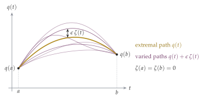
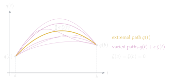
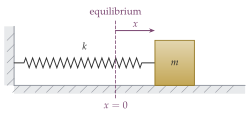
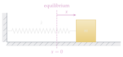

## Extremal problems

In the [previous chapter](lecture-02.qmd#fermats-principle), Snell's law came out of an *extremal problem*: among all paths from $A$ to $B$, light takes the one of least travel time. Hamilton's principle ([Exercise 2.2](lecture-02.qmd#exercises)) says the same about mechanics: the trajectory is the one that makes the time integral of $K - U$ extremal.

In each case we look for the extremal of a functional, and finding it amounts to solving a differential equation, the **Euler–Lagrange equation**. This chapter derives that equation.

We use the setting of [Definition 2.2](lecture-02.qmd#r-2-2):
$$\Gamma[q^\mu] = \int_a^b L\bigl(q^\mu(t),\, \dot q^\mu(t),\, t\bigr)\, dt,$$ {#eq-functional}
with independent variable $t$ and $N$ **generalized coordinates** $q^\mu(t)$, $\mu = 1, \ldots, N$. We compare paths with the same endpoints $q^\mu(a)$ and $q^\mu(b)$; recall that $L$ is twice continuously differentiable. Repeated indices are summed over: $\frac{\partial L}{\partial q^\mu}\zeta^\mu = \sum_{\mu=1}^N \frac{\partial L}{\partial q^\mu}\zeta^\mu$.

## The Lagrangian is not unique

::: {#r-3-1 .callout-important .theorem-box}

#### **Proposition 3.1** (Adding a total derivative).

Let $F(q^\mu, t)$ be twice continuously differentiable and $L' = L + \frac{dF}{dt}$, where $\frac{dF}{dt} = \frac{\partial F}{\partial q^\mu}\dot q^\mu + \frac{\partial F}{\partial t}$. Then, among paths with the same endpoints $q^\mu(a)$ and $q^\mu(b)$, the functionals $\Gamma$ and $\Gamma'$ built from $L$ and $L'$ have the same extremals.

::: {.callout-note .proof-box collapse="true"}

#### Proof

By the second fundamental theorem of calculus ([Theorem 12.2](../integration-theory/lecture-12.html#r-12-2) in the Integration Theory notes),
$$\Gamma'[q^\mu] = \Gamma[q^\mu] + F\bigl(q^\mu(b), b\bigr) - F\bigl(q^\mu(a), a\bigr).$$
Since all paths share their endpoints, the last two terms are the same for every path, so they vanish when we compare two paths: $\Gamma'[q_1] - \Gamma'[q_2] = \Gamma[q_1] - \Gamma[q_2]$. Hence $\Gamma$ and $\Gamma'$ have the same extremals.
:::
:::

So whenever we refer to *the* Lagrangian of a system, we are really looking at one element of a larger equivalence class: Lagrangians modulo a total derivative.

::: {#r-3-2 .callout-note .definition-box}

#### **Definition 3.2** (Equivalent Lagrangians).

Two Lagrangians are **equivalent**, $L \sim L'$, if they differ by a total time derivative:
$$L' - L = \frac{dF}{dt} \quad \text{for some twice continuously differentiable } F(q^\mu, t).$$
:::

This is an equivalence relation: it is reflexive (take $F = 0$), symmetric (replace $F$ by $-F$) and transitive (if $L' - L = \frac{dF_1}{dt}$ and $L'' - L' = \frac{dF_2}{dt}$, then $L'' - L = \frac{d}{dt}(F_1 + F_2)$). By [Proposition 3.1](#r-3-1), all Lagrangians in one equivalence class give the same extremals, and hence the same equations of motion. This will matter for symmetries: a transformation will count as a symmetry if it maps $L$ to an equivalent Lagrangian, not necessarily to $L$ itself.

## Deriving the Euler–Lagrange equations

Let $q^\mu(t)$ be the extremal path and compare it with the varied paths
$$q'^\mu(t) = q^\mu(t) + \epsilon\, \zeta^\mu(t), \qquad \zeta^\mu(a) = \zeta^\mu(b) = 0,$$ {#eq-variation}
where $\epsilon \in \mathbb R$ and $\zeta^\mu$ is an arbitrary twice continuously differentiable function in the same vector space as $q^\mu$ (otherwise we could not make sense of adding two elements living in different vector spaces). The endpoint conditions keep the endpoints fixed (@fig-perturbed-paths).

::: {#fig-perturbed-paths}
```{=html}
<div class="themed-figure"></div>
```

The extremal path $q(t)$ and a few varied paths $q(t) + \epsilon\,\zeta(t)$, all with the same endpoints because $\zeta(a) = \zeta(b) = 0$.
:::

For fixed $\zeta^\mu$, the functional becomes a function of $\epsilon$,
$$\Gamma(\epsilon) = \int_a^b L\bigl(q^\mu + \epsilon\zeta^\mu,\ \dot q^\mu + \epsilon\dot\zeta^\mu,\ t\bigr)\, dt,$$
which is extremal at $\epsilon = 0$, so
$$\left.\frac{d\Gamma}{d\epsilon}\right|_{\epsilon = 0} = 0.$$ {#eq-stationary}
Differentiating under the integral with the chain rule and setting $\epsilon = 0$ gives
$$\left.\frac{d\Gamma}{d\epsilon}\right|_{\epsilon=0} = \int_a^b \left( \frac{\partial L}{\partial q^\mu}\,\zeta^\mu + \frac{\partial L}{\partial \dot q^\mu}\,\dot\zeta^\mu \right) dt.$$ {#eq-first-variation}
Integrating the second term by parts,
$$\int_a^b \frac{\partial L}{\partial \dot q^\mu}\,\dot\zeta^\mu\, dt = \underbrace{\left[ \frac{\partial L}{\partial \dot q^\mu}\,\zeta^\mu \right]_a^b}_{=\,0} - \int_a^b \frac{d}{dt}\!\left( \frac{\partial L}{\partial \dot q^\mu} \right) \zeta^\mu\, dt,$$
where the boundary term vanishes because $\zeta^\mu(a) = \zeta^\mu(b) = 0$. Together with ([-@eq-stationary]) and ([-@eq-first-variation]) this gives
$$\int_a^b \left( \frac{\partial L}{\partial q^\mu} - \frac{d}{dt}\frac{\partial L}{\partial \dot q^\mu} \right) \zeta^\mu(t)\, dt = 0$$ {#eq-integrated}
for every admissible $\zeta^\mu$. Choosing all components of $\zeta$ zero except one, the bracket for that component must integrate to zero against every test function. The following lemma says the bracket then vanishes.

::: {#r-3-3 .callout-important .theorem-box}

#### **Lemma 3.3** (Fundamental lemma of the calculus of variations).

Let $A(t)$ be continuous on $[a,b]$. If
$$\int_a^b A(t)\, h(t)\, dt = 0$$
for every twice continuously differentiable $h$ on $[a,b]$ with $h(a) = h(b) = 0$, then $A(t) = 0$ for all $t \in [a,b]$.
:::

In other words, the lemma turns a *weak* formulation of an equation into a *strong* one.[^weak] See [[1]](#ref-1) for proofs and generalizations.

The bracket in ([-@eq-integrated]) is continuous because $L$ and the paths are $C^2$, which is one reason for the $C^2$ requirement in [Definition 2.2](lecture-02.qmd#r-2-2). Applying the lemma to each component gives:

::: {#r-3-4 .callout-important .theorem-box}

#### **Theorem 3.4** (Euler–Lagrange equations).

If $q^\mu(t)$ makes $\Gamma = \int_a^b L(q^\mu, \dot q^\mu, t)\, dt$ extremal among paths with the same endpoints, then
$$\frac{d}{dt}\left( \frac{\partial L}{\partial \dot q^\mu} \right) - \frac{\partial L}{\partial q^\mu} = 0, \qquad \mu = 1, \ldots, N.$$ {#eq-euler-lagrange}
:::

These are $N$ equations, one for each generalized coordinate. Expanding the total derivative with the chain rule,
$$\frac{d}{dt}\frac{\partial L}{\partial \dot q^\mu} = \frac{\partial^2 L}{\partial \dot q^\mu\, \partial \dot q^\nu}\,\ddot q^\nu + \frac{\partial^2 L}{\partial \dot q^\mu\, \partial q^\nu}\,\dot q^\nu + \frac{\partial^2 L}{\partial \dot q^\mu\, \partial t},$$
so whenever $L$ depends on the velocities, ([-@eq-euler-lagrange]) is a system of **second-order** ordinary differential equations. This is the claim made after [Definition 2.2](lecture-02.qmd#r-2-2): a first-order Lagrangian ($k = 1$) gives equations of order $2k = 2$. The $2N$ free constants of the solution are fixed by initial conditions $q^\mu(a)$ and $\dot q^\mu(a)$, or by boundary conditions $q^\mu(a)$ and $q^\mu(b)$.

::: {.callout-caution .example-box}

#### **Example** (The simple harmonic oscillator).

A mass $m$ on a spring with spring constant $k$ has a single generalized coordinate ($N = 1$), the displacement from equilibrium: $q = x$, with velocity $\dot q = \dot x$ (@fig-spring-mass). The Lagrangian is
$$L(q, \dot q) = K - U = \frac{1}{2} m \dot q^2 - \frac{1}{2} k q^2.$$
Its partial derivatives are
$$\frac{\partial L}{\partial \dot q} = m\dot q, \qquad \frac{\partial L}{\partial q} = -kq.$$
Inserting these into the Euler–Lagrange equation ([-@eq-euler-lagrange]) gives
$$\frac{d}{dt}\bigl(m\dot q\bigr) - (-kq) = m\ddot q + kq = 0 \quad \Longleftrightarrow \quad \ddot x + \omega^2 x = 0, \qquad \omega = \sqrt{k/m},$$
the equation of the harmonic oscillator.
:::

::: {#fig-spring-mass}
```{=html}
<div class="themed-figure" style="max-width: 430px; margin: 0 auto;"></div>
```

The harmonic oscillator. The generalized coordinate $x$ is the displacement of the mass from its equilibrium position.
:::

## Generalized momentum and the Hamiltonian

::: {#r-3-5 .callout-note .definition-box}

#### **Definition 3.5** (Generalized momentum and generalized force).

The **generalized momentum** (or **canonical momentum**) **canonically conjugate** to $q^\mu$, and the **generalized force**, are
$$p_\mu = \frac{\partial L}{\partial \dot q^\mu}, \qquad f_\mu = \frac{\partial L}{\partial q^\mu}.$$
:::

For the oscillator, $p = m\dot x$ is the ordinary momentum. In this notation the Euler–Lagrange equations take the form of Newton's second law,
$$\dot p_\mu = f_\mu.$$ {#eq-momentum-form}

Along a solution, the total time derivative of $L$ is
$$\frac{dL}{dt} = \frac{\partial L}{\partial q^\mu}\,\dot q^\mu + \frac{\partial L}{\partial \dot q^\mu}\,\ddot q^\mu + \frac{\partial L}{\partial t} = \dot p_\mu \dot q^\mu + p_\mu \ddot q^\mu + \frac{\partial L}{\partial t} = \frac{d}{dt}\bigl( p_\mu \dot q^\mu \bigr) + \frac{\partial L}{\partial t},$$
using ([-@eq-momentum-form]) in the second step. This motivates the following definition.

::: {#r-3-6 .callout-note .definition-box}

#### **Definition 3.6** (Hamiltonian).

The **Hamiltonian** is the function of the coordinates, momenta and time
$$H(q^\mu, p_\mu, t) = p_\mu \dot q^\mu - L(q^\mu, \dot q^\mu, t),$$
where each velocity $\dot q^\mu$ is expressed in terms of $q^\mu$, $p_\mu$ and $t$ by solving $p_\mu = \partial L/\partial\dot q^\mu$. It is the Legendre transform of $L$ (see [Chapter 4](lecture-04.qmd)).[^legendre] Along solutions of the Euler–Lagrange equations,
$$\frac{dH}{dt} = -\frac{\partial L}{\partial t}.$$ {#eq-hamiltonian-rate}
:::

So if $L$ does not depend explicitly on time, $H$ is conserved. For the oscillator,
$$H = p\dot x - L = \frac{1}{2} m\dot x^2 + \frac{1}{2} k x^2,$$
the total energy $K + U$. This is a first example of the link anticipated in [Chapter 1](lecture-01.qmd#what-is-a-symmetry) and at the start of [Chapter 2](lecture-02.qmd#functionals-and-the-action): when $L$ has no explicit time dependence, the functional $\Gamma$ is invariant under time translations $t \to t + s$, and this symmetry comes with a conservation law, here conservation of energy. This is the first of many conservation laws we will meet. In the coming chapters we discuss more conservation laws that follow from the Euler–Lagrange equations, look further at the equivalence between Hamilton's principle and Newton's second law, and work through some exercises.

## References {.unnumbered}

1. []{#ref-1}Fundamental lemma of the calculus of variations, *Wikipedia*. [en.wikipedia.org](https://en.wikipedia.org/wiki/Fundamental_lemma_of_the_calculus_of_variations)
2. []{#ref-2}D. Harlow and J.-q. Wu, *Covariant phase space with boundaries*, Journal of High Energy Physics **10** (2020) 146. <https://arxiv.org/abs/1906.08616>

[^weak]: An equation $A(t) = 0$ is said to hold in the **strong** sense if it holds at every point $t$. It holds in the **weak** sense if it holds only "on average" against test functions: $\int_a^b A(t)\,h(t)\,dt = 0$ for every test function $h$ (here: twice continuously differentiable, with $h(a) = h(b) = 0$). Equation ([-@eq-integrated]) is the weak form of the Euler–Lagrange equation, and the lemma promotes it to the strong form ([-@eq-euler-lagrange]).

[^legendre]: Note that this formulation treats time separately from space: $t$ is singled out as the parameter along which the system evolves. In general relativity, where space and time are not treated differently from one another, singling out a time in this way breaks the theory's general covariance. The *covariant phase space* method instead relates Hamiltonian dynamics to Lagrangian field theories while preserving covariance; see for example Harlow and Wu [[2]](#ref-2).
