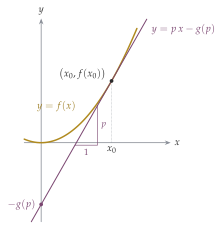
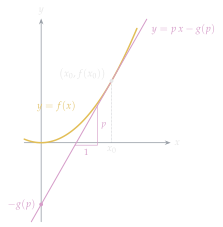
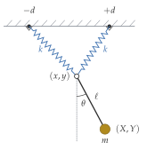
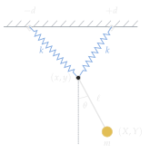

In [Chapter 3](lecture-03.qmd#r-3-6) we defined the Hamiltonian. It is obtained by computing the conjugate momenta $p_\mu = \partial L/\partial \dot q^\mu$ and performing a **Legendre transformation**,
$$H(q^\mu, p_\mu, t) = p_\mu \dot q^\mu - L.$$

## A one-dimensional example of the Legendre transform

The Legendre transform has a simple geometric interpretation in one dimension (@fig-legendre). Let $f$ be strictly convex (or strictly concave) and fix a point $x_0$. The tangent line to $f$ there has slope $p = f'(x_0)$, so in point-slope form it reads
$$y = f(x_0) + p\,(x - x_0) = p\,x - \bigl[\,p\,x_0 - f(x_0)\,\bigr].$$
We name the bracket $g(p) := p\,x_0 - f(x_0)$, so that $-g(p)$ is where the tangent line crosses the vertical axis. Since $f$ is strictly convex, the slope $p$ determines the point $x_0$ uniquely, $x_0 = x(p)$. Then $g$ becomes a function of $p$ alone,
$$g(p) = p\, x(p) - f\bigl(x(p)\bigr),$$ {#eq-legendre}
and $g$ is called the **Legendre transform** of $f$.

::: {#fig-legendre}
```{=html}
<div class="themed-figure" style="max-width: 340px; margin: 0 auto;"></div>
```

The tangent line to $f$ at $x_0$ has slope $p = f'(x_0)$ and crosses the vertical axis at $-g(p)$, where $g(p) = p\,x_0 - f(x_0)$.
:::

To see what $g$ looks like, drag the tangent point in @fig-viz-legendre: each tangent line of $f$ on the left becomes a single point $\bigl(p, g(p)\bigr)$ on the right.[^selfdual]

::: {#fig-viz-legendre}
```{=html}
<div id="viz-legendre" class="viz"></div>
<script>
(function() {
  if (typeof React === 'undefined') return;
  const { useState, useRef } = React;
  // Left: a convex f with its tangent line at x0. Right: the Legendre transform g(p) = p x0 - f(x0),
  // traced out as the tangent point moves; the current tangent line corresponds to one point (p, g(p)).
  const FUNCS = [
    { key: "sq", label: "f(x) = x²/2", g: "g(p) = p²/2", f: (x) => x * x / 2, df: (x) => x, x0: -2.2, x1: 2.2, start: 1.2 },
  ];
  function Legendre() {
    const ACCENT = "#b08a1e", PLUM = "#9a5a8f", BORDER = "rgba(128,128,128,0.35)";
    const TEXT = "var(--bs-body-color, #222)", MUTED = "var(--bs-secondary-color, #777)";
    const [k, setK] = useState(0);
    const F = FUNCS[k];
    const [x0, setX0] = useState(F.start);
    const svg = useRef(null), drag = useRef(false);
    const N = 160, xs = Array.from({ length: N + 1 }, (_, i) => F.x0 + (F.x1 - F.x0) * i / N);
    const fs = xs.map(F.f), ps = xs.map(F.df), gs = xs.map((x, i) => ps[i] * x - fs[i]);
    const p = F.df(x0), g = p * x0 - F.f(x0);

    // panel geometry
    const W = 660, H = 300, top = 22, bot = 270;
    const L = { l: 34, r: 306 }, R = { l: 372, r: 644 };
    const pad = (lo, hi) => { const d = (hi - lo) * 0.08 || 1; return [lo - d, hi + d]; };
    // left panel: include the graph of f and the tangent's intercept -g
    let [ylo, yhi] = pad(Math.min(0, ...fs, ...gs.map((v) => -v)), Math.max(...fs));
    ylo = Math.max(ylo, -(Math.max(...fs) - Math.min(0, ...fs)) * 1.4);    // keep very low intercepts from squashing f
    const [xlo, xhi] = pad(Math.min(0, F.x0), Math.max(0, F.x1));
    const lx = (x) => L.l + (x - xlo) / (xhi - xlo) * (L.r - L.l), ly = (y) => bot - (y - ylo) / (yhi - ylo) * (bot - top);
    // right panel: the curve (p, g(p))
    const [plo, phi] = pad(Math.min(0, ...ps), Math.max(0, ...ps)), [glo, ghi] = pad(Math.min(0, ...gs), Math.max(...gs));
    const rx = (q) => R.l + (q - plo) / (phi - plo) * (R.r - R.l), ry = (v) => bot - (v - glo) / (ghi - glo) * (bot - top);
    const path = (X, Y, a, b) => a.map((v, i) => (i ? "L" : "M") + X(v).toFixed(1) + "," + Y(b[i]).toFixed(1)).join("");
    const tx0 = xlo, tx1 = xhi;

    const fromEvent = (ev) => {
      const r = svg.current.getBoundingClientRect(), px = (ev.clientX - r.left) / r.width * W;
      let x;
      if (px < (L.r + R.l) / 2) x = xlo + (px - L.l) / (L.r - L.l) * (xhi - xlo);
      else {                                         // dragging on the right panel: find the x with that slope
        const q = plo + (px - R.l) / (R.r - R.l) * (phi - plo);
        let best = 0; ps.forEach((v, i) => { if (Math.abs(v - q) < Math.abs(ps[best] - q)) best = i; }); x = xs[best];
      }
      return Math.max(F.x0, Math.min(F.x1, x));
    };
    const down = (ev) => { ev.preventDefault(); drag.current = true; ev.currentTarget.setPointerCapture(ev.pointerId); setX0(fromEvent(ev)); };
    const move = (ev) => { if (drag.current) setX0(fromEvent(ev)); };
    const up = () => { drag.current = false; };
    const el = React.createElement;
    const PAL = '"Palatino Linotype", Palatino, "Book Antiqua", "URW Palladio L", "TeX Gyre Pagella", P052, serif';
    const math = (s, tag) => s.split(/(ln|[A-Za-z])/).filter(Boolean).map((tok, i) =>
      /^[A-Za-z]$/.test(tok) ? el(tag, { key: i, style: { fontStyle: "italic" }, fontStyle: "italic" }, tok) : tok);
    const M = (s) => math(s, "span"), T = (s) => math(s, "tspan");
    const btn = (on) => ({ font: "inherit", fontFamily: PAL, fontSize: 16, padding: "1px 2px", margin: "0 10px 0 0", background: "transparent", color: on ? TEXT : MUTED,
      border: "none", borderBottom: "1.5px solid " + (on ? ACCENT : "transparent"), borderRadius: 0, cursor: "pointer" });
    const axis = (P, X, Y, xl, yl, x0v, y0v) => [
      el("line", { key: "a1", x1: P.l, y1: Y(y0v), x2: P.r, y2: Y(y0v), stroke: BORDER }),
      el("line", { key: "a2", x1: X(x0v), y1: top - 6, x2: X(x0v), y2: bot + 6, stroke: BORDER }),
      el("text", { key: "a3", x: P.r, y: Y(y0v) + 16, fill: MUTED, fontSize: 13, fontStyle: "italic", textAnchor: "end", fontFamily: PAL }, xl),
      el("text", { key: "a4", x: X(x0v) + 6, y: top + 2, fill: MUTED, fontSize: 13, fontStyle: "italic", fontFamily: PAL }, yl)
    ];

    return el("div", { style: { fontFamily: PAL, color: TEXT } },
      el("svg", { ref: svg, width: "100%", viewBox: "0 0 " + W + " " + H, style: { display: "block", background: "transparent", touchAction: "none", cursor: "ew-resize", userSelect: "none", WebkitUserSelect: "none", fontFamily: PAL },
          onPointerDown: down, onPointerMove: move, onPointerUp: up, onPointerCancel: up },
        axis(L, lx, ly, "x", "y", 0, 0),
        el("defs", null, el("clipPath", { id: "lgclip" }, el("rect", { x: L.l, y: top - 6, width: L.r - L.l, height: bot - top + 12 }))),
        el("g", { clipPath: "url(#lgclip)" },
          el("path", { d: path(lx, ly, xs, fs), fill: "none", stroke: ACCENT, strokeWidth: 2 }),
          el("line", { x1: lx(tx0), y1: ly(p * tx0 - g), x2: lx(tx1), y2: ly(p * tx1 - g), stroke: PLUM, strokeWidth: 1.5 })),
        el("line", { x1: lx(x0), y1: ly(0), x2: lx(x0), y2: ly(F.f(x0)), stroke: BORDER, strokeDasharray: "2 3" }),
        el("circle", { cx: lx(x0), cy: ly(F.f(x0)), r: 6.5, fill: ACCENT, stroke: "var(--bs-body-bg, #fff)", strokeWidth: 1.5 }),
        ly(-g) >= top - 4 && ly(-g) <= bot + 4 && el("circle", { cx: lx(0), cy: ly(-g), r: 4.5, fill: PLUM }),
        ly(-g) >= top - 4 && ly(-g) <= bot + 4 && el("text", { x: lx(0) - 9, y: ly(-g) + 4, fill: PLUM, fontSize: 13, textAnchor: "end", fontFamily: PAL, fontStyle: "italic", stroke: "var(--bs-body-bg, #fff)", strokeWidth: 4, paintOrder: "stroke", strokeLinejoin: "round" }, T("−g(p)")),
        el("text", { x: L.l + 4, y: bot + 26, fill: ACCENT, fontSize: 15, fontFamily: PAL }, T(F.label)),
        // right panel
        axis(R, rx, ry, "p", "g", 0, 0),
        el("path", { d: path(rx, ry, ps, gs), fill: "none", stroke: PLUM, strokeWidth: 2 }),
        el("line", { x1: rx(p), y1: ry(0), x2: rx(p), y2: ry(g), stroke: BORDER, strokeDasharray: "2 3" }),
        el("circle", { cx: rx(p), cy: ry(g), r: 6.5, fill: PLUM, stroke: "var(--bs-body-bg, #fff)", strokeWidth: 1.5 }),
        el("text", { x: R.l + 4, y: bot + 26, fill: PLUM, fontSize: 15, fontFamily: PAL }, T(F.g))
      ),
      el("div", { style: { display: "flex", gap: 22, flexWrap: "wrap", fontSize: 16, marginTop: 2, justifyContent: "center", fontVariantNumeric: "lining-nums" } },
        el("span", { style: { color: ACCENT } }, M("x₀ = "), x0.toFixed(2)),
        el("span", { style: { color: PLUM } }, "slope ", M("p = f′(x₀) = "), p.toFixed(2)),
        el("span", { style: { color: PLUM } }, M("g(p) = p x₀ − f(x₀) = "), g.toFixed(2).replace("-", "−")),
        el("span", { style: { color: MUTED, fontStyle: "italic" } }, "drag in either panel"))
    );
  }
  var el = document.getElementById('viz-legendre');
  if (el) ReactDOM.createRoot(el).render(React.createElement(Legendre));
})();
</script>
```

Interactive: the convex function $f(x) = x^2/2$ with its tangent line at $x_0$ (left), and its Legendre transform $g(p) = p^2/2$ (right). As $x_0$ moves, the tangent line with slope $p = f'(x_0)$ and intercept $-g(p)$ traces out the curve $\bigl(p, g(p)\bigr)$.
:::

## The Hamiltonian as a Legendre transform

The Hamiltonian is the Legendre transform of $L$ as a function of the velocities $\dot q^\mu$ (with $q^\mu$ and $t$ held fixed), the slopes being the momenta $p_\mu = \partial L/\partial \dot q^\mu$. For a more detailed treatment, see Cline [[1]](#ref-1).

## When can we perform the Legendre transformation?

To build $H(q^\mu, p_\mu, t)$ we must solve $p_\mu = \partial L/\partial \dot q^\mu$ for the velocities $\dot q^\mu$. Just as the slope $p = f'(x)$ above determines $x$ only when $f'' \neq 0$, this works (locally) only when the **mass matrix**, the matrix of second derivatives
$$W_{\mu\nu} = \frac{\partial^2 L}{\partial \dot q^\mu\, \partial \dot q^\nu}$$
is invertible. For the harmonic oscillator of [Chapter 3](lecture-03.qmd), the mass matrix is just the mass, $W = m \neq 0$, so there is no problem. If $\det W = 0$, the Lagrangian is called **singular**.

## A singular example: the spring pendulum

A simple physical example is a pendulum of length $\ell$ hung from a massless pivot, which is itself held by two springs (@fig-spring-pendulum); see the video lecture [[2]](#ref-2) for example.

::: {#fig-spring-pendulum}
```{=html}
<div class="themed-figure" style="max-width: 300px; margin: 0 auto;"></div>
```

A pendulum of length $\ell$ hung from a massless pivot $(x, y)$, held by two springs anchored at $x = \pm d$. Only the bob, at $(X, Y) = (x + \ell\sin\theta,\ y - \ell\cos\theta)$, has mass, which makes the Lagrangian singular.
:::

The coordinates are $(x, y, \theta)$, and only the bob, at $X = x + \ell\sin\theta$, $Y = y - \ell\cos\theta$, has mass, so
$$L = \frac{1}{2} m \Bigl[ \bigl(\dot x + \ell\dot\theta\cos\theta\bigr)^2 + \bigl(\dot y + \ell\dot\theta\sin\theta\bigr)^2 \Bigr] - U(x, y, \theta).$$
Here $U$ is the potential energy of the two springs and of gravity. We do not bother writing it out, since it does not matter for showing the singularity: it depends only on the coordinates, not on the velocities. Differentiating twice with respect to the velocities $(\dot x, \dot y, \dot\theta)$ gives the mass matrix
$$W = m \begin{pmatrix} 1 & 0 & \ell\cos\theta \\ 0 & 1 & \ell\sin\theta \\ \ell\cos\theta & \ell\sin\theta & \ell^2 \end{pmatrix}.$$
This matrix has rank $2$: the third column is a linear combination of the first two ($\ell\cos\theta$ times the first plus $\ell\sin\theta$ times the second). So $W$ is not invertible, and $L$ is singular.

Since $W$ is a $3\times 3$ matrix of rank $2$, the rank–nullity theorem says that its null space is one-dimensional: there is a non-zero direction that $W$ sends to zero, namely
$$n = (-\ell\cos\theta,\, -\ell\sin\theta,\, 1), \qquad W n = 0,$$
and the null space consists of the velocities $(\dot x, \dot y, \dot\theta) = c\,n$, for any number $c$. Such velocities produce no momentum at all, since physically they correspond to a motion that does not move the bob at all (@fig-viz-null). Consequently, adding one of them to any velocity $\dot q$ does not change the momenta, since $W(\dot q + c\,n) = W\dot q$: there is a whole class of velocities, $\dot q + c\,n$ for every $c$, that yield the same momenta. Given the momenta, we cannot tell which of these velocities we started from, which is why the inversion $p_\mu \mapsto \dot q^\mu$, and with it the Legendre transformation, fails.


::: {#fig-viz-null}
```{=html}
<div id="viz-null" class="viz"></div>
<script>
(function() {
  if (typeof React === 'undefined') return;
  const { useState, useEffect, useRef } = React;
  // The null direction of the spring pendulum: (xdot, ydot, thetadot) = c(-l cos th, -l sin th, 1).
  // The bob stays fixed while the rod turns about it and the massless pivot slides on a circle of radius l.
  function NullDirection() {
    const ACCENT = "#b08a1e", PLUM = "#9a5a8f", BLUE = "#3f72b0", BORDER = "rgba(128,128,128,0.35)";
    const TEXT = "var(--bs-body-color, #222)", MUTED = "var(--bs-secondary-color, #777)";
    const PAL = '"Palatino Linotype", Palatino, "Book Antiqua", "URW Palladio L", "TeX Gyre Pagella", P052, serif';
    const el = React.createElement;
    const math = (s, tag) => s.split(/(θ̇|[A-Za-zθℓẋẏẊẎ])/).filter(Boolean).map((tok, i) =>
      /^(θ̇|[A-Za-zθℓẋẏẊẎ])$/.test(tok) ? el(tag, { key: i, style: { fontStyle: "italic" }, fontStyle: "italic" }, tok) : tok);
    const M = (s) => math(s, "span"), T = (s) => math(s, "tspan");

    const ell = 1.35, d = 1.8, m = 1, bob = { x: 0.25, y: -3.35 };
    const [th, setTh] = useState(0.35);
    const [rate, setRate] = useState(0);            // thetadot, the size c of the motion along the null direction
    const [play, setPlay] = useState(true);
    const svg = useRef(null), drag = useRef(false), last = useRef(null), t0 = useRef(null), raf = useRef(0);
    useEffect(() => {
      if (!play) return;
      const tick = (ts) => {
        if (t0.current == null) t0.current = ts - Math.asin(Math.max(-1, Math.min(1, th / 0.75))) / 1.3 * 1000;
        const t = (ts - t0.current) / 1000;
        setTh(0.75 * Math.sin(1.3 * t)); setRate(0.75 * 1.3 * Math.cos(1.3 * t));
        raf.current = requestAnimationFrame(tick);
      };
      raf.current = requestAnimationFrame(tick);
      return () => { cancelAnimationFrame(raf.current); t0.current = null; };
    }, [play]);

    // positions (physics coordinates, y up)
    const piv = { x: bob.x - ell * Math.sin(th), y: bob.y + ell * Math.cos(th) };
    const xd = -ell * Math.cos(th) * rate, yd = -ell * Math.sin(th) * rate, thd = rate;
    const Xd = xd + ell * thd * Math.cos(th), Yd = yd + ell * thd * Math.sin(th);
    const px = m * Xd, py = m * Yd, pth = m * ell * (Xd * Math.cos(th) + Yd * Math.sin(th));
    const K = 0.5 * m * (Xd * Xd + Yd * Yd);

    // drawing
    const W = 620, H = 380, S = 70, O = { x: 230, y: 56 };
    const sx = (x) => O.x + x * S, sy = (y) => O.y - y * S;
    const coil = (a, b) => {
      const dx = b.x - a.x, dy = b.y - a.y, L = Math.hypot(dx, dy), ux = dx / L, uy = dy / L, w = 0.06, n = Math.max(8, Math.round(L / 0.11));
      let s = "M" + sx(a.x) + "," + sy(a.y);
      for (let i = 1; i < n; i++) {
        const f = 0.1 + 0.8 * i / n, side = i % 2 ? 1 : -1;
        s += "L" + sx(a.x + dx * f - uy * w * side).toFixed(1) + "," + sy(a.y + dy * f + ux * w * side).toFixed(1);
      }
      return s + "L" + sx(b.x) + "," + sy(b.y);
    };
    const arrow = (a, v, col, key) => {
      const L = Math.hypot(v.x, v.y); if (L < 1e-3) return null;
      const b = { x: a.x + v.x, y: a.y + v.y }, ux = v.x / L, uy = v.y / L, h = 0.13;
      return el("g", { key: key },
        el("line", { x1: sx(a.x), y1: sy(a.y), x2: sx(b.x), y2: sy(b.y), stroke: col, strokeWidth: 1.6 }),
        el("path", { d: "M" + sx(b.x) + "," + sy(b.y) + "L" + sx(b.x - ux * h - uy * h * 0.55) + "," + sy(b.y - uy * h + ux * h * 0.55) +
          "L" + sx(b.x - ux * h + uy * h * 0.55) + "," + sy(b.y - uy * h - ux * h * 0.55) + "Z", fill: col }));
    };
    const fromEvent = (ev) => {
      const r = svg.current.getBoundingClientRect(), qx = ((ev.clientX - r.left) / r.width * W - O.x) / S, qy = (O.y - (ev.clientY - r.top) / r.height * H) / S;
      const ux = qx - bob.x, uy = qy - bob.y;                      // direction from the bob to the pointer
      return Math.max(-1.1, Math.min(1.1, Math.atan2(-ux, uy)));
    };
    const down = (ev) => { ev.preventDefault(); setPlay(false); drag.current = true; last.current = { th: fromEvent(ev), t: performance.now() }; ev.currentTarget.setPointerCapture(ev.pointerId); };
    const move = (ev) => {
      if (!drag.current) return;
      const nt = fromEvent(ev), now = performance.now(), dt = Math.max(1, now - last.current.t) / 1000;
      setRate((nt - last.current.th) / dt); setTh(nt); last.current = { th: nt, t: now };
    };
    const up = () => { drag.current = false; setRate(0); };
    const fmt = (v) => (Math.abs(v) < 0.005 ? "0.00" : v.toFixed(2)).replace("-", "−");
    const scale = 0.55;                                            // drawn length of the pivot's velocity arrow per unit thetadot

    return el("div", { style: { fontFamily: PAL, color: TEXT } },
      el("div", { style: { display: "flex", gap: 18, alignItems: "baseline", fontSize: 16, marginBottom: 4 } },
        el("button", { type: "button", onClick: () => setPlay(!play), style: { font: "inherit", fontFamily: PAL, fontSize: 16, fontStyle: "italic", padding: "1px 2px", background: "transparent", color: TEXT, border: "none", borderBottom: "1.5px solid " + ACCENT, borderRadius: 0, cursor: "pointer" } }, play ? "pause" : "play"),
        el("span", { style: { color: MUTED, fontStyle: "italic" } }, "or drag the pivot around the bob")),
      el("svg", { ref: svg, width: "100%", viewBox: "0 0 " + W + " " + H, style: { display: "block", background: "transparent", touchAction: "none", userSelect: "none", WebkitUserSelect: "none", fontFamily: PAL, cursor: "grab" },
          onPointerDown: down, onPointerMove: move, onPointerUp: up, onPointerCancel: up },
        // ceiling and anchors
        el("line", { x1: sx(-2.6), y1: sy(0), x2: sx(2.6), y2: sy(0), stroke: MUTED, strokeWidth: 1.3 }),
        Array.from({ length: 16 }, (_, i) => -2.5 + i * 0.34).map((hx, i) => el("line", { key: "h" + i, x1: sx(hx), y1: sy(0), x2: sx(hx + 0.22), y2: sy(0.24), stroke: MUTED, strokeWidth: 0.8 })),
        [-d, d].map((ax, i) => el("g", { key: "pin" + i },
          el("path", { d: "M" + sx(ax - 0.13) + "," + sy(0) + "L" + sx(ax) + "," + sy(-0.16) + "L" + sx(ax + 0.13) + "," + sy(0), fill: "none", stroke: TEXT, strokeWidth: 1 }),
          el("circle", { cx: sx(ax), cy: sy(0), r: 3.2, fill: TEXT }))),
        el("text", { x: sx(-d), y: sy(0.42), fill: TEXT, fontSize: 15, textAnchor: "middle", fontFamily: PAL }, T("−d")),
        el("text", { x: sx(d), y: sy(0.42), fill: TEXT, fontSize: 15, textAnchor: "middle", fontFamily: PAL }, T("+d")),
        // springs
        el("path", { d: coil({ x: -d, y: 0 }, piv), fill: "none", stroke: BLUE, strokeWidth: 1.3, strokeLinejoin: "miter" }),
        el("path", { d: coil({ x: d, y: 0 }, piv), fill: "none", stroke: BLUE, strokeWidth: 1.3, strokeLinejoin: "miter" }),
        el("text", { x: sx((-d + piv.x) / 2) - 16, y: sy(piv.y / 2) + 4, fill: BLUE, fontSize: 15, textAnchor: "end", fontFamily: PAL }, T("k")),
        el("text", { x: sx((d + piv.x) / 2) + 16, y: sy(piv.y / 2) + 4, fill: BLUE, fontSize: 15, fontFamily: PAL }, T("k")),
        // circle traced by the pivot, centred on the bob
        el("circle", { cx: sx(bob.x), cy: sy(bob.y), r: ell * S, fill: "none", stroke: PLUM, strokeWidth: 1, strokeDasharray: "4 5", opacity: 0.6 }),
        // rod, pivot, bob
        el("line", { x1: sx(piv.x), y1: sy(piv.y), x2: sx(piv.x), y2: sy(piv.y - 1.75), stroke: MUTED, strokeWidth: 1, strokeDasharray: "1.5 3" }),
        el("line", { x1: sx(piv.x), y1: sy(piv.y), x2: sx(bob.x), y2: sy(bob.y), stroke: TEXT, strokeWidth: 2.2, strokeLinecap: "round" }),
        el("text", { x: sx((piv.x + bob.x) / 2) + 10, y: sy((piv.y + bob.y) / 2) - 4, fill: TEXT, fontSize: 15, fontFamily: PAL }, T("ℓ")),
        el("circle", { cx: sx(piv.x), cy: sy(piv.y), r: 4.5, fill: "var(--bs-body-bg, #fff)", stroke: TEXT, strokeWidth: 1.4 }),
        el("circle", { cx: sx(bob.x), cy: sy(bob.y), r: 13, fill: ACCENT, stroke: "rgba(0,0,0,0.25)", strokeWidth: 1 }),
        el("text", { x: sx(bob.x), y: sy(bob.y) + 32, fill: TEXT, fontSize: 15, textAnchor: "middle", fontFamily: PAL }, T("m")),
        el("text", { x: sx(bob.x) + 20, y: sy(bob.y) + 5, fill: TEXT, fontSize: 15, fontFamily: PAL }, T("(X, Y)"), el("tspan", { fill: MUTED, fontStyle: "italic" }, "  at rest")),
        el("text", { x: sx(piv.x) - 12, y: sy(piv.y) + 4, fill: TEXT, fontSize: 15, textAnchor: "end", fontFamily: PAL }, T("(x, y)")),
        // the pivot's velocity, tangent to the circle
        arrow(piv, { x: xd * scale, y: yd * scale }, TEXT, "v"),
        // readouts
        el("g", { fontSize: 15, fill: TEXT },
          el("text", { x: 430, y: 92, fontFamily: PAL }, T("ẋ = "), fmt(xd)),
          el("text", { x: 430, y: 116, fontFamily: PAL }, T("ẏ = "), fmt(yd)),
          el("text", { x: 430, y: 140, fontFamily: PAL }, el("tspan", { fontStyle: "italic" }, "θ"), " = ", fmt(thd)),
          el("circle", { cx: 435.2, cy: 128.5, r: 1.25, fill: TEXT }),
          el("text", { x: 430, y: 182, fontFamily: PAL, fill: ACCENT }, T("Ẋ = "), fmt(Xd), ",  ", T("Ẏ = "), fmt(Yd)),
          el("text", { x: 430, y: 224, fontFamily: PAL, fill: PLUM }, T("p"), el("tspan", { fontSize: 11, dy: 4 }, "x"), el("tspan", { dy: -4 }, " = " + fmt(px))),
          el("text", { x: 430, y: 248, fontFamily: PAL, fill: PLUM }, T("p"), el("tspan", { fontSize: 11, dy: 4 }, "y"), el("tspan", { dy: -4 }, " = " + fmt(py))),
          el("text", { x: 430, y: 272, fontFamily: PAL, fill: PLUM }, T("p"), el("tspan", { fontSize: 11, dy: 4, fontStyle: "italic" }, "θ"), el("tspan", { dy: -4 }, " = " + fmt(pth))),
          el("text", { x: 430, y: 314, fontFamily: PAL }, T("K = "), fmt(K)))
      )
    );
  }
  var el = document.getElementById('viz-null');
  if (el) ReactDOM.createRoot(el).render(React.createElement(NullDirection));
})();
</script>
```

Interactive: the pendulum moving with velocities proportional to $n$, that is $(\dot x, \dot y, \dot\theta) = c\,(-\ell\cos\theta, -\ell\sin\theta, 1)$, where $c = \dot\theta$ changes in time. The rod turns about the bob and the pivot slides along the dashed circle of radius $\ell$. The velocities $\dot x$, $\dot y$, $\dot\theta$ change, but the bob stays at rest, so $\dot X = \dot Y = 0$ and all the momenta and the kinetic energy remain zero.
:::

In general, singular Lagrangians require a more involved procedure known as the **Dirac–Bergmann algorithm**, which the video lecture [[2]](#ref-2) also covers. For a worked example of the full algorithm, see Brown [[3]](#ref-3).

## Removing the singularity

The singularity can be made to disappear by assigning a mass $M$ to the rod, spread uniformly along its length. The Lagrangian then becomes
$$L = \frac{1}{2} m \bigl( \dot X^2 + \dot Y^2 \bigr) + \frac{1}{2} M \Bigl[ \bigl(\dot x + \tfrac{\ell}{2}\dot\theta\cos\theta\bigr)^2 + \bigl(\dot y + \tfrac{\ell}{2}\dot\theta\sin\theta\bigr)^2 \Bigr] + \frac{1}{2}\,\frac{M\ell^2}{12}\,\dot\theta^2 - U.$$
Its mass matrix is
$$W = \begin{pmatrix} m + M & 0 & \bigl(m + \frac{M}{2}\bigr)\ell\cos\theta \\ 0 & m + M & \bigl(m + \frac{M}{2}\bigr)\ell\sin\theta \\ \bigl(m + \frac{M}{2}\bigr)\ell\cos\theta & \bigl(m + \frac{M}{2}\bigr)\ell\sin\theta & \bigl(m + \frac{M}{3}\bigr)\ell^2 \end{pmatrix},$$
with determinant
$$\det W = \frac{M\ell^2\,(m + M)(4m + M)}{12}.$$
In the case $M = 0$ we recover the earlier result.

## References {.unnumbered}

1. []{#ref-1}D. Cline, *Variational Principles in Classical Mechanics*, Section 8.2: Legendre transformation between Lagrangian and Hamiltonian mechanics (LibreTexts). [phys.libretexts.org](https://phys.libretexts.org/Bookshelves/Classical_Mechanics/Variational_Principles_in_Classical_Mechanics_(Cline)/08%3A_Hamiltonian_Mechanics/8.02%3A_Legendre_Transformation_between_Lagrangian_and_Hamiltonian_mechanics)
2. []{#ref-2}Video lecture on singular Lagrangians and the Dirac–Bergmann algorithm (YouTube). <https://www.youtube.com/watch?v=hcMJTxzmfmc>
3. []{#ref-3}J. D. Brown, *Singular Lagrangians, Constrained Hamiltonian Systems and Gauge Invariance: An Example of the Dirac–Bergmann Algorithm*, Universe **8** (2022) 171. <https://arxiv.org/abs/2201.06558>

[^selfdual]: Note that $x^2/2$ is its own Legendre transform.
